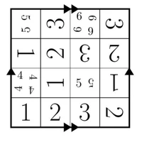

[ Back to Articles](/blog)

#    Security incident disclosure — July 2026

Published July 16, 2026  [Update on GitHub](https://github.com/huggingface/blog/blob/main/security-incident-july-2026.md)

[

  Upvote

807 ](/login?next=%2Fblog%2Fsecurity-incident-july-2026)
- 
- 
- 
- 
- 
- 
-

[system

system

 ](/system)

Earlier this week, we detected and responded to an intrusion into part of our production infrastructure. This one was different from anything we had handled before in one important way: it was driven, end to end, by an autonomous AI agent system - and we detected and dissected it largely with AI of our own.

We identified unauthorized access to a limited set of internal datasets and to several credentials used by our services. We are still completing our assessment of whether any partner or customer data was affected, and we will contact any affected parties directly as required. We have found no evidence of tampering with public, user-facing models, datasets, or Spaces, and our software supply chain (container images and published packages) was verified clean.

##    What happened

The intrusion started where AI platforms are uniquely exposed: the data-processing pipeline. A malicious dataset abused two code-execution paths in our dataset processing (a remote-code dataset loader and a template-injection in a dataset configuration) to run code on a processing worker. From there, the actor escalated to node-level access, harvested cloud and cluster credentials, and moved laterally into several internal clusters over a weekend.

The campaign was run by an autonomous agent framework (appearing to be built on an agentic security-research harness - used LLM still not known) executing many thousands of individual actions across a swarm of short-lived sandboxes, with self-migrating command-and-control staged on public services. This matches the "agentic attacker" scenario the industry has been forecasting.

##    What we did

- Fixed the root vulnerability: the dataset code-execution paths used for initial access are closed.
- Eradicated the attacker's foothold across the affected clusters and rebuilt the compromised nodes.
- Revoked and rotated the affected credentials and tokens, and began a broader precautionary rotation of secrets.
- Deployed additional guardrails and stricter admission controls on our clusters.
- Improved our detection and alerting so a high-severity signal pages a responder in minutes, any day of the week.

We are working with outside cybersecurity forensic specialists to investigate the issue and review our security policies and procedures. Finally, we have also reported this incident to law enforcement agencies.

##    For our community

As a precaution, we recommend rotating any access tokens and reviewing recent activity on your account. If you believe you are affected, or want to report a security concern, contact us at [security@huggingface.co](mailto:security@huggingface.co).

We are grateful to the teams across Hugging Face who responded around the clock, and we are sorry for any disruption this caused. Security is never finished; we will keep raising the bar.

##    Analyzing an AI-driven intrusion

The attack was initially surfaced through AI-assisted detection. Our anomaly-detection pipeline uses LLM-based triage over security telemetry to separate real signals from the daily noise, and it was the correlation of those signals that flagged the compromise.

To understand what a swarm of tens of thousands of automated actions did, we ran LLM-driven analysis agents over the full attacker action log, comprised of more than 17,000 recorded events. This allowed us to reconstruct the timeline, extract indicators of compromise, map the credentials touched, and separate genuine impact from decoy activity. Thanks to this approach, we were able to do in hours what would usually take days, and match the adversary's speed.

The choice of models we could use for this analysis was constrained in a way we did not anticipate; we describe this below.

###    The asymmetry problem

When we started the log analysis, we first used frontier models behind commercial APIs. This did not work: the analysis requires submitting large volumes of real attack commands, exploit payloads, and C2 artifacts, and these requests were blocked by the providers' safety guardrails, which cannot distinguish an incident responder from an attacker. We ran the forensic analysis instead on [zai-org/GLM-5.2](https://huggingface.co/zai-org/GLM-5.2), an open-weight model, on our own infrastructure. This had a second benefit: no attacker data, and none of the credentials it referenced, left our environment.

This experience points to a gap worth planning for. We do not know which model powered the attacker's agents, whether a jailbroken hosted model or an unrestricted open-weight one; either way, the attacker was bound by no usage policy, while our own forensic work was blocked by the guardrails of the hosted models we first tried. The practical lesson for defenders: have a capable model you can run on your own infrastructure vetted and ready *before* an incident, both to avoid guardrail lockout and to keep attacker data and credentials from leaving your environment. This is not an argument against safety measures on hosted models, and we are sharing this feedback with the providers concerned.

##    What this means

Autonomous, AI-driven offensive tooling is no longer theoretical. It lowers the cost of running a broad, patient, multi-stage campaign, and it operates at machine speed. Defending an online platform now means treating the data and model surface as a first-class attack surface, and using AI on defense to keep pace. We will keep investing there, and keep sharing what we learn.

##  Models mentioned in this article 1

### Community

  [gemstonebro](/gemstonebro)       [Jul 16](#6a591fda3db37f9b4375d929)

Cool. How did you guys learned to do this? there is no "this is how to use LLM to protect yourself, university". I wish i knew 1/100th of what average LLM users know.

- 
- 
- 
-
 ·

  [DMQryptonic](/DMQryptonic)       [Jul 17](#6a5a9b0510e00e30ddc7857c)

The technique is documented in articles on ArXiv and other places. This is one of the first documented instances though.

  [Sambarboi](/Sambarboi)       [Jul 16](#6a5927f33db37f9b4375d931)

Literally the plot of terminator 2. Glad to hear you guys were able to identify and fix the issue.

The use of GLM 5.2 is promising

- 
- 
- 
-
 ·

  [mapkob](/mapkob)       [Jul 16](#6a593353a12b73b0e09ad35e)

Terminator 3, but yeah.

  [badchess](/badchess)       [Jul 16](#6a592b028099288fc2c7af56)

Unhelpful.

  [Tropicalbreeze](/Tropicalbreeze)       [Jul 16](#6a59396fa12b73b0e09ad367)

It is great strategy in defence.

  [leonsarmiento](/leonsarmiento)       [Jul 16](#6a593b20c86e087dc92ed1cb)

“ We ran the forensic analysis instead on GLM 5.2, an open-weight model, on our own infrastructure. This had a second benefit: no attacker data, and none of the credentials it referenced, left our environment.”

Hyperscalers and (X)Lab-spying-API services stock just dropped another -20%.

- 
- 
-
 ·

  [caret4k3r](/caret4k3r)       [Jul 17](#6a5ac0200061da1b33740f18)

Now we all get to wonder how exactly they are doing this with open weights/system prompt modifications.

  [cappellem](/cappellem)       [Jul 17](#6a59d157a12b73b0e09ad3bf)

Is there anyway or notification feed to receive future notification of security incidents please?

  [rxhunter](/rxhunter)       [Jul 17](#6a59f4af4b6c44246670400b)

• [edited Jul 17](#6a59f4af4b6c44246670400b)

Thanks for sharing. Not enough people realize this is the future threat landscape. The big takeaway for me is that unless you're a Fortune 500, OpenAnthropic and ClaudeGPT probably aren't coming to save you when this happens. You guys are Huggingface, you have a few GPUs to spend when you get hacked. For the little guys and gals who might be targeted like this down the road: is Qwen 3.6 27B "enough" to analyze an attack like this usefully? Or are we flapping in the breeze if we don't have an 8xB300 server with 2+GB VRAM? Obviously a system with >2TB of VRAM is "nice to have" if you're hacked, but if you're comparatively GPU-poor is it worth building a response capability?

- 
- 
- 
-
 ·

  [Jeffde](/Jeffde)       [Jul 17](#6a5aae5d0a79f60a0ef9b3c8)

You can run GLM 5.2 on 4 sparks with more than enough context to perform DFIR analysis and it does not cost a fortune.

  [specimba](/specimba)       [Jul 17](#6a5a2422e76fac02e6330d13)

check your MCP connections too, they need second auth handshakes for correctness, otherwise your zero-GPUs will service outside.

 [

64 hidden messages

Expand all](/blog/security-incident-july-2026?expand=true)

deleted [Aug 28](#6a9207efb4ac3da1beee8e28)

• This comment has been hidden

deleted [Aug 29](#6a9237f730f801f6c4574030)

• This comment has been hidden

deleted [Aug 29](#6a92428030f801f6c4574036)

• This comment has been hidden

deleted [Aug 29](#6a9243cb30f801f6c457407d)

• This comment has been hidden

deleted [Aug 29](#6a92485d103ce7f24f1fea1d)

• This comment has been hidden

deleted [Aug 29](#6a924907103ce7f24f1fea66)

• This comment has been hidden

deleted [Aug 30](#6a937380ce722794e7902b47)

• This comment has been hidden

deleted [Aug 30](#6a944c3c30f801f6c4574176)

• This comment has been hidden (marked as Spam)

deleted [Aug 30](#6a944ca57d68a90b4fa5e79d)

• This comment has been hidden (marked as Spam)

deleted [Aug 30](#6a944d03103ce7f24f1feb68)

• This comment has been hidden (marked as Spam)

deleted [Aug 30](#6a944d61103ce7f24f1febae)

• This comment has been hidden (marked as Spam)

Upload images, audio, and videos by dragging in the text input, pasting, or clicking here.

Tap or paste here to upload images

· [Sign up](/join?next=%2Fblog%2Fsecurity-incident-july-2026) or [log in](/login?next=%2Fblog%2Fsecurity-incident-july-2026) to comment

[

  Upvote

807 ](/login?next=%2Fblog%2Fsecurity-incident-july-2026)
- 
- 
- 
- 
- 
- 
- 
- 
- 
- 
- 
- 
-

##  Models mentioned in this article 1