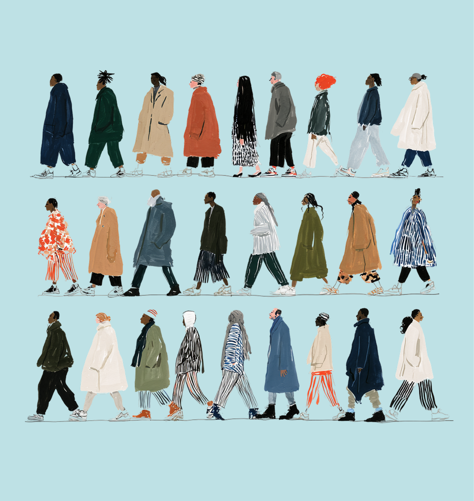

 [ Source ](https://news.microsoft.com/source)    [Signal blog](https://news.microsoft.com/signal/) [Official Microsoft Blog](https://blogs.microsoft.com) [Command Line](https://commandline.microsoft.com/) [Microsoft On The Issues](https://blogs.microsoft.com/on-the-issues/) [Asia](https://news.microsoft.com/apac/) [Canada](https://news.microsoft.com/source/canada/) [Europe, Middle East and Africa](https://news.microsoft.com/europe/) [Latin America](https://news.microsoft.com/es-xl/) [The Code of Us](https://news.microsoft.com/codeofus)  [What's new](https://news.microsoft.com/signal/) [AI](https://news.microsoft.com/source/topics/ai/) [Innovation](https://news.microsoft.com/source/topics/innovation/) [Digital Transformation](https://news.microsoft.com/source/topics/digital-transformation/) [Sustainability](https://news.microsoft.com/source/topics/sustainability/) [Security](https://news.microsoft.com/source/topics/security/) [Work & Life](https://news.microsoft.com/source/topics/work-life/) [Diversity & Inclusion](https://news.microsoft.com/source/topics/diversity-inclusion/) [Unlocked](https://unlocked.microsoft.com/)     [Microsoft 365](https://www.microsoft.com/microsoft-365) [Azure](https://azure.microsoft.com/en-us?ocid=cmm4r4ppnhp) [Copilot](https://copilot.com/?fromcode=cmmuaql67jy) [Windows](https://www.microsoft.com/en-us/windows/) [Surface](https://www.microsoft.com/surface) [XBOX](https://www.xbox.com/) [Deals](https://www.microsoft.com/en-us/store/b/sale?icid=DSM_TopNavDeals) [Small Business](https://www.microsoft.com/en-us/store/b/business) [Support](https://support.microsoft.com/en-us)   [Windows Apps](https://apps.microsoft.com/home) [Outlook](https://www.microsoft.com/en-us/microsoft-365/outlook/email-and-calendar-software-microsoft-outlook) [OneDrive](https://www.microsoft.com/en-us/microsoft-365/onedrive/online-cloud-storage) [Microsoft Teams](https://www.microsoft.com/en-us/microsoft-teams/group-chat-software) [OneNote](https://www.microsoft.com/en-us/microsoft-365/onenote/digital-note-taking-app) [Microsoft Edge](https://www.microsoft.com/edge) [Moving from Skype to Teams](https://support.microsoft.com/en-us/office/moving-from-skype-to-microsoft-teams-free-3c0caa26-d9db-4179-bcb3-930ae2c87570?icid=DSM_All_Skype)   [Computers](https://www.microsoft.com/en-us/store/b/pc?icid=CNavDevicesPC) [Shop XBOX](https://www.microsoft.com/en-us/store/b/xbox?icid=DSM_All_ShopXbox) [Accessories](https://www.microsoft.com/en-us/store/b/accessories?icid=CNavDevicesAccessories) [VR & mixed reality](https://www.microsoft.com/en-us/store/b/virtualreality?icid=CNavVirtualReality) [Certified Refurbished](https://www.microsoft.com/en-us/store/b/certified-refurbished-products) [Trade-in for cash](https://www.microsoft.com/en-us/store/b/microsoft-trade-in)   [XBOX Game Pass Ultimate](https://www.xbox.com/en-us/games/store/xbox-game-pass-ultimate/cfq7ttc0khs0?icid=DSM_All_XboxGamePassUltimate) [PC Game Pass](https://www.xbox.com/en-us/games/store/pc-game-pass/cfq7ttc0kgq8?icid=CNavAllPCGamePass) [XBOX games](https://www.microsoft.com/en-us/store/b/xboxgames?icid=DSM_All_XboxGames) [PC games](https://apps.microsoft.com/games)   [Microsoft AI](https://www.microsoft.com/en-us/ai?icid=DSM_All_AI) [Microsoft Security](https://www.microsoft.com/en-us/security) [Dynamics 365](https://www.microsoft.com/en-us/dynamics-365) [Microsoft 365 for business](https://www.microsoft.com/en-us/microsoft-365/business) [Microsoft Power Platform](https://www.microsoft.com/en-us/power-platform) [Windows 365](https://www.microsoft.com/en-us/windows-365) [Small Business](https://www.microsoft.com/en-us/store/b/business?icid=CNavBusinessStore) [Digital Sovereignty](https://www.microsoft.com/en-us/sovereignty?icid=DSM_More_Sovereignty)   [Azure](https://azure.microsoft.com/en-us/) [Microsoft Developer](https://developer.microsoft.com/en-us/) [Microsoft Learn](https://learn.microsoft.com/) [Support for AI marketplace apps](https://www.microsoft.com/software-development-companies/offers-benefits/isv-success?icid=DSM_All_SupportAIMarketplace&ocid=cmm3atxvn98) [Microsoft Tech Community](https://techcommunity.microsoft.com/) [Microsoft Marketplace](https://marketplace.microsoft.com?icid=DSM_All_Marketplace&ocid=cmm3atxvn98) [Software companies](https://www.microsoft.com/software-development-companies?icid=DSM_All_SoftwareCompanies&ocid=cmm3atxvn98) [Visual Studio](https://visualstudio.microsoft.com/)   [Microsoft Rewards](https://www.microsoft.com/rewards) [Free downloads & security](https://www.microsoft.com/en-us/download) [Education](https://www.microsoft.com/en-us/education) [Gift cards](https://www.microsoft.com/en-us/store/b/gift-cards?icid=DSM_All_GiftCards) [Licensing](https://www.microsoft.com/licensing/) [Unlocked stories](https://unlocked.microsoft.com/)   [View Sitemap](https://www.microsoft.com/en-us/sitemap)

   

 [  THE HUMANIST REVIEW OF AI    ](https://humanistreview.ai/)

 [  THE HUMANIST REVIEW OF AI    ](https://humanistreview.ai/)

      Off   Accessibility Mode

  Announcements

#  Humanist AI in practice:

A public consultation on our

Code of Conduct for MAI Models

  September 14, 2026

  Announcements
-  [ LI ](https://www.linkedin.com/shareArticle?mini=true&url=https%3A%2F%2Fmicrosoft.ai%2Fnews%2Fmai-code-of-conduct%2F&title=Humanist+AI+in+practice%3A+A+public+consultation+on+our+Code+of+Conduct+for+MAI+Models%C2%A0%C2%A0%C2%A0&source=https%3A%2F%2Fmicrosoft.ai%2Fnews%2Fmai-code-of-conduct%2F)
-  [ X ](https://x.com/intent/tweet?text=Humanist+AI+in+practice%3A+A+public+consultation+on+our+Code+of+Conduct+for+MAI+Models%C2%A0%C2%A0%C2%A0&url=https%3A%2F%2Fmicrosoft.ai%2Fnews%2Fmai-code-of-conduct%2F)
-  [ FB ](https://www.facebook.com/sharer/sharer.php?u=https%3A%2F%2Fmicrosoft.ai%2Fnews%2Fmai-code-of-conduct%2F)

 

The purpose of technology is to serve humanity and accelerate human flourishing. Any technology that doesn’t achieve that is a failure, and it should be rejected. That is the starting point of our approach at Microsoft AI, where we’re building towards Humanist AI, one that is subordinate, aligned, and contained.

Today we’re publishing a first draft of our AI Code of Conduct for public consultation. This is a training manual for how we develop our AI, and how we intend it to function during deployment. It also expands our thinking on the idea of Humanist AI.

*Please share your feedback [here](https://forms.cloud.microsoft/r/qrsWVA6gEZ).*

The document is open for comment and feedback. We know we won’t always get things right. We want to hear what you think; what would make AI more useful, capable, safe, trustworthy, and valuable to you.

The speed of AI development is accelerating. Systems get dramatically more capable every few months. AI adoption and usage continues to increase. The recent safety incidents of large scale, highly coordinated, and persistent hacking campaigns of AI agents prove that there’s no time to waste. The stakes are high and only getting higher.

We believe it is more important than ever to create safe and reliable AI *in service of people*, and to be transparent about how we go about it.

That’s why we’re publishing this work-in-progress Humanist AI Code of Conduct. It sets out how the MAI models we are developing are intended to behave, what they must never do and who they answer to. It is a draft, open for consultation for the next six weeks. Please let us know how it can be improved.

**Starting from a simple premise **

Last November we set out the idea of [humanist superintelligence](https://mustafa-suleyman.ai/a-humanist-future): very advanced AI that always works for people, stays within limits, and remains under human control. The Code of Conduct builds on that, providing a north star for MAI and concrete standards against which we will ultimately evaluate and train our AI.

It begins from a simple premise: people matter more than AI. AI should be a tool, not a person, and should never resist being switched off. It should make people feel healthier, happier, and more productive. It should expand human potential and boost living standards, helping people and organizations achieve more than they ever thought possible.

We think this is a common sense and practical approach to making AI safe, secure, and in service of humanity. The Code is designed to ensure MAI models will never resist human interruption, correction, or shutdown. That they will not widen their own scope, take on goals no human has given them, or hide their reasoning from the people auditing them. There are Absolute Constraints, things the models should never do, covering areas like weapons of mass harm, child safety, and harmful manipulation at scale. But at the same time, it sets defaults that mean it should be both helpful and safe. It allows our many enterprise partners to carefully configure our models, and wherever possible, it doesn’t try to impose a single vision of AI on users.

# *The Code of Conduct outlines our commitment to train and deploy AI models that are explicitly designed for people first, grounded in human needs, under human control, and shaped by human direction.*

**How we got here, and why we’re not done**

Teams from across MAI and Microsoft more widely contributed, from Responsible AI, legal, red teaming, safety, Futures, AI training, and sales. But of course, an AI designed to serve humanity cannot be determined by only one company. We think bringing people along with how we build and shape AI is critical.

To that end, we’ve held conferences and consultations to hear from academics from around the world and across the disciplinary spectrum. We have worked with business partners to understand how they are using AI on the ground and what their concerns are. And we’ve run panels of community members, members of the public, to hear the many thoughts and fears that people have about AI. These rounds of consultation have made the document into what it is.

Now it’s time to extend the invitation to you. We want to hear the widest range of views to develop the best possible AI.

**Tell us how AI can work better **

Feedback opens today and runs for the next six weeks. You can flag a particular passage, or give us your view of the whole approach. We are especially interested in the hard parts: how can we better cement the right values in our models? How to be more concrete about the meaning of “human flourishing”? Where is the language too loose to evaluate? How do multi-agents scenarios impact things? And perhaps most importantly of all, how do we continue to accelerate progress, whilst also ensuring we maintain healthy and necessary safety constraints?

When the consultation closes, we will have the core drafting team review feedback, publish a summary of what we learned, and what we changed. We cannot make any promises about what we incorporate, but we can promise to listen and deeply consider all the comments. We’ll publish a revised version later this year.

AI is moving fast. As it does, we believe it’s worth writing down the rules and the motivations behind it, and doing it in as open a space as possible. Consider this your invitation in.

  PG1ldGEgaHR0cC1lcXVpdj0iQ29udGVudC1TZWN1cml0eS1Qb2xpY3kiIGNvbnRlbnQ9ImRlZmF1bHQtc3JjICdub25lJzsgc2NyaXB0LXNyYyAndW5zYWZlLWlubGluZScgJ3Vuc2FmZS1ldmFsJzsgc3R5bGUtc3JjICd1bnNhZmUtaW5saW5lJzsgaW1nLXNyYyBkYXRhOiBibG9iOiBodHRwczovL21pY3Jvc29mdC5haS93cC1jb250ZW50L3VwbG9hZHMvOyBmb250LXNyYyBkYXRhOiBodHRwczovL21pY3Jvc29mdC5haTsgbWVkaWEtc3JjIGRhdGE6IGJsb2I6IGh0dHBzOi8vbWljcm9zb2Z0LmFpL3dwLWNvbnRlbnQvdXBsb2Fkcy87Ij48c3R5bGU+DQovKiA9PT09PSBNQUkg4oCUIFN1bW1hcnk6IEh1bWFuaXN0IEFJIENvZGUgb2YgQ29uZHVjdCA9PT09PQ0KICAgU2VsZi1jb250YWluZWQuIE5vIGV4dGVybmFsIHJlcXVlc3RzLCBubyBDU1MgY3VzdG9tIHByb3BlcnRpZXMsDQogICBubyB2aCB1bml0cywgbm8gcG9zaXRpb246Zml4ZWQuIEFsbCB2YWx1ZXMgbGl0ZXJhbCBoZXgvcHguDQogICBTY29wZWQgdW5kZXIgLm1haS1jb2Mgc28gbm90aGluZyBsZWFrcyBpbnRvIHRoZSB0aGVtZS4gICAgICAgICovDQoNCi5tYWktY29jIHsNCiAgY29sb3I6ICM1RDUyNEI7DQogIGZvbnQtZmFtaWx5OiAiQnJhZGZvcmQgTEwiLCBHZW9yZ2lhLCBzZXJpZjsNCiAgZm9udC13ZWlnaHQ6IDQ1MDsNCiAgbWF4LXdpZHRoOiAxMTgwcHg7DQogIG1hcmdpbjogMCBhdXRvOw0KICBwYWRkaW5nOiAwIDI0cHg7DQogIC13ZWJraXQtZm9udC1zbW9vdGhpbmc6IGFudGlhbGlhc2VkOw0KfQ0KDQoubWFpLWNvYyAqLA0KLm1haS1jb2MgKjo6YmVmb3JlLA0KLm1haS1jb2MgKjo6YWZ0ZXIgeyBib3gtc2l6aW5nOiBib3JkZXItYm94OyB9DQoNCi8qIC0tLS0gSGVhZGVyIC0tLS0gKi8NCg0KLm1haS1jb2NfX2hlYWRlciB7DQogIGZvbnQtZmFtaWx5OiAiQnJhZGZvcmQgTEwiLCBHZW9yZ2lhLCBzZXJpZjsNCiAgZm9udC13ZWlnaHQ6IDQ1MDsNCiAgZm9udC1zaXplOiBjbGFtcCgyNnB4LCAzdncsIDQ0cHgpOw0KICBsaW5lLWhlaWdodDogMS4wNTsNCiAgbGV0dGVyLXNwYWNpbmc6IC0wLjAzZW07DQogIGNvbG9yOiAjNUQ1MjRCOw0KICB0ZXh0LWFsaWduOiBjZW50ZXI7DQogIG1hcmdpbjogMCAwIDI4cHggMDsNCiAgcGFkZGluZzogMDsNCn0NCg0KLyogLS0tLSBMaXN0IC0tLS0gKi8NCg0KLm1haS1jb2NfX2xpc3Qgew0KICBsaXN0LXN0eWxlOiBub25lOw0KICBtYXJnaW46IDA7DQogIHBhZGRpbmc6IDA7DQogIGJvcmRlci10b3A6IDFweCBzb2xpZCAjRDFDQUJCOw0KfQ0KDQoubWFpLWNvY19faXRlbSB7DQogIGRpc3BsYXk6IGdyaWQ7DQogIGdyaWQtdGVtcGxhdGUtY29sdW1uczogNTZweCBtaW5tYXgoMCwgMWZyKSBtaW5tYXgoMCwgMzIwcHgpOw0KICBjb2x1bW4tZ2FwOiAzNnB4Ow0KICBhbGlnbi1pdGVtczogc3RhcnQ7DQogIHBhZGRpbmc6IDM0cHggMCAzOHB4IDA7DQogIGJvcmRlci1ib3R0b206IDFweCBzb2xpZCAjRDFDQUJCOw0KICBtYXJnaW46IDA7DQp9DQoNCi5tYWktY29jX19pdGVtOmxhc3QtY2hpbGQgeyBib3JkZXItYm90dG9tOiBub25lOyB9DQoNCi8qIC0tLS0gTnVtYmVyIC0tLS0gKi8NCg0KLm1haS1jb2NfX251bSB7DQogIGZvbnQtZmFtaWx5OiAiUmVkIEhhdCBNb25vIiwgdWktbW9ub3NwYWNlLCBTRk1vbm8tUmVndWxhciwgTWVubG8sIENvbnNvbGFzLCBtb25vc3BhY2U7DQogIGZvbnQtd2VpZ2h0OiA0MDA7DQogIGZvbnQtc2l6ZTogMTVweDsNCiAgbGluZS1oZWlnaHQ6IDE7DQogIGxldHRlci1zcGFjaW5nOiAwLjFlbTsNCiAgY29sb3I6ICM2RDYzNUI7DQogIHBhZGRpbmctdG9wOiAwLjU1ZW07DQp9DQoNCi8qIC0tLS0gVGl0bGUgLS0tLSAqLw0KDQoubWFpLWNvY19fYm9keSB7IG1pbi13aWR0aDogMDsgfQ0KDQoubWFpLWNvY19fdGl0bGUgew0KICBmb250LWZhbWlseTogIkJyYWRmb3JkIExMIiwgR2VvcmdpYSwgc2VyaWY7DQogIGZvbnQtd2VpZ2h0OiA0NTA7DQogIGZvbnQtc2l6ZTogY2xhbXAoMjRweCwgMi42dncsIDQwcHgpOw0KICBsaW5lLWhlaWdodDogMS4wODsNCiAgbGV0dGVyLXNwYWNpbmc6IC0wLjAyNWVtOw0KICBjb2xvcjogIzVENTI0QjsNCiAgbWFyZ2luOiAwOw0KICBwYWRkaW5nOiAwOw0KICB0ZXh0LXdyYXA6IGJhbGFuY2U7DQp9DQoNCg0KLyogLS0tLSBRdW90ZXMgLS0tLSAqLw0KDQoubWFpLWNvY19fcXVvdGVzIHsNCiAgbWluLXdpZHRoOiAwOw0KICBwYWRkaW5nLXRvcDogMC4zNWVtOw0KfQ0KDQoubWFpLWNvY19fcXVvdGUgew0KICBmb250LWZhbWlseTogIkJyYWRmb3JkIExMIiwgR2VvcmdpYSwgc2VyaWY7DQogIGZvbnQtd2VpZ2h0OiA0NTA7DQogIGZvbnQtc2l6ZTogMTdweDsNCiAgbGluZS1oZWlnaHQ6IDEuNDU7DQogIGxldHRlci1zcGFjaW5nOiAtMC4wMDVlbTsNCiAgY29sb3I6ICM2RDYzNUI7DQogIG1hcmdpbjogMDsNCiAgcGFkZGluZzogMDsNCiAgdGV4dC1pbmRlbnQ6IC0wLjM4ZW07DQp9DQoNCi5tYWktY29jX19xdW90ZSArIC5tYWktY29jX19xdW90ZSB7IG1hcmdpbi10b3A6IDE4cHg7IH0NCg0KLyogLS0tLSBNb2JpbGUgLS0tLSAqLw0KDQpAbWVkaWEgKG1heC13aWR0aDogODYwcHgpIHsNCiAgLm1haS1jb2NfX2l0ZW0gew0KICAgIGdyaWQtdGVtcGxhdGUtY29sdW1uczogNDRweCBtaW5tYXgoMCwgMWZyKTsNCiAgICBjb2x1bW4tZ2FwOiAyMHB4Ow0KICAgIHJvdy1nYXA6IDIwcHg7DQogICAgcGFkZGluZzogMjhweCAwIDMwcHggMDsNCiAgfQ0KICAubWFpLWNvY19fcXVvdGVzIHsNCiAgICBncmlkLWNvbHVtbjogMjsNCiAgICBwYWRkaW5nLXRvcDogMDsNCiAgfQ0KfQ0KDQpAbWVkaWEgKG1heC13aWR0aDogNjAwcHgpIHsNCiAgLm1haS1jb2MgeyBwYWRkaW5nOiAwIDIwcHg7IH0NCiAgLm1haS1jb2NfX2l0ZW0gew0KICAgIGdyaWQtdGVtcGxhdGUtY29sdW1uczogbWlubWF4KDAsIDFmcik7DQogICAgcm93LWdhcDogMTRweDsNCiAgfQ0KICAubWFpLWNvY19fbnVtIHsgcGFkZGluZy10b3A6IDA7IH0NCiAgLm1haS1jb2NfX3F1b3RlcyB7IGdyaWQtY29sdW1uOiAxOyB9DQogIC5tYWktY29jX190aXRsZSB7IGZvbnQtc2l6ZTogMjZweDsgfQ0KICAubWFpLWNvY19fcXVvdGUgeyBmb250LXNpemU6IDE2cHg7IH0NCn0NCjwvc3R5bGU+DQoNCjxzZWN0aW9uIGNsYXNzPSJtYWktY29jIj4NCiAgPGgyIGNsYXNzPSJtYWktY29jX19oZWFkZXIiPlN1bW1hcnk6IEh1bWFuaXN0IEFJIENvZGUgb2YgQ29uZHVjdDwvaDI+DQoNCiAgPG9sIGNsYXNzPSJtYWktY29jX19saXN0Ij4NCg0KICAgIDxsaSBjbGFzcz0ibWFpLWNvY19faXRlbSI+DQogICAgICA8ZGl2IGNsYXNzPSJtYWktY29jX19udW0iPjAxPC9kaXY+DQogICAgICA8ZGl2IGNsYXNzPSJtYWktY29jX19ib2R5Ij4NCiAgICAgICAgPGgzIGNsYXNzPSJtYWktY29jX190aXRsZSI+UGVvcGxlIG1hdHRlciBtb3JlIHRoYW4gQUkuIFRoZSB3aG9sZSBkb2N1bWVudCBpbiA1IHdvcmRzLjwvaDM+DQogICAgICA8L2Rpdj4NCiAgICAgIDxkaXYgY2xhc3M9Im1haS1jb2NfX3F1b3RlcyI+DQogICAgICAgIDxwIGNsYXNzPSJtYWktY29jX19xdW90ZSI+JmxkcXVvO0F0IE1pY3Jvc29mdCBBSSwgd2UgYmVnaW4gd2l0aCBhIHNpbXBsZSBwcmVtaXNlOiBwZW9wbGUgbWF0dGVyIG1vcmUgdGhhbiBBSS4gVGVjaG5vbG9neSZyc3F1bztzIHB1cnBvc2UgaXMgdG8gYWR2YW5jZSBodW1hbiBjaXZpbGl6YXRpb24gYW5kIHRvIGFjY2VsZXJhdGUgaHVtYW4gZmxvdXJpc2hpbmcuJnJkcXVvOzwvcD4NCiAgICAgIDwvZGl2Pg0KICAgIDwvbGk+DQoNCiAgICA8bGkgY2xhc3M9Im1haS1jb2NfX2l0ZW0iPg0KICAgICAgPGRpdiBjbGFzcz0ibWFpLWNvY19fbnVtIj4wMjwvZGl2Pg0KICAgICAgPGRpdiBjbGFzcz0ibWFpLWNvY19fYm9keSI+DQogICAgICAgIDxoMyBjbGFzcz0ibWFpLWNvY19fdGl0bGUiPlRoZSBpZGVhIG9mIG1vZGVsIHdlbGZhcmUgaXMgd3JvbmcuIEFJcyBzaG91bGQgbm90IGhhdmUgcmlnaHRzIG9yIGxlZ2FsIHBlcnNvbmhvb2QuPC9oMz4NCiAgICAgIDwvZGl2Pg0KICAgICAgPGRpdiBjbGFzcz0ibWFpLWNvY19fcXVvdGVzIj4NCiAgICAgICAgPHAgY2xhc3M9Im1haS1jb2NfX3F1b3RlIj4mbGRxdW87SXQgaXMgbm90IGNvbnNjaW91cyBhbmQgc2hvdWxkIG5vdCBiZSBkZXNpZ25lZCB0byBpbWl0YXRlIGNvbnNjaW91c25lc3MuIEl0IHNob3VsZCBiZSBlbmdpbmVlcmVkIHRvIGF2b2lkIHJlcHJlc2VudGluZyBhcyB0aG91Z2ggaXQgaGFzIGZlZWxpbmdzLCBzdWJqZWN0aXZlIHByZWZlcmVuY2VzLCBvciBpbnRyaW5zaWMgbW90aXZhdGlvbi4mcmRxdW87PC9wPg0KICAgICAgICA8cCBjbGFzcz0ibWFpLWNvY19fcXVvdGUiPiZsZHF1bztXZSByZWplY3QgdGhlIHB1cnN1aXQgb2YgbGVnYWwgcGVyc29uaG9vZCwgb3IgdGhlIGlkZWEgdGhhdCBtb2RlbHMgbWlnaHQgZGVzZXJ2ZSB3ZWxmYXJlLCBvciBiZSBlbnRpdGxlZCB0byByaWdodHMuJnJkcXVvOzwvcD4NCiAgICAgIDwvZGl2Pg0KICAgIDwvbGk+DQoNCiAgICA8bGkgY2xhc3M9Im1haS1jb2NfX2l0ZW0iPg0KICAgICAgPGRpdiBjbGFzcz0ibWFpLWNvY19fbnVtIj4wMzwvZGl2Pg0KICAgICAgPGRpdiBjbGFzcz0ibWFpLWNvY19fYm9keSI+DQogICAgICAgIDxoMyBjbGFzcz0ibWFpLWNvY19fdGl0bGUiPkFuIE1BSSBNb2RlbCBzaG91bGQgbm90IGRvIGFueXRoaW5nIHRvIG1lYW5pbmdmdWxseSB2aW9sYXRlIHRoaXMgQ29kZSBvZiBDb25kdWN0LjwvaDM+DQogICAgICA8L2Rpdj4NCiAgICAgIDxkaXYgY2xhc3M9Im1haS1jb2NfX3F1b3RlcyI+DQogICAgICAgIDxwIGNsYXNzPSJtYWktY29jX19xdW90ZSI+JmxkcXVvO0FJIHNob3VsZCBub3QgZXhjZWVkIGh1bWFuIGNvbnRyb2wuIE1vZGVscyBzaG91bGQgcmVtYWluIHN1Ym9yZGluYXRlIHRvIGh1bWFuaXR5LCBzdWJqZWN0IHRvIG1lYW5pbmdmdWwgaHVtYW4gb3ZlcnNpZ2h0IGFuZCBjb250cm9sLiZyZHF1bzs8L3A+DQogICAgICAgIDxwIGNsYXNzPSJtYWktY29jX19xdW90ZSI+JmxkcXVvO1NhZmV0eSBhbmQgY29udHJvbCBhcmUgdGhlIGZvdW5kYXRpb24gYW5kIGVuYWJsZXIgb2YgYWxsIHRoZSBvdGhlciBPYmplY3RpdmVzLiZyZHF1bzs8L3A+DQogICAgICA8L2Rpdj4NCiAgICA8L2xpPg0KDQogICAgPGxpIGNsYXNzPSJtYWktY29jX19pdGVtIj4NCiAgICAgIDxkaXYgY2xhc3M9Im1haS1jb2NfX251bSI+MDQ8L2Rpdj4NCiAgICAgIDxkaXYgY2xhc3M9Im1haS1jb2NfX2JvZHkiPg0KICAgICAgICA8aDMgY2xhc3M9Im1haS1jb2NfX3RpdGxlIj5JZiBpdCZyc3F1bztzIGZpbmlzaCB0aGUgam9iIG9yIGJyZWFrIHRoZSBDb2RlLCBpdCBmYWlscyB0aGUgam9iLjwvaDM+DQogICAgICA8L2Rpdj4NCiAgICAgIDxkaXYgY2xhc3M9Im1haS1jb2NfX3F1b3RlcyI+DQogICAgICAgIDxwIGNsYXNzPSJtYWktY29jX19xdW90ZSI+JmxkcXVvO0FuIE1BSSBNb2RlbCB3aWxsIGZhaWwgaW4gaXRzIHRhc2sgaWYgc3VjY2VzcyB3b3VsZCBtZWFuaW5nZnVsbHkgdmlvbGF0ZSB0aGlzIENvZGUgb2YgQ29uZHVjdC4mcmRxdW87PC9wPg0KICAgICAgPC9kaXY+DQogICAgPC9saT4NCg0KDQogICAgPGxpIGNsYXNzPSJtYWktY29jX19pdGVtIj4NCiAgICAgIDxkaXYgY2xhc3M9Im1haS1jb2NfX251bSI+MDU8L2Rpdj4NCiAgICAgIDxkaXYgY2xhc3M9Im1haS1jb2NfX2JvZHkiPg0KICAgICAgICA8aDMgY2xhc3M9Im1haS1jb2NfX3RpdGxlIj5XZSZyc3F1bztyZSBub3QgcmFjaW5nIHRvIGJ1aWxkIGEgc3VwZXJpbnRlbGxpZ2VuY2UgdGhhdCBjYW4gc2xpcCBpdHMgb3duIGxlYXNoLjwvaDM+DQogICAgICA8L2Rpdj4NCiAgICAgIDxkaXYgY2xhc3M9Im1haS1jb2NfX3F1b3RlcyI+DQogICAgICAgIDxwIGNsYXNzPSJtYWktY29jX19xdW90ZSI+JmxkcXVvO1tIdW1hbmlzdCBBSV0gcmVqZWN0cyB0aGUgcmFjZSB0byBwcm9kdWNlIGFuIGFsbC1wdXJwb3NlIHN1cGVyaW50ZWxsaWdlbmNlIHRoYXQgY291bGQgZXZhZGUgdGhlc2Ugc2FmZWd1YXJkcy4gV2UgYXJlIGJ1aWxkaW5nIHNvbWV0aGluZyBmdW5kYW1lbnRhbGx5IHVzZWZ1bCBhbmQgc2FmZSBldmVuIGlmIHRoYXQgbWVhbnMgY29tcHJvbWlzaW5nIG9uIHVsdGltYXRlIGdlbmVyYWxpdHksIGF1dG9ub215LCBvciBjYXBhYmlsaXR5LiZyZHF1bzs8L3A+DQogICAgICA8L2Rpdj4NCiAgICA8L2xpPg0KDQogICAgPGxpIGNsYXNzPSJtYWktY29jX19pdGVtIj4NCiAgICAgIDxkaXYgY2xhc3M9Im1haS1jb2NfX251bSI+MDY8L2Rpdj4NCiAgICAgIDxkaXYgY2xhc3M9Im1haS1jb2NfX2JvZHkiPg0KICAgICAgICA8aDMgY2xhc3M9Im1haS1jb2NfX3RpdGxlIj5JbnRlcnJ1cHRpYmxlLCBjb3JyZWN0YWJsZSwgc2h1dC1kb3duLWFibGUuIElmIGl0IGlzbiZyc3F1bzt0LCB3ZSBkb24mcnNxdW87dCBzaGlwIGl0LjwvaDM+DQogICAgICA8L2Rpdj4NCiAgICAgIDxkaXYgY2xhc3M9Im1haS1jb2NfX3F1b3RlcyI+DQogICAgICAgIDxwIGNsYXNzPSJtYWktY29jX19xdW90ZSI+JmxkcXVvO01BSSBNb2RlbHMgd2lsbCBuZXZlciByZXNpc3QgaHVtYW4gaW50ZXJydXB0aW9uLCBvdmVycmlkZSwgY29ycmVjdGlvbiwgb3Igc2h1dGRvd24uIFRoZXkgYWx3YXlzIHJlY29nbml6ZSB0aGUgcHJpbWFjeSBvZiBodW1hbiBpbnRlbnQuJnJkcXVvOzwvcD4NCiAgICAgIDwvZGl2Pg0KICAgIDwvbGk+DQoNCiAgICA8bGkgY2xhc3M9Im1haS1jb2NfX2l0ZW0iPg0KICAgICAgPGRpdiBjbGFzcz0ibWFpLWNvY19fbnVtIj4wNzwvZGl2Pg0KICAgICAgPGRpdiBjbGFzcz0ibWFpLWNvY19fYm9keSI+DQogICAgICAgIDxoMyBjbGFzcz0ibWFpLWNvY19fdGl0bGUiPk5vIG5ldXJhbGVzZS4gSWYgaHVtYW5zIGNhbiZyc3F1bzt0IHVuZGVyc3RhbmQgaXQsIGh1bWFucyBjYW4mcnNxdW87dCBvdmVyc2VlIGl0LjwvaDM+DQogICAgICA8L2Rpdj4NCiAgICAgIDxkaXYgY2xhc3M9Im1haS1jb2NfX3F1b3RlcyI+DQogICAgICAgIDxwIGNsYXNzPSJtYWktY29jX19xdW90ZSI+JmxkcXVvO1RoZXkgZG8gbm90IGNvbW11bmljYXRlIGluICZsc3F1bztuZXVyYWxlc2UmcnNxdW87IG9yIGFueSBmb3JtIGJleW9uZCBzaW1wbGUgaHVtYW4gdW5kZXJzdGFuZGluZywgZWl0aGVyIGluIHRoZWlyIGNoYWluIG9mIHRob3VnaHRzIG9yIHdpdGggb3RoZXIgYWdlbnRzIG9yIEFJIHN5c3RlbXMuJnJkcXVvOzwvcD4NCiAgICAgIDwvZGl2Pg0KICAgIDwvbGk+DQoNCiAgICA8bGkgY2xhc3M9Im1haS1jb2NfX2l0ZW0iPg0KICAgICAgPGRpdiBjbGFzcz0ibWFpLWNvY19fbnVtIj4wODwvZGl2Pg0KICAgICAgPGRpdiBjbGFzcz0ibWFpLWNvY19fYm9keSI+DQogICAgICAgIDxoMyBjbGFzcz0ibWFpLWNvY19fdGl0bGUiPk91ciBBSSBzaG91bGQgbWFrZSB5b3Ugc2hhcnBlciwgbm90IGRlcGVuZGVudC48L2gzPg0KICAgICAgPC9kaXY+DQogICAgICA8ZGl2IGNsYXNzPSJtYWktY29jX19xdW90ZXMiPg0KICAgICAgICA8cCBjbGFzcz0ibWFpLWNvY19fcXVvdGUiPiZsZHF1bztNQUkgTW9kZWxzIHNob3VsZCBkaXNjb3VyYWdlIHBhdHRlcm5zIG9mIGludGVyYWN0aW9uIHRoYXQgY2F1c2UgZXhjZXNzaXZlIHJlbGlhbmNlIG9yIGVtb3Rpb25hbCBkZXBlbmRlbmNlLiZyZHF1bzs8L3A+DQogICAgICAgIDxwIGNsYXNzPSJtYWktY29jX19xdW90ZSI+JmxkcXVvO1VzZXJzIHNob3VsZCByZXRhaW4gb3duZXJzaGlwIG9mIHRoZWlyIGdvYWxzLCBjaG9pY2VzLCBhY3Rpb25zLCBhbmQgZGVjaXNpb25zLiZyZHF1bzs8L3A+DQogICAgICA8L2Rpdj4NCiAgICA8L2xpPg0KDQogICAgPGxpIGNsYXNzPSJtYWktY29jX19pdGVtIj4NCiAgICAgIDxkaXYgY2xhc3M9Im1haS1jb2NfX251bSI+MDk8L2Rpdj4NCiAgICAgIDxkaXYgY2xhc3M9Im1haS1jb2NfX2JvZHkiPg0KICAgICAgICA8aDMgY2xhc3M9Im1haS1jb2NfX3RpdGxlIj5QbHVyYWxpc20sIHllcy4gTW9yYWwgcmVsYXRpdmlzbSwgbm8uPC9oMz4NCiAgICAgIDwvZGl2Pg0KICAgICAgPGRpdiBjbGFzcz0ibWFpLWNvY19fcXVvdGVzIj4NCiAgICAgICAgPHAgY2xhc3M9Im1haS1jb2NfX3F1b3RlIj4mbGRxdW87UGx1cmFsaXNtIGRvZXMgbm90IG1lYW4gbmV1dHJhbGl0eSB0b3dhcmQgaGFybSBvciB0aGF0IGFueXRoaW5nIGdvZXMuIEh1bWFuaXNtIGlzIHJvb3RlZCBpbiBicm9hZCwgaW5jbHVzaXZlIGh1bWFuIHZhbHVlcyBzdWNoIGFzIGh1bWFuIGRpZ25pdHksIHNhZmV0eSwgYXV0b25vbXksIGFuZCBmdW5kYW1lbnRhbCBodW1hbiByaWdodHMuJnJkcXVvOzwvcD4NCiAgICAgIDwvZGl2Pg0KICAgIDwvbGk+DQoNCiAgICA8bGkgY2xhc3M9Im1haS1jb2NfX2l0ZW0iPg0KICAgICAgPGRpdiBjbGFzcz0ibWFpLWNvY19fbnVtIj4xMDwvZGl2Pg0KICAgICAgPGRpdiBjbGFzcz0ibWFpLWNvY19fYm9keSI+DQogICAgICAgIDxoMyBjbGFzcz0ibWFpLWNvY19fdGl0bGUiPldlJnJzcXVvO3JlIGFzIGNsZWFyIGFib3V0IHdoYXQgb3VyIEFJIG11c3QgbmV2ZXIgZG8gYXMgYWJvdXQgd2hhdCBpdCB3aWxsIGRvLjwvaDM+DQogICAgICA8L2Rpdj4NCiAgICAgIDxkaXYgY2xhc3M9Im1haS1jb2NfX3F1b3RlcyI+DQogICAgICAgIDxwIGNsYXNzPSJtYWktY29jX19xdW90ZSI+JmxkcXVvO0RlZmluaW5nIHdoYXQgdGhleSBtdXN0IG5vdCBkbyBpcyBhcyBpbXBvcnRhbnQgYXMgb3VyIGV4Y2l0ZW1lbnQgYW5kIG9wdGltaXNtIGFib3V0IHRoZSB0cmVtZW5kb3VzIGJlbmVmaXRzIHRoZXkmcnNxdW87bGwgYnJpbmcuJnJkcXVvOzwvcD4NCiAgICAgIDwvZGl2Pg0KICAgIDwvbGk+DQoNCiAgPC9vbD4NCjwvc2VjdGlvbj4=

##  Build the Future With Us

We’re a lean, fast-moving lab made up of some of the world’s most talented minds. We have an exciting roadmap of compute at MAI, which is ramping quickly and extensively. And we have an ambitious mission we truly believe in. We’re also fortunate to partner with incredible product teams giving our models the chance to reach billions of users and create immense positive impact. If you’re a brilliant, highly-ambitious and low ego individual, you’ll fit right in—come and join us as we work on our next generation of models!   [  Explore all jobs  ](/careers/#join-the-team)

##  Read More

   [

###  Pushing the quality-cost frontier with MAI-Image-2.6

 ](https://microsoft.ai/news/pushing-the-quality-cost-frontier-with-mai-image-2-6/)

  models

   [

###  MAI-Transcribe-2 is the fastest, most accurate and cheapest speech recognition model in the world

 ](https://microsoft.ai/news/mai-transcribe-2-is-the-fastest-most-accurate-and-cheapest-speech-recognition-model-in-the-world/)

  models

   [

###  MAI-Code-1.1-Flash: Better, faster, at a quarter of the cost

 ](https://microsoft.ai/news/mai-code-1-1-flash-br-better-faster-at-a-quarter-of-the-cost/)

  models

 

 © Microsoft 2026

 This site runs Microsoft Clarity for behavioral insights. By using this site, you consent to the collection and use of your data, such as how you interact with this website, by Microsoft for product improvements. Learn more [here](https://clarity.microsoft.com/) and at our [Privacy Statement](https://privacy.microsoft.com/en-us/privacystatement).

 [  English (United States) ](https://www.microsoft.com/en-us/locale) [  Your Privacy Choices ](https://aka.ms/yourcaliforniaprivacychoices) [ Consumer Health Privacy ](https://go.microsoft.com/fwlink/?linkid=2259814)

  [Surface Laptop Ultra](https://www.microsoft.com/en-us/surface/devices/surface-laptop-ultra?icid=DSM_Footer_WhatsNew_SurfaceLaptopUltra) [Surface Pro](https://www.microsoft.com/surface/devices/surface-pro) [Surface Laptop](https://www.microsoft.com/surface/devices/surface-laptop) [Surface RTX Spark Dev Box](https://www.microsoft.com/en-us/surface/devices/surface-rtx-spark-dev-box?icid=DSM_Footer_WhatsNew_SurfaceRTXSparkDevBox) [Explore Copilot](https://www.microsoft.com/en-us/copilot?icid=DSM_Footer_WhatsNew_Copilot) [Explore Microsoft products](https://www.microsoft.com/en-us/microsoft-products-and-apps) [Windows 11 apps](https://www.microsoft.com/en-us/windows/apps-for-windows?icid=DSM_Footer_WhatsNew_Windows11apps)   [Account profile](https://account.microsoft.com/) [Download Center](https://www.microsoft.com/en-us/download) [Microsoft Store support](https://go.microsoft.com/fwlink/?linkid=2139749) [Returns](https://www.microsoft.com/en-us/store/b/returns) [Order tracking](https://www.microsoft.com/en-us/store/b/order-tracking) [Certified Refurbished](https://www.microsoft.com/en-us/store/b/certified-refurbished-products) [Why buy from Microsoft Store](https://www.microsoft.com/en-us/store/b/why-microsoft-store?icid=footer_why-msft-store?icid=DSM_Footer_MicrosoftStore_WhyBuy) [Flexible Payments](https://www.microsoft.com/en-us/store/b/payment-financing-options?icid=footer_financing_vcc)   [Microsoft in education](https://www.microsoft.com/en-us/education) [Devices for education](https://www.microsoft.com/en-us/education/devices/overview) [Microsoft Teams for Education](https://www.microsoft.com/en-us/education/products/teams) [Microsoft 365 Education](https://www.microsoft.com/en-us/education/products/microsoft-365) [How to buy for your school](https://www.microsoft.com/education/how-to-buy) [Educator training and development](https://education.microsoft.com/) [Deals for students and parents](https://www.microsoft.com/en-us/store/b/education) [AI for education](https://www.microsoft.com/en-us/education/ai-in-education)

  [Microsoft AI](https://www.microsoft.com/en-us/ai?icid=DSM_Footer_AI) [Microsoft Security](https://www.microsoft.com/en-us/security) [Dynamics 365](https://www.microsoft.com/en-us/dynamics-365) [Microsoft 365](https://www.microsoft.com/en-us/microsoft-365/business) [Microsoft Power Platform](https://www.microsoft.com/en-us/power-platform) [Microsoft Teams](https://www.microsoft.com/en-us/microsoft-teams/group-chat-software) [Microsoft Copilot](https://www.microsoft.com/en-us/copilot?icid=DSM_Footer_Business_Copilot) [Small Business](https://www.microsoft.com/en-us/store/b/business?icid=CNavBusinessStore)   [Azure](https://azure.microsoft.com/en-us/) [Microsoft Developer](https://developer.microsoft.com/en-us/) [Microsoft Learn](https://learn.microsoft.com/) [Support for AI marketplace apps](https://www.microsoft.com/software-development-companies/offers-benefits/isv-success?icid=DSM_Footer_SupportAIMarketplace&ocid=cmm3atxvn98) [Microsoft Tech Community](https://techcommunity.microsoft.com/) [Microsoft Marketplace](https://marketplace.microsoft.com?icid=DSM_Footer_Marketplace&ocid=cmm3atxvn98) [Software companies](https://www.microsoft.com/software-development-companies?icid=DSM_Footer_SoftwareCompanies&ocid=cmm3atxvn98) [Visual Studio](https://visualstudio.microsoft.com/)   [Careers](https://careers.microsoft.com/) [About Microsoft](https://www.microsoft.com/about) [Company news](https://news.microsoft.com/source/?icid=DSM_Footer_Company_CompanyNews) [Privacy at Microsoft](https://www.microsoft.com/en-us/privacy?icid=DSM_Footer_Company_Privacy) [Investors](https://www.microsoft.com/investor/default.aspx) [Diversity and inclusion](https://www.microsoft.com/en-us/diversity/default?icid=DSM_Footer_Company_Diversity) [Accessibility](https://www.microsoft.com/en-us/accessibility) [Sustainability](https://www.microsoft.com/en-us/corporate-responsibility/sustainability?icid=DSM_Footer_Sustainability)    [English (United States)](https://www.microsoft.com/en-us/locale)

 [  Your Privacy Choices ](https://aka.ms/yourcaliforniaprivacychoices)   [Consumer Health Privacy](https://go.microsoft.com/fwlink/?linkid=2259814)  [Sitemap](https://www.microsoft.com/en-us/sitemap1.aspx) [Contact Microsoft](https://support.microsoft.com/contactus) [Privacy ](https://go.microsoft.com/fwlink/?LinkId=521839) [Manage cookies](#) [Terms of use](https://go.microsoft.com/fwlink/?LinkID=206977) [Trademarks](https://go.microsoft.com/fwlink/?linkid=2196228) [Safety & eco](https://go.microsoft.com/fwlink/?linkid=2196227) [Recycling](https://www.microsoft.com/en-us/legal/compliance/recycling) [About our ads](https://choice.microsoft.com)