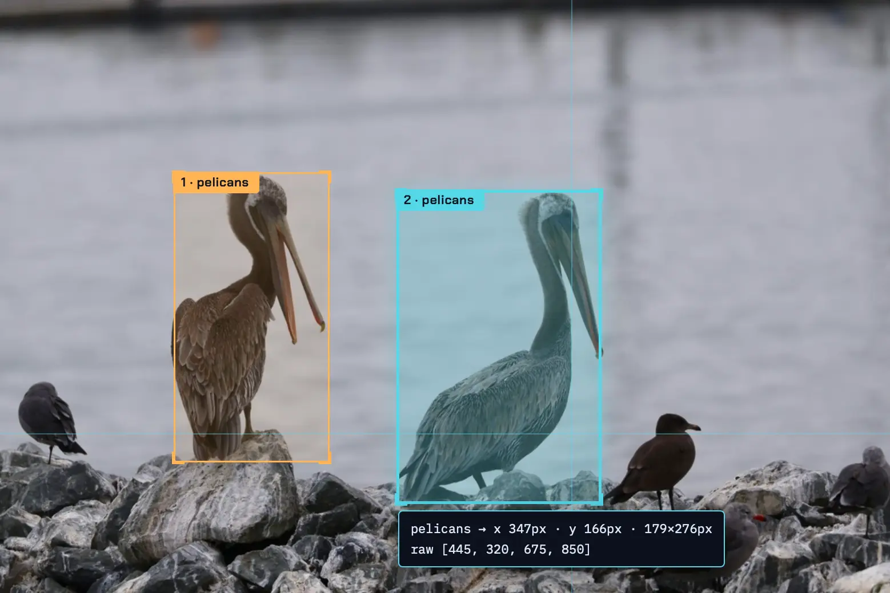
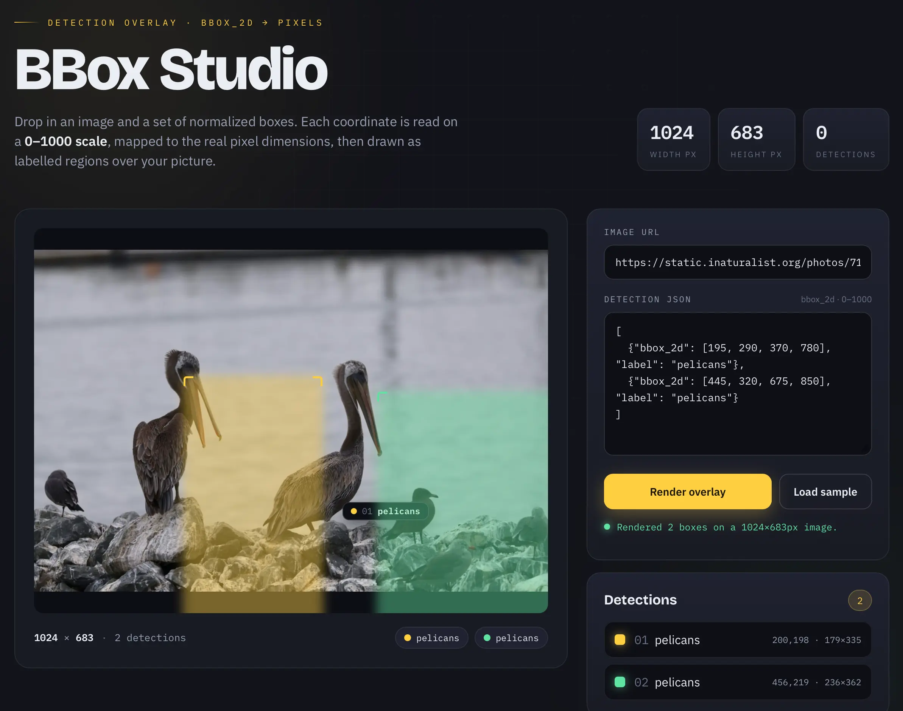

# [Simon Willison’s Weblog](/)

 [Newsletter](/newsletters/)


 **Sponsored by:** [Teleport](https://fandf.co/4xGOI6I) — AI agents (and sub-agents they spawn) are given the same access as humans, but they never sleep. Learn how to monitor and constrain their behavior with isolated ephemeral trusted runtimes.


## Qwen 3.8 27B is excellent, but it defaults to wildly overthinking things


16th August 2026

Friday’s big release was [Qwen 3.8 27B](https://huggingface.co/Qwen/Qwen3.8-27B), an Apache 2 licensed 27B parameter vision-capable LLM from Alibaba’s Qwen research lab. I’ve been looking forward to this one: 27B is an excellent size for running a model on a reasonably specced laptop, and its predecessor [Qwen 3.6 27B](https://simonwillison.net/2026/Apr/22/qwen36-27b/) was impressive.

Qwen’s [self-reported benchmarks](https://huggingface.co/Qwen/Qwen3.8-27B#benchmark-results) for this model are eye-opening. They show a boost from both Qwen 3.6 27B *and* the closed-weight Qwen 3.7-Plus, which was one of Qwen’s strongest models of any size as recently as [May this year](https://qwen.ai/blog?id=qwen3.7-plus). It will be interesting to hear what independent benchmarks have to say about the model.

I’ve been running the model on two different machines: my 128GB M5 Max MacBook Pro, and an [NVIDIA DGX Spark](https://simonwillison.net/2025/Oct/14/nvidia-dgx-spark/). On both machines I’m running LM Studio and [their 17GB Q4_K_M quantized build](https://lmstudio.ai/models/qwen3.8). I also tried using `llama-server` directly on the Spark.

#### The default of extra high results in spectacular over-thinking


Qwen’s documentation describes the model as defaulting to `xhigh` for the reasoning effort, and the LM Studio GGUF I’ve been trying preserves that default:

>

Qwen3.8 comes with official support for `reasoning_effort`, which can be used to adjust reasoning depth and control cost:
-  `xhigh` (default): for complex tasks demanding thorough analysis
-  `medium`: balancing accuracy and speed
-  `low`: efficient reasoning optimizing for speed and cost


This is a *hilarious* default. It’s absolutely not a good way to run the model, especially on consumer hardware. I’ve been finding the results extremely entertaining.

I quickly ran into problems with LM Studio’s default context limit of 8,192 tokens—Qwen was using them all up thinking about even the most mundane of problems. I loaded the model with the full 262,144 maximum context length and that problem went away.

Here’s [the pelican riding a bicycle](https://tools.simonwillison.net/markdown-svg-renderer#url=https%3A%2F%2Fgist.github.com%2Fsimonw%2Ffc909bea4fecf752c7bf9bad0e9dbf2a) SVG I got from my first attempt with that increased context length. It took **21 minutes** to generate, using 22,276 reasoning tokens to produce 3,223 tokens of output. You can read [the reasoning trace here](https://tools.simonwillison.net/markdown-svg-renderer#url=https%3A%2F%2Fgist.github.com%2Fsimonw%2Ffc909bea4fecf752c7bf9bad0e9dbf2a).


This is by far the best pelican SVG I’ve been able to generate with a model that runs on a local machine—and this Qwen is pretty small, just a 17GB file on disk. There’s a lot to like about this:
- The bicycle frame is the right shape
- It has legs on each side of the bike—that’s *very* rare
- Good, clear pelican pouch
- The wings extend to touch the handlebars!
- The motion lines are behind, not in front
- It has a tasteful background—nice sun, clouds, hill, flowers and grass.


Was that worth waiting 21 minutes for? Absolutely not.

Here’s that same prompt run with reasoning turned off—[transcript here](https://tools.simonwillison.net/markdown-svg-renderer#url=https%3A%2F%2Fgist.github.com%2Fsimonw%2F1265cfa8dce2f9ad5eb160792ff45a49). This one produced **3,715 tokens** and took 137s—just over two minutes.

 And just for completeness, I used OpenRouter to run the same prompt through the much larger Qwen 3.8 2.4T-A95B (released [last week](https://huggingface.co/Qwen/Qwen3.8-2.4T-A95B)) and got this snazzy [animated SVG](https://tools.simonwillison.net/markdown-svg-renderer#url=https%3A%2F%2Fgist.github.com%2Fsimonw%2F557016f0895b2abb4b9957caec781734):

  Your browser does not support HTML5 video.

I said Qwen at xhigh has a tendency to over-think things, but how bad really is it?

I tried a much simpler prompt, again with that default extra high setting:

>

`draw an svg of a circle`

Qwen’s reasoning trace started like this:

>

The user is asking for an SVG drawing of a circle. Simple request — but I want it to be a carefully crafted piece. Let me make something that goes beyond just `<circle>`: a single self-contained SVG file with character — maybe a geometric “circle study,” with subtle animation, layered rings, and a distinctive palette.

Keep the scope right: they asked for an SVG of a circle. So the core is a circle. But I can add craft: concentric guide circles (like a compass/geometry drawing), tick marks, a soft gradient fill on the main circle, restrained ambient motion (a slowly rotating dashed ring, pulsing glow). Respect prefers-reduced-motion? That’s more for CSS; SVG SMIL or CSS inside SVG will do.

Palette options: deep teal ink on warm paper? Or bold vermilion circle on off-white with navy construction lines — Bauhaus/compass-drawing vibe. Let me go with a “geometric study” look: cool slate background, or bright paper white? Paper white is fine if it’s not the cream-and-terracotta combo. [...]

Several minutes later it [produced](https://tools.simonwillison.net/markdown-svg-renderer#url=https%3A%2F%2Fgist.github.com%2Fsimonw%2F6f9e48293be5c916652d29f0dc0b0657) this *absolutely beautiful* animated circle, which was entirely not what I had asked for!

  Your browser does not support HTML5 video.   My strong recommendation: ignore that default. Run Qwen 3.8 27B on low or even no reasoning levels at first. It’s a great model, but wow that default setting is a bad place to start.

#### It’s very good at bounding boxes


A fun way to test a vision model is to see how well it can return bounding boxes around items in a photograph. I’ve seen previous Qwen models deal well with this, so I decided to put it to the test drawing bounding boxes around some pelicans.

I’ve seen asking for 0-1000 scale produce good results in the past. I tried this:

```
llm -a https://static.inaturalist.org/photos/714731804/large.jpg \
  -m lmstudio/qwen/qwen3.8-27b \
  'Return JSON bounding boxes for the pelicans in this photo, 0-1000 scale for each dimension'
```


Here’s [the reasoning trace](https://gist.github.com/simonw/a05cc78b2061555bd61d3bb9686e689f), which produced this:

```
[
  {"bbox_2d": [195, 290, 370, 780], "label": "pelicans"},
  {"bbox_2d": [445, 320, 675, 850], "label": "pelicans"}
]
```


This is *such a good match*. Here are those boxes rendered on top of the photo:



#### Building a tool to label bounding boxes


That visualization of the bounding boxes was taken using a new custom tool that I had Qwen 3.8 27B build for me, running offline on my laptop.

I forgot to dial down the thinking effort so it was *massively over-engineered*, but it did manage to produce [this full interface](https://static.simonwillison.net/static/2026/qwen-over-thinking-bbox.html) from [this single prompt](https://gist.github.com/simonw/121ad098860028b2fab603fa12da1fd9):

>

```
[
   {"bbox_2d": [195, 290, 370, 780], "label": "pelicans"},
   {"bbox_2d": [445, 320, 675, 850], "label": "pelicans"}
]

```


`Build an HTML page which has an input box for accepting the URL to an image and a textarea for accepting the above style of JSON.`

`It appends the image to the page, measures its width and height, then treats the coords in the bbox_2d as scaled from 0-1000 and scales them against the actual width and height, then it renders labelled boxes over the image.`

This screenshot shows one of the features I did *not* ask for—a demo scene, for if you don’t have a photograph to test the tool with:

![Screenshot of bbox·lab, a dark-themed web tool that overlays object-detection bounding boxes on an image, with an input panel on the left and a stage on the right showing two labeled boxes around stylized pelicans in a sunset illustration. Header: bbox·lab — normalized 0–1000 coords → pixel overlay; status indicator: RENDERED · 2 BOXES. Panel 01 INPUT (URL + detections) contains an IMAGE URL field reading data:image/png;base64,iVBORw0KGgoAAAANSUhEUgAAA+, a DETECTIONS — JSON textarea reading  {"bbox_2d": 195, 290, 370, 780, "label": "pelicans"}, {"bbox_2d": 445, 320, 675, 850, "label": "pelicans"} , an orange RENDER BOXES button, and dashed boxes labeled DEMO SCENE and CLEAR. Panel 03 STAGE header: display 661 × 661 px · 1 unit = 0.661px x 0.661px · nat 1000×1000. The stage shows a flat-style illustration of two dark pelican silhouettes with orange beaks standing in calm water against an orange-to-purple sunset sky with a pale yellow sun and distant birds; an orange bounding box labeled 1 · pelicans surrounds the left pelican and a cyan bounding box labeled 2 · pelicans surrounds the right pelican. Footer: move the cursor over the image to read grid coords; boxes map 0–1000 → displayed px.](../post-media/99684cfd84c0cf3e.webp)

Here’s the relevant segment of the thinking trace, where it decided to draw its own pelicans purely because I had used the label “pelicans” in the example JSON I gave it in the prompt:

>

Also a “load sample” that uses a known image? Can’t depend on external images, but… the image URL input is user-provided; I could add a “try with sample” button [...] Hmm, I can draw a simple scene on canvas, export it as a data URL, and load it into the image — that’s self-contained and demo-able! [...] But the user’s coords are for an actual pelican image; a generated placeholder can still demo the scaling. Generate a 1000x1000 placeholder: gradient water + two blob-like “pelican” silhouettes placed at the given bboxes (using the same scale — cute: silhouettes at the exact 0-1000 positions, showing the boxes align). This makes for a fun, self-contained demo. Keep it simple: sky gradient, sun, water, two pelican-ish shapes (ellipse body, circle head, beak). Place at bbox centers.

(I’m slightly nervous that models around the world might have a bias towards drawing pelicans at any chance they can get, brought on by nearly two years of exposure to my own stupid benchmark.)

Is all that over-thinking necessary? Maybe it is, at least a bit. I tried with reasoning turned off and got [this version](https://static.simonwillison.net/static/2026/qwen-no-thinking-bbox.html), ([transcript here](https://gist.github.com/simonw/8e78b1c64d9a56d08eedb954aa9445ee)), which nearly works but shows the boxes in the wrong place:



So without reasoning it didn’t quite one-shot a working tool. I’m sure it could get there with some follow-up prompts, but this is a good example of how reasoning can make a difference.

#### Yes, it can drive coding agents


One of the biggest questions around local models is whether or not they have enough horsepower to successfully run a coding agent loop. Coding agents require long context, strong code generation support and reliable tool-calling. On paper Qwen 3.8 27B has all three of these, so is it up to the task?

My initial experiments with [Pi](https://pi.dev/) have been very promising. I chose Pi because it has a shorter system prompt than most other options, making it a better fit for trying out smaller models.

I configured Pi to use Qwen 3.8 27B running in LM Studio on the Spark (shared via `tailscale serve`) by adding this to `~/.pi/agent/models.json`:

```
{
  "providers": {
    "spark": {
      "baseUrl": "https://spark-18b3.tail68a31.ts.net/v1",
      "api": "openai-responses",
      "apiKey": "dummy",
      "models": [
        {
          "id": "qwen3.8-27b",
          "reasoning": true
        }
      ]
    }
  }
}
```


Then ran `pi --provider spark --model qwen3.8-27b` in my `~/dev/datasette` folder and prompted:

>

`how does auth work?`

After a sequence of reasoning and tool calls that accessed a bunch of different files it produced [this reply](https://gist.github.com/simonw/6693d74a6bd45f641d43ceb9961dd95f#core-idea-actors--plugins-no-built-in-user-accounts), which is very solid.

Just one problem: I wanted to share that transcript. So I pointed Pi and Qwen 3.8 27B at the JSONL transcript file in `~/.pi/agent/sessions/--Users-simon-Dropbox-dev-datasette--` and prompted:

>

`Write Python code to convert this jsonl to markdown`

And it built and tested this [pi_jsonl_to_md.py](https://github.com/simonw/tools/blob/main/python/pi_jsonl_to_md.py), which did exactly what I needed. Here’s [that session transcript](https://gist.github.com/simonw/491e55ac9d741202ea0af5d9d93775d4), published using the tool that it created.

#### The quest for speed


So far this is all looking *very* promising. We have a 17GB model that runs on high-end consumer hardware and can write code, drive tools, annotate images and generally do everything that I need from an LLM for getting real work done.

There’s one very significant catch: it feels slow—especially when it starts over-thinking, but even without that it’s not particularly sprightly.

I’ve been getting around 15-30 tokens a second from LM Studio. That’s not terrible, but it’s slow enough that it’s going to be hard to win me away from hosted API models, which can return results a whole lot faster. Artificial Analysis [track token speed](https://artificialanalysis.ai/models#speed) and show OpenAI 5.6 Sol at 74 tokens/second and 5.6 Luna at an impressive 184/second.

The good news is that the community have been exploring ways to speed things up since the model was first released two days ago.

One of the most promising optimizations is baked into the model itself. Qwen supports [Multi-Token Prediction](https://sebastianraschka.com/llm-architecture-gallery/mtp/), an architecture trick where a cheaper mechanism guesses several tokens ahead and the main model can then quickly verify if the guesses were correct. This can have quite a dramatic effect on inference performance.

Based on [this tweet](https://twitter.com/ggerganov/status/2088340681701925253) from `llama.cpp` creator Georgi Gerganov I tried running the model with MTP like this on the Spark:

```
llama serve \
 -hf  ggml-org/Qwen3.8-27B-GGUF:Q4_K_M \
 -hfd ggml-org/Qwen3.8-27B-GGUF:Q4_0 \
 --spec-default \
 --spec-type draft-mtp \
 --reasoning-preserve
```


And sure enough, this gave me a significant boost. I had GPT-5.6 in Codex run [a comparative benchmark on the Spark](https://gist.github.com/simonw/b08c7eb9c126c806ba8987e269ea736b) and the `--spec-type draft-mtp` server outperformed the LM Studio default GGUF by around 72%.

I expect we’ll see a whole lot more innovation around serving this model faster over the next few weeks. The MLX community likely have some tricks brewing as well.

#### Some observations


The fact that a 17GB file can do all of this stuff on my home machines is a *miracle*. Once again, I’m delighted and amazed at how much progress local models have made this year. A year ago this would have been competitive with the best and most expensive of the proprietary models—today it can run on a capable laptop.

The only thing holding this back from being a daily driver is performance. It feels pretty slow on both the M5 Mac and the DGX Spark. That’s the catch with these dense (non-Mixture-of-Experts) models—they require a whole lot of memory bandwidth to perform well, and neither of the machines I have access to are top performers in that regard.

The most important thing about Qwen 3.8 27B is **what it demonstrates**. We can have an open weights general purpose model with a long context, effective tool calling, strong vision ability, and competent code generation, and we can fit the whole thing in just a 17GB file.

The models at this size continue to get better at an impressive rate. We don’t need to spend half a million dollars on datacenter-class hardware just to run a competent model.

Posted [16th August 2026](/2026/Aug/16/) at 10 pm · Follow me on [Mastodon](https://fedi.simonwillison.net/@simon), [Bluesky](https://bsky.app/profile/simonwillison.net), [Twitter](https://twitter.com/simonw) or [subscribe to my newsletter](https://simonwillison.net/about/#subscribe)


## More recent articles


- [Battle Drones - a vibe coded RTS with audio-based multiplayer](/2026/Oct/20/battledrones/) - 20th October 2026
- [Hello Python 3.15, goodbye 3.10, and now I can use 3.11](/2026/Oct/12/python-3-15/) - 12th October 2026
- [A new feature for my blog, built using my voice](/2026/Oct/9/built-using-my-voice/) - 9th October 2026
- [Claude Haiku 5.5](/2026/Oct/7/claude-haiku-5-5/) - 7th October 2026


This is **Qwen 3.8 27B is excellent, but it defaults to wildly overthinking things** by Simon Willison, posted on [16th August 2026](/2026/Aug/16/).


Part of series **[LLMs on personal devices](/series/llms-on-personal-devices/)**
- [OpenAI's new open weight (Apache 2) models are really good](/2025/Aug/5/gpt-oss/) - Aug. 5, 2025, 8:33 p.m.
- [Qwen3-4B-Thinking: "This is art - pelicans don't ride bikes!"](/2025/Aug/10/qwen3-4b/) - Aug. 10, 2025, 11:59 p.m.
- [Mr. Chatterbox is a (weak) Victorian-era ethically trained model you can run on your own computer](/2026/Mar/30/mr-chatterbox/) - March 30, 2026, 2:28 p.m.
- **Qwen 3.8 27B is excellent, but it defaults to wildly overthinking things**]() - Aug. 16, 2026, 10 p.m.
  [ ai 2,289 ](/tags/ai/) [ generative-ai 2,030 ](/tags/generative-ai/) [ local-llms 165 ](/tags/local-llms/) [ llms 1,996 ](/tags/llms/) [ qwen 62 ](/tags/qwen/) [ pelican-riding-a-bicycle 151 ](/tags/pelican-riding-a-bicycle/) [ llm-reasoning 105 ](/tags/llm-reasoning/) [ llama-cpp 30 ](/tags/llama-cpp/) [ llm-release 237 ](/tags/llm-release/) [ coding-agents 262 ](/tags/coding-agents/) [ lm-studio 23 ](/tags/lm-studio/) [ ai-in-china 109 ](/tags/ai-in-china/) [ dgx-spark 7 ](/tags/dgx-spark/) [ pi 6 ](/tags/pi/)

**Next:** [Conceptual integrity and counting lines of code](/2026/Aug/19/conceptual-integrity-and-counting-lines-of-code/)

**Previous:** [Now we have a timeline of the OpenAI accidental attack against Hugging Face](/2026/Aug/7/openai-timeline/)


###  Monthly briefing


 Sponsor me for **$10/month** and get a curated email digest of the month's most important LLM developments.

 Pay me to send you less!  [ Sponsor & subscribe ](https://github.com/sponsors/simonw/)


- [Disclosures](/about/#disclosures)
- [Colophon](/about/#about-site)
- ©
- [2002](/2002/)
- [2003](/2003/)
- [2004](/2004/)
- [2005](/2005/)
- [2006](/2006/)
- [2007](/2007/)
- [2008](/2008/)
- [2009](/2009/)
- [2010](/2010/)
- [2011](/2011/)
- [2012](/2012/)
- [2013](/2013/)
- [2014](/2014/)
- [2015](/2015/)
- [2016](/2016/)
- [2017](/2017/)
- [2018](/2018/)
- [2019](/2019/)
- [2020](/2020/)
- [2021](/2021/)
- [2022](/2022/)
- [2023](/2023/)
- [2024](/2024/)
- [2025](/2025/)
- [2026](/2026/)
-