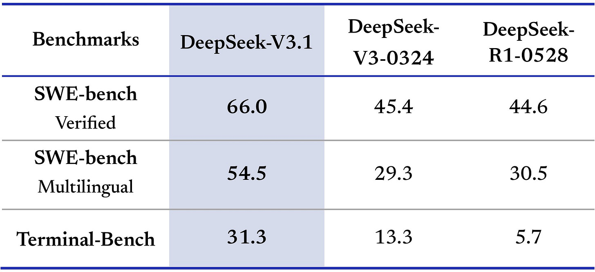
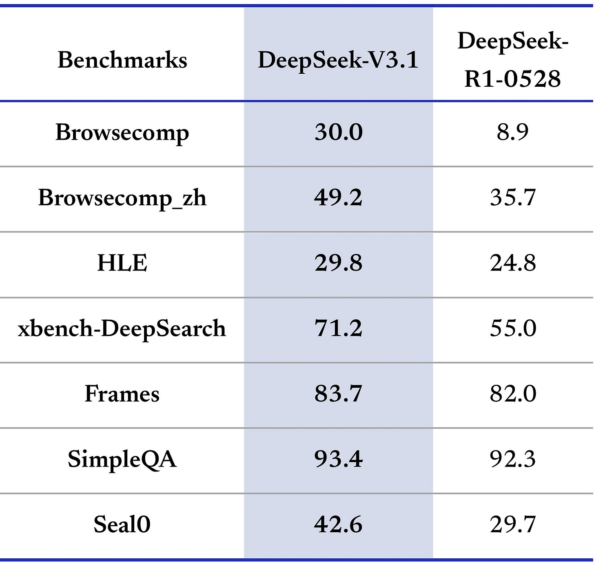
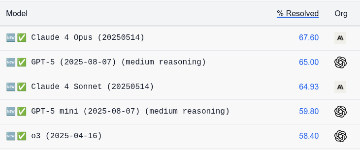
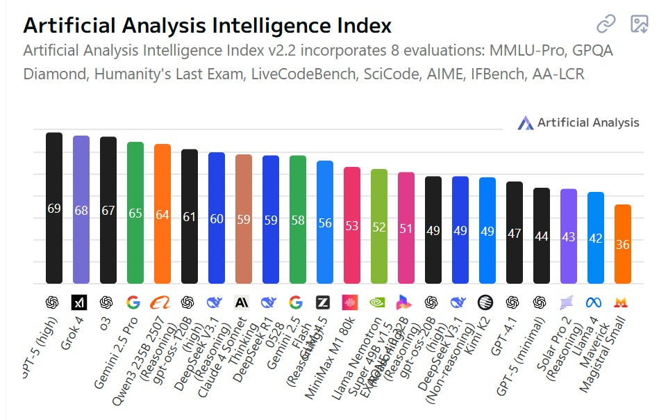

# DeepSeek v3.1 Is Not Having a Moment

[Zvi Mowshowitz](https://substack.com/@thezvi)

Aug 22, 2025

What if [DeepSeek released a model claiming 66 on SWE](https://x.com/deepsseek/status/1957886077047566613) and almost no one tried using it? Would it be any good? Would you be able to tell? Or would we get the shortest post of the year?

#### Why We Haven’t Seen v4 or r2

[Why are we settling for v3.1 and have yet to see](https://x.com/StefanFSchubert/status/1955893320024047628) [DeepSeek release v4 or r2 yet](https://www.ft.com/content/eb984646-6320-4bfe-a78d-a1da2274b092)?

>

Eleanor Olcott and Zijing Wu: Chinese artificial intelligence company DeepSeek delayed the release of its new model after failing to train it using Huawei’s chips, highlighting the limits of Beijing’s push to replace US technology.

DeepSeek was encouraged by authorities to adopt Huawei’s Ascend processor rather than use Nvidia’s systems after releasing its R1 model in January, according to three people familiar with the matter.

But the Chinese start-up encountered persistent technical issues during its R2 training process using Ascend chips, prompting it to use Nvidia chips for training and Huawei’s for inference, said the people.

The issues were the main reason the model’s launch was [delayed](https://www.ft.com/content/fb5c11bb-1d4b-465f-8283-451a19a3d425) from May, said a person with knowledge of the situation, causing it to lose ground to rivals.

The real world so often involves people acting so much stupider than you could write into fiction.

America tried to sell China H20s and China decided they didn’t want them and now Nvidia is halting related orders with suppliers.

DeepSeek says that the main restriction on their development is lack of compute, and the PRC responds not by helping them get better chips but by advising them to not use the chips that they have, greatly slowing things down at least for a while.

#### Introducing DeepSeek v3.1

In any case, [DeepSeek v3.1 exists now](https://x.com/deepsseek/status/1957886077047566613), and remarkably few people care?

>

[DeepSeek](https://x.com/deepseek_ai/status/1958417068568481854): Introducing DeepSeek-V3.1: our first step toward the agent era! 🚀

🧠 Hybrid inference: Think & Non-Think — one model, two modes

⚡️ Faster thinking: DeepSeek-V3.1-Think reaches answers in less time vs. DeepSeek-R1-0528

🛠️ Stronger agent skills: Post-training boosts tool use and multi-step agent tasks

[Try it now — toggle Think/Non-Think via the "DeepThink" button](https://t.co/n8tODcbEz2).

API Update ⚙️

🔹 deepseek-chat → non-thinking mode

🔹 deepseek-reasoner → thinking mode

🧵 128K context for both

🔌 [Anthropic API format supported](https://api-docs.deepseek.com/guides/anthropic_api).

✅ [Strict Function Calling supported in Beta API](https://api-docs.deepseek.com/guides/function_calling).

🚀 More API resources, smoother API experience

Tools & Agents Upgrades 🧰

📈 Better results on SWE / Terminal-Bench

🔍 Stronger multi-step reasoning for complex search tasks

⚡️ Big gains in thinking efficiency

🔹 V3.1 Base: 840B tokens continued pretraining for long context extension on top of V3

🔹 Tokenizer & chat template updated — [new tokenizer config](https://huggingface.co/deepseek-ai/DeepSeek-V3.1/blob/main/tokenizer_config.json).

🔗[ V3.1 Base Open-source weights](https://huggingface.co/deepseek-ai/DeepSeek-V3.1-Base).

🔗[ V3.1 Open-source weights](https://huggingface.co/deepseek-ai/DeepSeek-V3.1).

Pricing Changes 💳

🔹 New pricing starts & off-peak discounts end at Sep 5th, 2025, 16:00 (UTC Time)

🔹 Until then, APIs follow current pricing

📝 [Pricing page](https://api-docs.deepseek.com/quick_start/pricing/).

[Teortaxes](https://x.com/teortaxesTex/status/1958139448257855527): for now seems to have the same performance ceiling as 0528, maybe a bit weaker on some a bit stronger on other problems. The main change is that it's a unified merge that uses ≥2x fewer reasoning tokens. I take it as a trial balloon before V4 that'll be unified out of the box.

#### Signs of Life

There are some impressive scores here. [A true 66 on SWE would be very strong](https://x.com/jessi_cata/status/1958423894253261121).

There’s also the weird result where it is [claimed to outscore Opus 4 on Aider Polyglot](https://x.com/scaling01/status/1957890953026392212) at a low price.

>

[Wes Roth](https://x.com/WesRothMoney/status/1958121840880103720): DeepSeek has quietly published V 3.1, a 685-billion-parameter open-source model that folds chat, reasoning, and coding into a single architecture, handles 128 k-token context windows, and posts a 71.6 % score on the Aider coding benchmark edging out Claude Opus 4 while costing ~68× less in inference.

But these two data points don’t seem backed up by the other reactions, or especially the lack of other reactions, or some other test results.

Artificial Analysis has it coming in at 60 versus r1’s 59, which would be only a small improvement.

[Hasan Can said it hallucinates a lot](https://x.com/HCSolakoglu/status/1957993955674435924). [Steve Strickland says ‘it’s the worst LLM I’ve even tried’](https://x.com/SteveStricklan6/status/1958869568224436612) complaining about it failing a mundane task, which presumably was very bad luck.

I tried to conduct Twitter polls, but well over 90% of respondents had to click ‘see results’ which left me with only a handful of real responses and means Lizardman Constant problems and small sample size invalidate the results, beyond confirming no one is looking, and the different polls don’t entirely agree with each other as a result.

If this were most open model companies, I would treat this lack of reaction as indicating there was nothing here, that they likely targeted SWE as a benchmark, and move on.

Since it is DeepSeek, I give them more credit than that, but am still going to assume this is only a small incremental upgrade that does not change the overall picture. However, if 3.1 really was at 66-level for real in practice, it has been several days now, and people would likely be shouting it from the rooftops. They’re not.

#### How Should We Update?

Even if no one finds anything to do with it, I don’t downgrade DeepSeek much for 3.1 not impressing compared to if they hadn’t released anything. It’s fine to do incremental improvements. They should do a v3.1 here.

The dumbest style of reaction is when a company offers an incremental improvement (see: GPT-5) and people think that means it’s all over for them, or for AI in general, because it didn’t sufficiently blow them away. Chill out.

It’s also not fair to fully pin this on DeepSeek when they were forced to do a lot of their training this year on Huawei Ascend chips rather than Nvidia chips. Assuming, that is, they are going to be allowed to switch back.

Either way, the clock is ticking on v4 and r2.