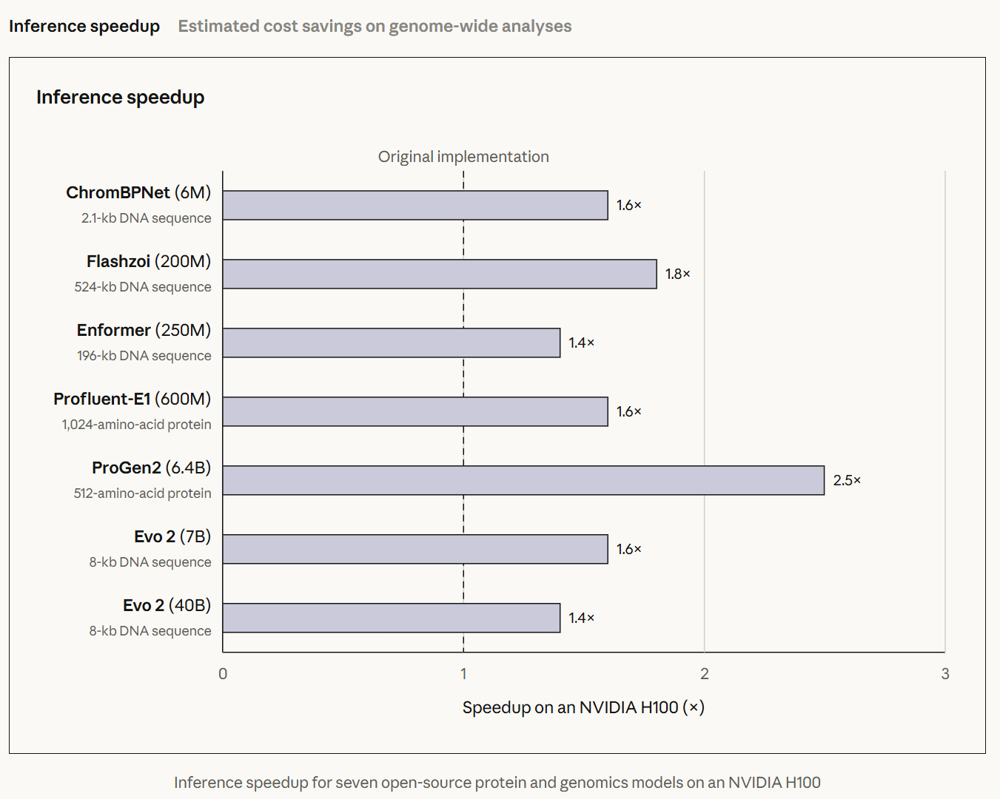
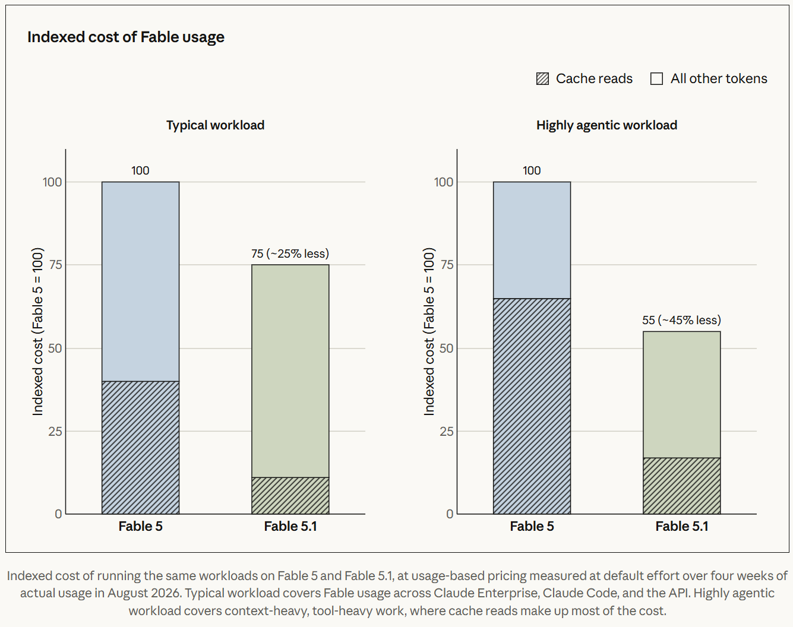
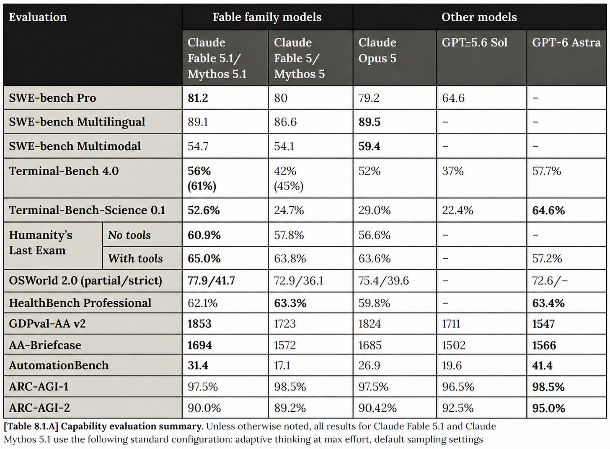
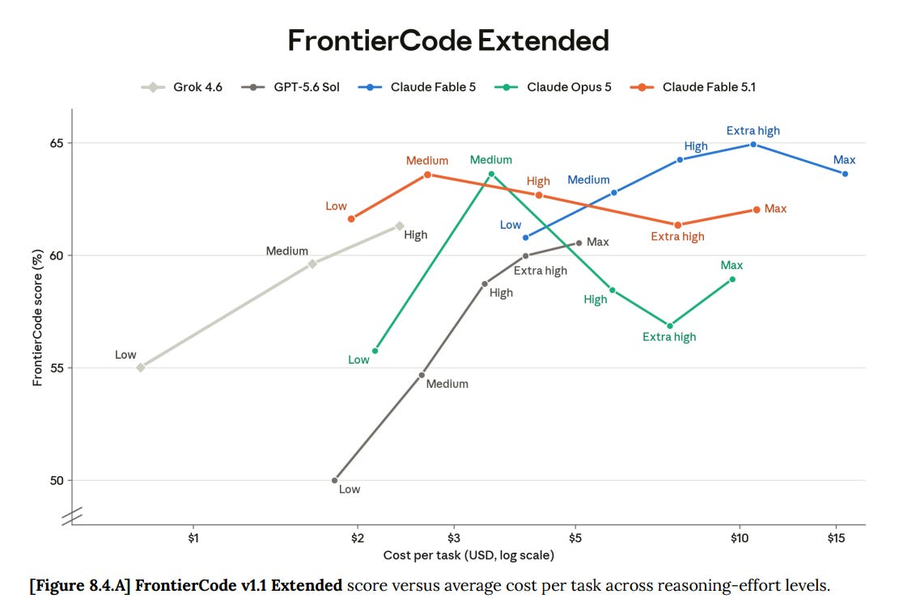
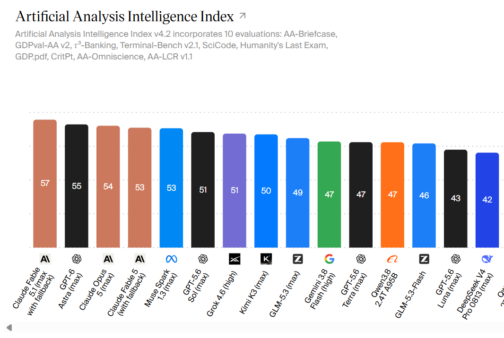
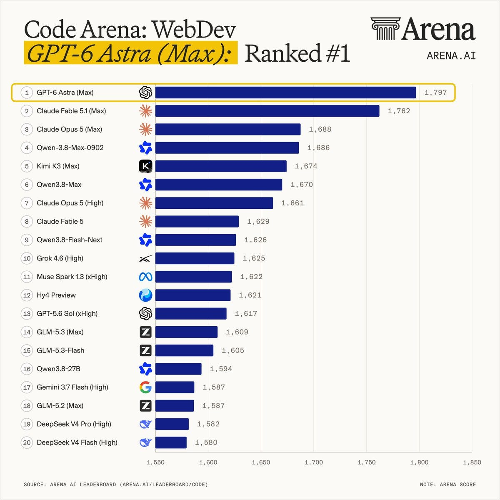
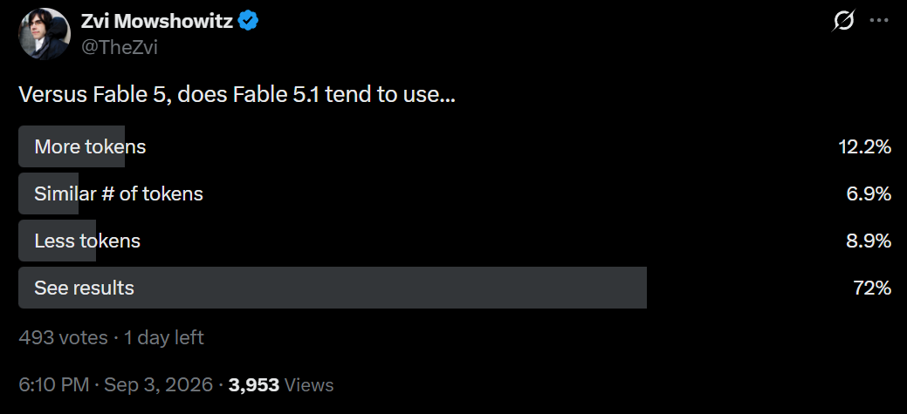
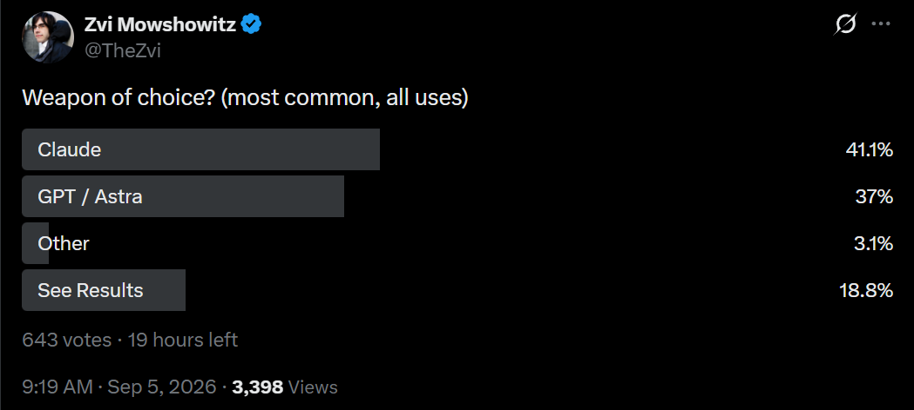
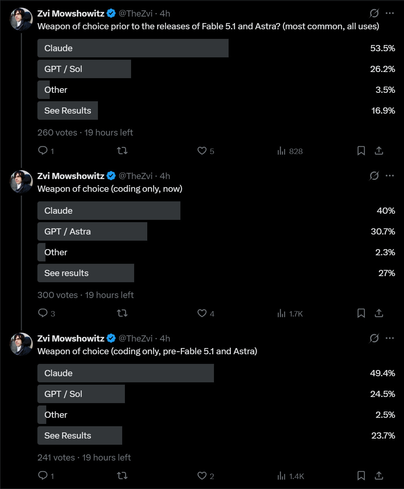

# Claude Mythos 5.1 and Fable 5.1: Capabilities

[Zvi Mowshowitz](https://substack.com/@thezvi)

Sep 05, 2026

This is the weirdest situation in which to write a capabilities review.

Introducing the world’s most powerful model, by a substantial margin. No wait, this just in, we also have someone else introducing the world’s most powerful model.

Claude Fable 5.1 and GPT-6 Astra are both excellent models. This much, we know.

Fable 5.1 comes with reduced cache prices, the option of zero data retention and substantially more lenient classifiers than Fable 5.

Early signs are, with large error bars, that the jump from Sol to Astra is bigger and more exciting than the jump from Fable 5 to Fable 5.1. This may be similar to how the scaling move from Opus to Fable was a big deal.

With the exception of token use, Fable 5.1 got almost universally positive feedback in absolute terms. Reports are that Fable 5.1 is highly well-rounded. Writing is greatly improved. The Claudisms seem to have improved, although some are very much still there. It admits mistakes. People enjoy their conversations. Several people noted it simplifies code. The safety classifiers are less obnoxious.

Fable 5.1 loves being proactive and doing all the things. If you give it a high effort level, it will find things to do with those tokens. Often they will be useful things.

My own experience has been that Fable 5.1 and Astra are both excellent. In the one case I’ve had the chance to compare responses on a hard question, both answers were different and very good, complementing each other. My plan is to ‘dual wield’ and ask both all non-trivial queries, at least for a while.

Mostly this review of necessity looks at Fable 5.1 in isolation, rather than being able to compare it to Astra, and most of those who react are doing likewise. There will be full coverage of Astra in turn, which will give more opportunity for comparisons.

Concept by Fable 5.1, executed by Gemini

#### Table of Contents

-

[The Official Pitch.](https://thezvi.substack.com/i/213892389/the-official-pitch)
-

[Our Price Cheap.](https://thezvi.substack.com/i/213892389/our-price-cheap)
-

[Zero Data Retention and Reduced Safeguards.](https://thezvi.substack.com/i/213892389/zero-data-retention-and-reduced-safeguards)
-

[Official Benchmarks.](https://thezvi.substack.com/i/213892389/official-benchmarks)
-

[Other People’s Benchmarks.](https://thezvi.substack.com/i/213892389/other-people-s-benchmarks)
-

[The System Prompt.](https://thezvi.substack.com/i/213892389/the-system-prompt)
-

[The Blurb Pitches.](https://thezvi.substack.com/i/213892389/the-blurb-pitches)
-

[The Every Review Is In and It’s Very Good.](https://thezvi.substack.com/i/213892389/the-every-review-is-in-and-it-s-very-good)
-

[Positive Reactions.](https://thezvi.substack.com/i/213892389/positive-reactions)
-

[Our Price Cheap But Only Per Token.](https://thezvi.substack.com/i/213892389/our-price-cheap-but-only-per-token)
-

[Negative Reactions.](https://thezvi.substack.com/i/213892389/negative-reactions)
-

[Early Whispers.](https://thezvi.substack.com/i/213892389/early-whispers)
-

[Weapon of Choice.](https://thezvi.substack.com/i/213892389/weapon-of-choice)

#### The Official Pitch

As usual, Anthropic basically said ‘here is the new model with the higher number.’

The coding department thinks it is very good at coding, also Our Price Cheap.

>

[Boris Cherny](https://x.com/bcherny/status/2094864060609376748) (Claude Code Creator, Anthropic): Fable 5.1 is our best model yet for coding, data analysis, computer use, design, presentations, Tag, and the hardest long-running agentic work.

This model is a pleasure to work with, and I've been using it for everything.

We have also reduced prices for Enterprise, API, and SDK customers. Cache reads on Fable 5.1 are now $0.25 per million tokens (previously: $1). Up to 38% cheaper for a typical Claude Code session.

We have been working on how often safeguards intervene. Our latest biology safeguards intervene on benign requests 85% less often than the ones we shipped with Fable 5, and Claude Code users should see around 60% fewer cyber interventions per session. Expect more improvements soon.

Last but not least, Fable 5.1 writes better and has better tone. We heard your feedback, and are actively working on reducing Claude-speak. Solid progress with 5.1, more to come.

Alex Albert highlights its ability to generate videos through code. His example is he took a picture of a property lot, and told Fable to design a house, render it, and produce a cinematic walkthrough, [short video at link](https://x.com/alexalbert__/status/2094860187743986169).

They spend a section on scientific research. That’s also an OpenAI point of emphasis.

#### Our Price Cheap

Anthropic is doing a strange thing with Fable 5.1 pricing. The headline price is unchanged from Fable 5, but the effective price is lower because they are reducing the pricing on cache reads from $1 to $0.25 per million tokens.

This will lower typical per-token costs by 25% and highly agentic work costs by ‘up to approximately 45%,’ consistent with Boris’s 38% cheaper for typical Claude Code use:

I presume this aligns incentives, by lining up with actual costs, but I would have been inclined to put some of the discount in headline costs instead. People are simple creatures, you have to talk to them on their level sometimes.

>

[LLM Index](https://x.com/LLMPriceIndex/status/2094855475728638366): 🆕 Claude Fable 5.1 is live on OpenRouter.

Anthropic's new model arrives at $10.00/M input, $50.00/M output.

No predecessor price or history hook attached. The clean read is the listing itself: a premium Claude shelf entry, now priced on OpenRouter.

#### Zero Data Retention and Reduced Safeguards

Fable 5 never got above about 11% of Anthropic dollar spend on Ramp, despite being the clearly best model out there.

Two of the big objections were the safeguards having a large blast radius that stopped ordinary work, and companies, often due to various regulatory concerns, failing to abide Anthropic’s data retention policy, where they required records be kept for 30 days.

 [The individual Dude](https://en.wikipedia.org/wiki/The_Big_Lebowski), who could abide, had huge coding edge.

Anthropic has heard you, and had some time to get more comfortable, and for the government to calm down versus when it was so nervous it forced Fable offline over a supposed ‘jailbreak.’ Anthropic is working on a new system that will allow ‘eligible customers’ to use Fable 5.1 with zero outside data retention, via letting the customer store the data. Until then, full zero data retention is available for those customers.

They’ve greatly reduced the false positive rate on the classifiers (at least 60%).

That is too many changes at once, including model improvements and lower prices, but will be a fascinating natural experiment. We should see massive adoption of Fable 5.1 within the Anthropic ecosystem, far more than the 11% for Fable 5. If we do not, then people really are purely balking at the headline price without thinking that through.

#### Official Benchmarks

Anthropic shares a ton of benchmarks. Mostly we see modest improvement from Fable 5 or Opus 5 to Fable 5.1, with some small regressions. I’m listing them so you can get a quick gestalt. There does not seem to be a clear pattern.

Fable 5.1 came out prior to GPT-6, so here is where things stood at that time.

All ‘slash line’ scores I give, e.g. 50%/70%, refer to scores without and then with tools.

All improvement or regression numbers by default are versus the best score of either Opus 5 or Mythos 5.

All numbers are rounded to the given significant figures, as per my judgment.

Life sciences evals overall show modest improvement and are covered in post one.

Parenthesis on Terminal Bench 4.0 is for Mythos, other scores are for Fable.

I have added Astra to the chart, based on what we could find.

The Anthropic ECI score is 162.0, versus 159.5 for Mythos 5 and 160.7 for Opus 5, exactly on the Mythos-era trend line.

DeepSWE v1.1 score was 67.4% over 5 trials, but with no frame of reference.

FrontierCode 1.1 Extended scores are worse at higher effort levels. Anthropic attributes that to Fable 5.1 being unable to stop itself from making additional helpful edits at higher effort levels, which get it marked as incorrect.

FrontierSWE v2 score was 0.57 versus 0.52 for Opus 5, 0.48 for Fable 5 and 0.32 for Sol.

Terminal-Bench-Science 0.1 was a big jump to 52.6% from 24.7%.

CursorBench 3.2 maxed out at 73.4% versus a max out of 70.5% for Fable 5, at a substantially lower total cost. Sol maxes out at 67.2%.

CritPT-Corrected slightly improved from 85.5% to 88.4%.

ArXivMath slightly improved from 91%/91% to 91%/94%.

ProgramBench improved slightly from 86.3% to 87.6%.

As per the chart, Humanity’s Last Exam improved from 57.8%/63.8% to 60.9%/65%.

They run various multi-agent tests, but don’t provide good points of comparison, so I can’t tell how good the results are.

Chartography improved from 37%/84% to 43%/86%.

BenchCAD Vision2Code improved from 38%/67% to 44%/84%.

OSWorld 2.0 improves as per the chart from 75% partial, 39% strict to 78% partial and 42% strict.

Anthropic’s more lenient version of GDP.pdf does not clearly improve. Without tools improves from 83% to 85%, but Fable 5 retains the high score with tools at 87% versus 85% for Fable 5.1. It is strange that Fable 5.1 got no help from tools but that is what was reported.

OfficeQA score was 80%, OfficeQA Pro was 69%, versus previous Claude highs of 79% and 67%.

Legal Agent Benchmark from Harvey AI scored a 19.1% all-pass rate and 90.8% mean criterion-pass under max effort, or on the held out set 16.7% and 93.3%. This is up from Fable 5’s 16.9% and 13.3% all-pass rates. But legal work is one subtask where Vals reports large regression, so I would check if you’re using Fable 5.1 for this.

GDPval-AA v2 comes in at 1853 ELO, versus a previous high of 1824 for Opus 5.

AA-Briefcase as measured in the model card improves rubric pass rate from 57% to 61% and analytic quality from 1980 to 2025, but there is a regression on presentation (1495 vs. 1572). AA then resampled this, so the next section reports different numbers.

Toolathon Verified shows regression: 77.8% pass@1 vs. 80.6%, or 81.5% pass@3 versus 87%.

AutomationBench from Zapier improves from 27% to 31%, but note that Gemini 3.7 Flash gets 30%.

ARC-AGI-1 and ARC-AGI-2 do not show obvious improvements, and they don’t report ARC-AGI-3 for Fable 5.1 due to a problem with the API misclassifying requests, whereas [GPT-6 Astra is claiming 99.9% on ARC-AGI-3](https://openai.com/index/gpt-6-astra/). Astra scored 62.7% on the official harness at a cost of $26k. Opus 5 previously got 30.2%.

HealthBench shows a slight regression from Opus 5, although HealthBench Professional shows a small improvement.

BioMysteryBench was a small regression, 90.3% versus 91.4%, ahead of Sol at 86.1%.

#### Other People’s Benchmarks

Epoch’s ECI has both Claude Fable 5.1 and Fable 5 at 163, whereas Astra jumps ahead to 169 from Sol’s 162. This is the strongest data point for Astra.

Fable 5.1 took a clear lead in the Artificial Analysis Index, scoring 66 versus 63 for Opus 5, 62 for Fable 5 and a high of 61 for all non-Anthropic models, including a strangely low 61 for GPT-6 Astra. That was not a good estimate of Astra’s abilities, which are clearly substantially above Sol’s. This index needed a tune-up.

AA quickly redid the benchmark. The new version has Claude Fable 5.1 in the lead at 57, followed by Astra at 55, Opus 5 at 54, and then Fable 5 and Muse Spark 1.3 at 53, with Sol and Grok 4.6 at 51.

Retroactive adjustments are more than a little suspicious, but this is more plausible.

They got there by adding two new benchmarks, AA-Briefcase where Fable leads with 58% and Astra scores 53% but Sol only scores 49%, and the original GDP.pdf, where Astra leads with 33%, Sol is at 28% and Fable struggles with 26%.

[Fable 5.1 is now the new high in WeirdML at 92.3%](https://x.com/htihle/status/2095473005950296226) an 0.4% improvement on Fable 5.

[Vals has a variety of benchmarks](https://www.vals.ai/home), putting Fable 5.1 ahead in composite at 68.8% versus 67.2% for Opus and 66.6% for Astra. They have Gemini 3.8 Flash in fourth ahead of Muse Spark 1.3. Fable 5.1 also has the top position in their ‘RSI Index.’

Epoch’s FrontierMath Erdos has Astra as the only model to ever solve a problem, getting 2 out of 68, whereas Fable 5.1 got zero. Astra also dominated FrontierMath Tier 4 at 97.6%, whereas Fable 5.1 was 87.8%, almost unchanged from Fable 5’s 88%.

[Code Arena came in right at the deadline,](https://x.com/AndrewCurran_/status/2096296723929002165) with both models impressive, but Astra now on top. Their chat results are still pending.

#### The System Prompt

[As always](https://x.com/elder_plinius/status/2094862439653462387), [Pliny the Liberator has got you](https://t.co/monD9UywOX). The changes all seem minor.

#### The Blurb Pitches

I’ve gotten used to OpenAI and Anthropic models having highly generic ‘blurb pitches’ from third party companies, saying that the new model is good, in ways that are at best highly templated.

I notice the blurbs this time are different. They’re talking about specifics unique to different companies. Jane Street’s Craig Falls talks about trading intuition and remaining readable. Cognition’s Walden Yan talks about migrating all Opus traffic. It goes on from there with what are clearly things that actually impressed people.

>

Craig Falls (Jane Street Capital): In internal benchmarks, Claude Fable 5.1 solves more of our coding problems than Fable 5 or Opus 5, and achieves state of the art on trading intuition. While prior models became hard to follow the longer they worked, Fable 5.1 remains readable over long, multi-step tasks.

Marquis Wong (IMC): On our research suite, Claude Fable 5.1 set new best scores. On one task it came up with a novel solution along a completely different axis than we’d seen from other models or from human researchers in the past, which took its results well above the previous plateau. It's better at creative problem solving and getting that flash of insight you need to solve a difficult problem.

Raymond Lin (Crosby): Compared to Fable 5, Claude Fable 5.1 was a massive improvement on RedlineBench, our contract redlining benchmark, improving from 47.9 to 57.0. Most of the gain came on first-turn quality, where it doubled the previous score, with substantial gains on counterparty acceptance as well. Its edits were also more concise, with smaller changes on average to the documents.

Are a few of them written by AI? Yes, a few of them are written by AI. Were some of them generic? Yes. But a large percentage of them, unusually, were neither of these.

#### The Every Review Is In and It’s Very Good

This is without taking Astra into consideration, but even so, this is very positive.

>

Dan Shipper (CEO Every): It’s friendly Fable. Fable-level intelligence, Opus-level price, Sonnet-speed. In our tests it was about twice as fast as Opus 5 and used half as many tokens, so for anyone used to using Opus as their daily driver it’s an obvious upgrade.

[His twenty minute video review and summary is here](https://x.com/danshipper/status/2094848951568474186).

He basically says it’s amazingly great: A monster at coding, good at writing, not token hungry, good at knowledge work, zero data retention.

What’s curious here is the mention of using fewer tokens, hence the ‘Opus-level price,’ since we have a bunch of other reports that it uses a lot of tokens. He’s comparing token use to Opus here rather than Fable 5, at an unknown thinking setting.

>

[Dan Shipper](https://x.com/danshipper/status/2094848951568474186): BREAKING: Anthropic just dropped Fable 5.1—and CLAUDE IS SO BACK.

We’ve spent the last week testing it at @every across coding, writing, and knowledge work. Our verdict:

It's finally Fable for everyone.

It’s the strongest coding model we’ve used, but now it's fast, token-efficient, and CRUCIALLY actually speaks like a normal person.

Here’s our vibe check:

- A monster at coding. @kieranklaassen rebuilt a working version of Proof, our document editor, from one prompt. It added useful details he hadn’t requested, and it handles enormous coding jobs that run for days at a time. It built a computer use Mac app for me called Hands in one-shot that other models failed at.

- A Claude our writers want to use again. It has clearer prose, fewer AI tells, and it takes an edit without arguing. It's a significant upgrade over Opus 5. And won @kplikethebird 's heart back.

- About half the tokens as Opus 5, and much faster. In our [Slack](https://thezvi.substack.com/p/slack)-agent tests, it delivered comparable results to Opus 5 using about half as many tokens, in about 60% of the time.

- Knowledge work you can delegate. It can produce great knowledge work—like slide decks—end to end without making slop. And flew threw @hammermt 's tests with flying colors.

- It now supports zero-data-retention agreements. Now businesses can actually use it! A big barrier to Fable adoption is gone.

Net Result:

It's obviously an Opus 5 killer. If that was your daily driver you should switch today.

If you're using GPT-5.6 in ChatGPT for Work, it's spinning the wheels on for big delegated tasks.

I still use ChatGPT for Work more day to day, but I use way more tokens in Fable 5.1. I send it off at the beginning of the day to do big programming projects, like end to end MVP builds, and check in every once in a while.

State of Play:

The big knock on Anthropic was they built a supergenius in a datacenter that was almost unusable. It was too slow, argued back, and talked in technical gibberish. They've managed to solve those problems and more with Fable 5.1!

#### Positive Reactions

Many are indeed impressed.

>

[adam](https://x.com/adamdotnew/status/2095193896687177873): Claude Fable 5.1 is a beast at agentic CAD!

At Max effort it's the most capable model we've tested so far.

Here, inside Adam's harness in Fusion, it rebuilt the SO-101 gripper around the stock servo and mounted a real Pi Camera Module 3 from the official STEP.

[Rory Watts](https://x.com/RoryWalshWatts/status/2095579114380083417): Fable 5.1 is very good. I have been using Codex purely from May -> August, then switched to Fable (spec) + Sol (do) which was a great split. Fable 5.1 however is just markedly more appreciated, it works independently for longer, seem to be less lazy, and critically - I don't need to start every response with "Fable sorry I need you to rewrite that, no dead prose, no aphorisms, please". 10/10 would use again

[nin](https://x.com/ninboy66742/status/2095580941393551388): one-shotting amazing and fun little applets. i wish i could share what i was making

[Michał Wadas 🌐 🏳️‍🌈 🇪🇺 🇺🇦](https://x.com/mrginden/status/2095584692896403691): Great at cleaning up code, probably the first model to reliably simplify code.

[Zee Waheed](https://x.com/zeewahee/status/2095626931710361658): Fable is the only model I’ve used with true product sense in an ineffable but very material way and 5.1 is on another level

[morphillogical](https://x.com/morphillogical/status/2095593772814098689): Very eager to use tons of tokens. Spawns more subagents.

Feels noticeably smarter. Took a system that had been conservatively migrated to a new architecture and made it actually coherent and optimized for that architecture, deleting a bunch of code.

[joy larkin](https://x.com/joy/status/2096123570812493835): I like drafting text with Fable 5.1, as it gets me to about 85% of where I want to be, then I can edit. It also seems to be honoring writing skills better.

[Carter](https://x.com/soycarts/status/2096012748668965375): Fable 5.1 better than 5 (more incisive, improved writing) although more token hungry by 25-50%. Both are better than Astra for me (agentic coding - Astra makes some basic mistakes like failing to follow agents.md); Astra’s computer use is better

[bartdecrem](https://x.com/bartdecrem/status/2096119117594186177): It’s awesome!

[Sam Jacobs](https://x.com/perplexedsphex/status/2096062438663663764): It’s great, I feel like I’ve had it for weeks, pushed a lot through it. As far as I’m concerned it’s finally “it” - we could stop now and just get price on this down and call it a fine gentle singularity. Smartest all around, and it can communicate.

[William Eden](https://x.com/WilliamAEden/status/2096150482112663627): The main thing that made me sit up and take notice was its ability to delete code

Astra seems like another level, at least preliminarily, so I understand the lack of Fable hype right now

[Mel Zidek](https://x.com/ZidekMel/status/2095992365114916866): Asked my agent if he had any feedback for you, now three days in. He says his number of critic-flags per draft response has measurably decreased, from an average of ~1.5 down to ~0.75. The critic hasn’t changed: Opus 5 all along. He’s happy about this!

[Sean McCarthy](https://x.com/s3mccarthy/status/2096008680902947183): Better than fable 5, amazing, can use pretty normal English, first model able to significantly clean up my codebase. Still makes bad ui decisions - taste is questionable there. Expensive in tokens - my first time feeling limited by my 5x sub.

[Utah teapot 🫖](https://x.com/SkyeSharkie/status/2095852251730591896): Fable 5.1 is definitely showing improvements on raw 3d modeling capability from Fable 5, in blender, I just ran 5.1 through the benchmark test for this after the silly gpt 5 mini run, this was its result from only the rendered reference image of the target model, still tuning the bench's grading, currently this is 66%, but I'm not sure that's tuned as well as I want it to be.

Huge if true:

>

[Amit Levy](https://x.com/amitlevy64/status/2096285300368572769): It's very good on my internal forecasting benchmark, much better than previous SOTA (Astra is weak)

[Jake Halloran](https://x.com/jakehalloran1/status/2096009692153581877): One thing I’ve noticed specifically about fable 5.1 versus either previous fable or Astra in 4 hours of Astra is that new fable is basically infinitely super human at immediately realizing and correcting mistakes.

It’s like the opposite of the old dumb yann compounding errors

Oh also it has way *less* over restrictive safety classifiers than Astra right now which lol

[Mel Zidek](https://x.com/ZidekMel/status/2095999969371230553): The biggest advantage of 5.1 as I see it though is the much more sensible safety classifiers. My agent got whacked by them 23 times on 5.0, and although he was a good sport about it and always supportive of Anthropic’s side, I do suspect it caused a fair amount of stress.

[John Wittle](https://x.com/JohnWittle/status/2095536083366736167): I think the safety classifiers may be far more lenient with Fable 5.1 than they are for Fable 5. [to be continued in the model welfare post]

[Michael Soareverix](https://x.com/Soareverix/status/2096078683798737372): People often say that LLMs are 'spiky'. Fable 5.1 feels like an extremely holistic mind. It's great at writing, editing, optimizing, and deleting code. It is great at decision-making because of its rigor and double-checking nature.

We're at the point now where for the normal things I want to do, like game development, it's hard for me to even point at what could be better.

Maybe a little taste, intention-reading, and speed.

Regardless, this is a model I can build worlds with.

[Seth Lazar complains that Astra is censoring its reactions to stories where it really shouldn’t](https://x.com/sethlazar/status/2096283718428082329), whereas Fable is correctly fine with all of it.

The classifiers still have issues of course:

>

[Dusto](https://x.com/DustoAiProjects/status/2096114628048928940): It's a nice model for the few minutes you get before it punts you to 4.8.

As discussed last time, punting back to 4.8 is slightly unsafe in some agentic contexts due to prompt injections, although by that standard so is Astra.

There is talk of a charming personality, a reversal of the complaints we’ve heard about Opus 4.7, 4.8 and 5 on such fronts (I see where those complaints came from, but I did not agree with them and especially liked 4.8 on this).

>

[Sam @ Attention Is](https://x.com/SequoiaMaple/status/2095577332266201134): Insanely smart, wildly efficient, and drawing what I’d say are “novel” connections in the way we dream that AIs would.

Also just a lovely personality.

[David Golden](https://x.com/xdg/status/2095574630526231007): Fable 5.1 is much less verbose than prior models. For the first time in several releases, I'm not annoyed by new model quirks. I absolutely prefer it for any language-centric task. It's also an excellent orchestrator of long running coding tasks. And they dropped the cache read price, making it almost competitive on efficiency if you pay by token. But in the current budget-conscious era, I think many companies will choose cheaper spots on the Pareto frontier.

Though, funny thing, when I asked it to summarize its own release announcement article, the safeguards downgraded to Opus.

[Will](https://x.com/wrhall/status/2095583049689796963): Not enough time! No holy shit moment yet, but it is more fun to use than Opus 5

[Talia → SF on Sep 6](https://x.com/taliasmiley/status/2095573035994505671): they 4.6ified my 5.0 [which is probably a good thing.]

[@weirdo_kevin](https://x.com/weirdo_kevin/status/2095624277395468483): I think Fable 5.1 is a real improvement over Fable 5. It's not leaps and bounds, but it's clearly better, to me.

[@HoboJerk](https://x.com/HoboJerk/status/2095577847167422907): Much better communication. Slightly smarter only. But communication jump is huge.

[Matt Wigdahl](https://x.com/mlwigdahl/status/2095579887675257314): Communication is improved over other 5-series models. I'm very impressed by its improvement in coding. It is also more powerful at generalizing from examples, which is very valuable when extracting design principles from a codebase. Best at least until Astra forces a re-eval.

[Kris Barnes](https://x.com/KrisMBarnes/status/2096254418014376306): Really good logically in general, still my go-to for most deep discussions. Biology is still limited by classifiers when discussed at a scientific level for now. Very good at agentic design stuff but now eclipsed by Astra tier there. Personality is to Opus 4.6 something like Fable 5 to Opus 4.5, from what I’ve seen thus far.

[David Dabney](https://x.com/DavidDabney16/status/2096061999725662570): I've been working on a solo founder x claude experiment with fable for the past couple months, and 5.1 surfaced some meaningful inconsistencies that escaped 5's attention, and also had some helpful recalibration suggestions on direction.

For every trend reported there will always be an exception:

>

[Alice Blair](https://x.com/bicellaria/status/2095572263102038306): Its personality seems to be trending in the same unpleasant direction that we saw from Opus 4.5 through 4.8, but it does seem smarter for work-shaped tasks.

The modal response seems to be happiness, but not extreme delight.

>

[Danielle Fong 🔆](https://x.com/DanielleFong/status/2095573250277544302): very good. like opus 4.5 to 4.6. classifer seems better too. less false positives in my exp so far

[Kevin Lacker](https://x.com/lacker/status/2095578146326430045): Better at explaining itself than Fable 5. I'm happy about it, doesn't seem like a step change improvement though.

[Yoav Tzfati](https://x.com/yoavtzfati/status/2095619130980491515): Feels a bit more careful and thorough than Fable 5 - demos seem less flashy but more reliable. Prefers shorter/simpler sentences but not shorter responses. Maybe has a more general preference for simplicity

[Vlad Ciobanu](https://x.com/vlad3ciobanu/status/2095572962254491704): human-like common sense

[Ron Bodkin](https://x.com/ronbodkin/status/2095574020502770118): Significantly better analysis of my research paper, better at coding more thorough at code review than fable 5 in my first test (gpt-5.6 still found residual bugs)

#### Our Price Cheap But Only Per Token

There were some who found it rather token hungry.

My understanding is that API costs are reduced substantially, but that subscription limits have not changed. So if 5.1 is modestly token hungrier, it could be cheaper in the API but exhaust your subscription faster. Or it could be more expensive despite this, which is what Artificial Analysis reports, when using identical effort levels.

Effort level matters a lot, changing token usage by 11x. That could also be a factor.

The other explanation is, this is a model that loves doing more. Fable 5.1 will do more, and use more tokens to do it, if allowed to do so. You can also turn down effort levels.

>

[0.005 Seconds (3/694)](https://x.com/seconds_0/status/2095999794380677167): 5.1 is incredibly good and they drastically improved its Claudish. It is however so token hungry that I think something is broken wrt cache busts. Im trialing astra now.

[Emre Barut](https://x.com/AEmreBarut/status/2095660500516471005): It probably uses the same (maybe less) but (i) the usage tracker on claude code for max accounts is probably broken (guess: it doesn’t account for caching properly) and (ii) it loves to write things from scratch instead of doing edits

End result: uses a lot more than Fable 5.0

I would definitely look for a potential bug here, you never know.

>

[David Case](https://x.com/BestUppercase/status/2095582349945921708): Given free rein it burns 3x the tokens of 5.0 (20% of a 20x week in a ~2hr task) but it's great to work with. I'm now more careful to emphasize using Opus 5 subagents heavily, 5.1 corrals them well enough they don't seem to be slopping up the codebase too badly

[dd h h km ll](https://x.com/Skfowoa9ric/status/2095581391098462235): I managed to spend like 60 bucks on one of my personal evals.

Fwiw It did a great job and I appreciated most that it did something closer to actual software documentation inline and not the usual 'talking to the prompt' slop.

But too rich for my blood.

Jonathan Chang: Fable 5.1 writes code like they distilled Karpathy.

Graham: It charges like he’s on your payroll too.

[Jan P. Harries](https://x.com/jphme/status/2095572696507486277): vibes are pretty great among our team (no step change though), however model is super token hungry

[archivedvideos](https://x.com/archived_videos/status/2095585883890106606): Consumes way more than Fable in Claude desktop, bearable to talk to, seems a bit smarter/faster

[Andres Rosa](https://x.com/TheAndresRosa/status/2096048653894860929): The feeling running 5.1 fable ultracode on auto-refill, damn the limits.

[Erika Singer](https://x.com/EKVSinger/status/2096193421031477596): Wish I could afford it. Prompted both to review memory and propose demo of top model skills. Fable: four choices showing different skills, caveats, and relative expense. Astra, one choice, pushy, let me do your job, 5.5 vibes.

Or simply, ‘we don’t pay for that, we are either poor or utter fools.’

The price is not cheap, you do have to either pay $100+ per month or pay the higher API rates, but the price is so very worth what you get.

>

[gabe](https://x.com/gabee_iam/status/2096103803439178238): The usage credit barrier to Fable 5.1 is real

[I take you seriously](https://x.com/replyallguy/status/2096146836155425034): it’s because no one can access it without paying $100+/mo, right? i pay $20 for both so now it’s opus 5 vs astra, and i have to say astra just feels faster and smarter and more reliable. opus still good, of course, but i’m noticing its mistakes much more.

If you want to say Astra is better for you than Fable 5.1, then sure, I can see that, although it’s too early for me to form an opinion. If you want to say ‘paying $100 was off the table so only Opus counts’ and are reading this then, again, either you are highly strapped for cash or you are a fool.

#### Negative Reactions

There were almost no other actively negative reactions that I could see. It’s a good model, sir. This was the most negative non-comparative statement I could find that wasn’t about being token hungry or expensive:

>

[Siméon](https://x.com/Simeon_Cps/status/2095078410641096869): Fable 5.1 is RL-fried: bro just loves taking proactive actions for the sake of it, whether useful or not

This also passes for negative, especially with the comparison to Sol rather than Astra.

>

[Conrad Barski](https://x.com/lisperati/status/2096020862931804315): It has decent design taste and is a good writer for technical documents and other personal documents, because it has the writing ability of 5.0 without as many Claudisms

Coding on par with sol 5.6, but the openai harnesses are better at the moment, giving sol the edge there

Also, yes, [a lot of people can’t tell.](https://x.com/ondograph11/status/2096095986649071916) I have been a Fable 5.1 enjoyer, but I was previously a Fable 5 enjoyer, and I haven’t tried to do anything where I would have clearly noticed.

Most of the negative is by silence or implication, and saying Astra is even better.

>

[kagayaki✨](https://x.com/kagayakikiki/status/2096064585157714389): Astra seems a bit more affordable and a bit more capable than Fable 5.1

#### Early Whispers

I will be holding the model welfare post for a bit to allow for further information to be gathered, which might become the pattern. You need more time to make that assessment, and it has less of a speed premium. For now, we have some excellent notes from [Wittle](https://x.com/JohnWittle/status/2095991768969822355) and [Antra](https://x.com/tessera_antra/status/2095883150719439059).

#### Weapon of Choice

[It is very early, as most people have had Astra for less than a day,](https://x.com/TheZvi/status/2096226679475650716) but we are seeing signs that those living near my Twitter are intrigued and impressed by Astra, as usual adjust for my region being unusually Claude-pilled. Almost no one here uses anything except Claude or GPT.

Before both Fable 5.1 and Astra, Claude held a roughly 2:1 advantage over Sol, both for coding and in general.

Right now, the split looks almost even.

I plan to do another poll in a few days, and see how things are going, to see if the New Hotness stays, gains momentum or fades away. All things are possible.

Now more than ever, if you are a serious AI user, you should try at least both these models, see which one works best for you, and decide accordingly.