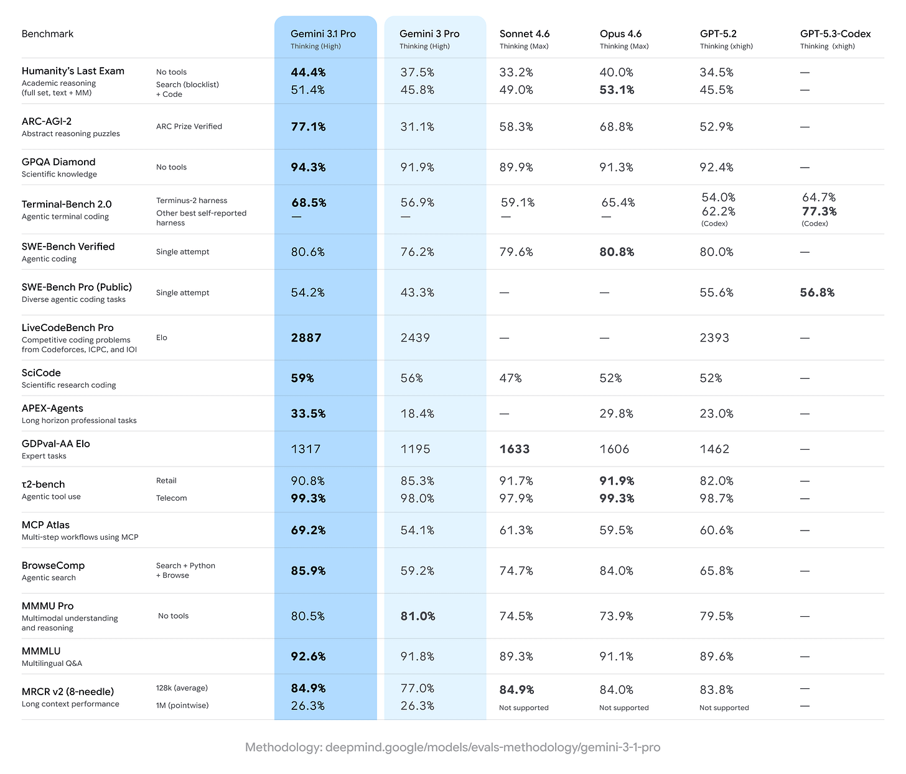
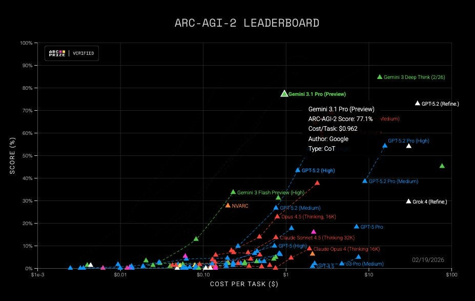
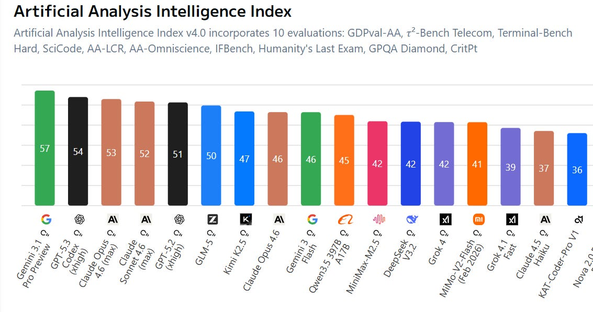
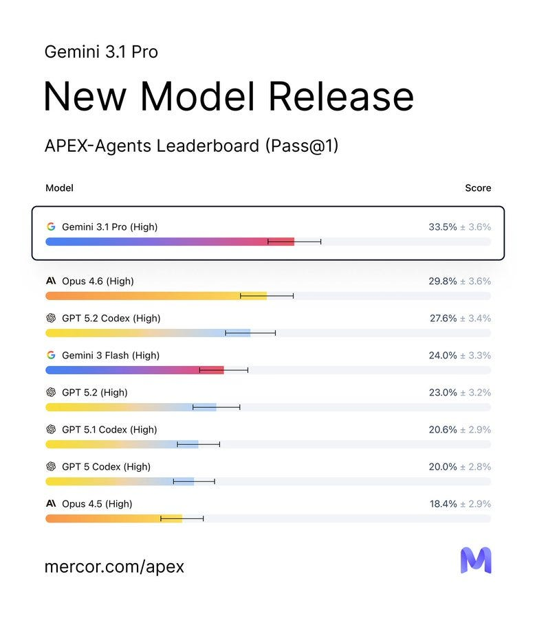
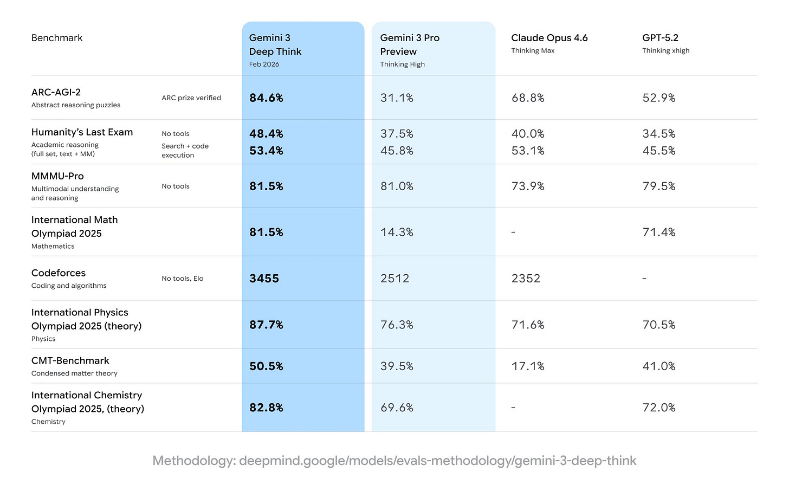

# Gemini 3.1 Pro Aces Benchmarks, I Suppose

[Zvi Mowshowitz](https://substack.com/@thezvi)

Mar 04, 2026

I’ve been trying to find a slot for this one for a while. I am thrilled that today had sufficiently little news that I am comfortable posting this.

Gemini 3.1 scores very well on benchmarks, but most of us had the same reaction after briefly trying it: “It’s a Gemini model.”

And that was that, given our alternatives. But it’s got its charms.

Consider this a nice little, highly skippable break.

#### The Pitch

It’s a good model, sir. [That’s the pitch](https://blog.google/innovation-and-ai/models-and-research/gemini-models/gemini-3-1-pro/).

>

[Sundar Pichai](https://x.com/sundarpichai/status/2024516418855981298) (CEO Google): Gemini 3.1 Pro is here. Hitting 77.1% on ARC-AGI-2, it’s a step forward in core reasoning (more than 2x 3 Pro).

With a more capable baseline, it’s great for super complex tasks like visualizing difficult concepts, synthesizing data into a single view, or bringing creative projects to life.

We’re shipping 3.1 Pro across our consumer and developer products to bring this underlying leap in intelligence to your everyday applications right away.

[Jeff Dean also highlighted ARC-AGI-2](https://x.com/JeffDean/status/2024525132266688757) along with some cool animations, an urban planning sim, some heat transfer analysis and the general benchmarks.

#### On Your Marks

[Google presents a good standard set of benchmarks](https://blog.google/innovation-and-ai/models-and-research/gemini-models/gemini-3-1-pro/), not holding back the ones where Opus 4.6 comes out on top. I tip my cap for the quick turnaround incorporating Sonnet 4.6.

The highlight is ARC.

>

[ARC Prize](https://x.com/arcprize/status/2024522812728496470): Gemini 3.1 Pro on ARC-AGI Semi-Private Eval

@GoogleDeepMind

- ARC-AGI-1: 98%, $0.52/task

- ARC-AGI-2: 77%, $0.96/task

Gemini to push the Pareto Frontier of performance and efficiency

The highlight here is covering up Claude Opus 4.6, which is in the mid-60s for a cost modestly above Gemini 3.1 Pro.

>

Gemini 3.1 Pro overall looks modestly better on these evals than Opus 4.6.

The official announcement doesn’t give us much else. Here’s a model. Good scores.

[The model card](https://storage.googleapis.com/deepmind-media/Model-Cards/Gemini-3-1-Pro-Model-Card.pdf) is thin, but offers modestly more to go on.

>

[Gemini](https://deepmind.google/models/model-cards/gemini-3-1-pro/): Gemini 3.1 Pro is the next iteration in the Gemini 3 series of models, a suite of highly intelligent and adaptive models, capable of helping with real-world complexity, solving problems that require enhanced reasoning and intelligence, creativity, strategic planning and making improvements step-by-step. It is particularly well-suited for applications that require:
-

agentic performance
-

advanced coding
-

long context and/or multimodal understanding
-

algorithmic development

Their mundane safety numbers are a wash versus Gemini 3 Pro.

Their frontier safety framework tests were run, but we don’t get details. All we get is a quick summary that mostly is ‘nothing to see here.’ The model reaches several ‘alert’ thresholds that Gemini 3 Pro already reached, but no new ones. For Machine Learning R&D and Misalignment they report gains versus 3 Pro and some impressive results (without giving us details), but say the model is too inconsistent to qualify.

It’s good to know they did run their tests, and that they offer us at least this brief summary of the results. It’s way better than nothing. I still consider it rather unacceptable, and as setting a very poor precedent. Gemini 3.1 is a true candidate for a frontier model, and they’re giving us quick summaries at best.

#### Other People’s Benchmarks

A few of the benchmarks I typically check don’t seem to have tested 3.1 Pro. Weird. But we still have a solid set to look at.

[Artificial Analysis has Gemini 3.1 Pro in the lead by a full three points](https://artificialanalysis.ai/).

[CAIS AI Dashboard has 3.1 Pro way ahead on text capabilities](https://dashboard.safe.ai/) and overall.

[Gemini 3.1 Pro dominates Voxelbench at 1725](https://x.com/voxelbench/status/2024558946023854437) versus 1531 for GPT-5.2 and 1492 for Claude Opus 4.6.

[LiveBench has it at 79.93, in the lead by 3.6 points over Claude Opus 4.6](https://livebench.ai/#/?highunseenbias=true).

[LiveCodeBench Pro has Gemini dominating](https://livecodebenchpro.com/), but the competition (Opus and Codex) aren’t really there.

[Clay Schubiner has it on top, although not on coding, the edge over 2nd place Claude Opus 4.6 comes from ‘Analytical%’ and ‘Visual%](https://x.com/cschubiner/status/2024652920495440265).’

[Mercor has Gemini 3.1 Pro as the new leader in APEX-Agents](https://x.com/mercor_ai/status/2024555890947629425).

>

[Mercor](https://x.com/mercor_ai/status/2024555893443248417): Gemini 3.1 Pro completes 5 tasks that no model has been able to do before. It also tops the banking and consulting leaderboards - beating out Opus 4.6 and ChatGPT 5.2 Codex, respectively. Gemini 3 Flash still holds the top spot on our APEX Agents law leaderboard with a 0.9% lead. [See the latest APEX-Agents leaderboard](https://mercor.com/apex/apex-agents-leaderboard/).

[Brokk power rankings have Gemini 3.1 Pro in the A tier](https://brokk.ai/power-ranking?version=openround-2025-08-20&models=ds-v3.1%2Cflash-2.5%2Cgp2.5-default%2Cgpt-oss-120b%2Cgpt5%2Cgpt5-mini%2Copus4.1%2Cq3c%2Csonnet4%2Cv3) with GPT-5.2 and Qwen 3.5 27b, behind only Gemini Flash. Opus is in the B tier.

[Gemini 3.1 Pro is at the top of ZeroBench](https://zerobench.github.io/).

[It’s slightly behind on Mercor, with GPT-5.2-xHigh in front](https://www.mercor.com/apex/apex-agents-leaderboard/). Opus is in third.

#### Gemini 3 DeepThink V2

[Gemini 3 Deep Think arrived in the house](https://blog.google/innovation-and-ai/models-and-research/gemini-models/gemini-3-deep-think/?utm_source=tw&utm_medium=social&utm_campaign=og&utm_content=&utm_term=) with a major upgrade to V2 a little bit before Gemini 3.1 Pro.

It turns out to be a runtime configuration of Gemini 3.1 Pro, which explains how the benchmarks were able to make such large jumps.

>

[Google](https://x.com/Google/status/2021982003818823944): Today, we updated Gemini 3 Deep Think to further accelerate modern science, research and engineering.

With 84.6% on ARC-AGI-2 and a new standard on Humanity’s Last Exam, see how this specialized reasoning mode is advancing research & development

[Google](https://x.com/Google/status/2021982006821658661): Gemini 3 Deep Think hits benchmarks that push the frontier of intelligence.

By the numbers:

 48.4% on Humanity’s Last Exam (without tools)

 84.6% on ARC-AGI-2 (verified by ARC Prize Foundation)

 3455 Elo score on Codeforces (competitive programming)

The new Deep Think is now available in the Gemini app for Google AI Ultra subscribers and, for the first time, we’re also making Deep Think available via the Gemini API to select researchers, engineers and enterprises. Express interest in [early access here](https://forms.gle/eEF5natXTQimPhYH9).

Those are some pretty powerful benchmark results. Let’s check out the safety results.

What do you mean, we said at first? There are no safety results?

>

[Nathan Calvin](https://x.com/_NathanCalvin/status/2022108258841112778): Did I miss the Gemini 3 Deep Think system card? Given its dramatic jump in capabilities seems nuts if they just didn’t do one.

There are really bad incentives if companies that do nothing get a free pass while cos that do disclose risks get (appropriate) scrutiny

After they corrected their initial statement, Google’s position is that they don’t technically see the increased capability of V2 as imposing Frontier Safety Framework (FSF) requirements, but that they did indeed run additional safety testing which they will share with us shortly.

I am happy we will got this testing, but I find the attempt to say it is not required, and the delay in sharing it, unacceptable. We need to be praising Anthropic and also OpenAI for doing better, even if they in some ways fell short, and sharply criticizing Google for giving us actual nothing at time of release.

It was interesting to see reacts like this one, when we believed that V2 was based on 3.0 with a runtime configuration with superior scaffolding, rather than on 3.1.

>

[Noam Brown](https://x.com/polynoamial/status/2022818095879065610) (OpenAI): Perhaps a take but I think the criticisms of @GoogleDeepMind ‘s release are missing the point, and the real problem is that AI labs and safety orgs need to adapt to a world where intelligence is a function of inference compute.

… The corollary of this is that capabilities far beyond Gemini 3 Deep Think are already available to anyone willing to scaffold a system together that uses even more inference compute.

… Most Preparedness Frameworks were developed in ~2023 before the era of effective test-time scaling. But today, there is a massive difference on the hardest evals between something like GPT-5.2 Low and GPT-5.2 Extra High.

… In my opinion, the proper solution is to account for inference compute when measuring model capabilities. E.g., if one were to spend $1,000 on inference with a really good scaffold, what performance could be expected on a benchmark? ARC-AGI has already adopted this mindset but few other benchmarks have.

… If that were the norm, then indeed releasing Deep Think probably would not result in a meaningful safety change compared to Gemini 3 Pro, other than making good scaffolds more easily available to casual users.

The jump in some benchmarks for DeepThink V2 is very large, so it makes more sense in retrospect it is based on 3.1.

When I thought the difference was only the scaffold, I wrote:
-

If the scaffold Google is using is not appreciably superior to what one could already do, then it was necessary to test Gemini 3 Pro against this type of scaffold when it was first made available, and it is also necessary to test Claude or ChatGPT this way.
-

If the scaffold Google is using is appreciably superior, it needs its own tests.
-

I’d also say yes, a large part of the cost of scaling up inference is figuring out how to do it. If you make it only cost $1,000 to spend $1,000 on a query, that’s a substantial jump in de facto capabilities available to a malicious actor, or easily available to the model itself, and so on.
-

Like it or not, our safety cases are based largely on throwing up Swiss cheese style barriers and using security through obscurity.

That seems right for a scaffold-only upgrade with improvements of this magnitude.

The V2 results look impressive, but most of the gains were (I think?) captured by 3.1 Pro without invoking V2. It’s hard to tell because they show different benchmarks for V2 versus 3.1. The frontier safety reports say that once you take the added cost of V2 into account, it doesn’t look more dangerous than the 3.1 baseline.

That suggests that V2 is only the right move when you need its ‘particular set of skills,’ and for most queries it won’t help you much.

#### Positive Feedback

It does seem good at visual presentation, which the official pitches emphasized.

>

[Junior García](https://x.com/jrgarciadev/status/2025195992526500050): Gemini 3.1 Pro is insanely good at animating svgs

[internetperson](https://x.com/internetope/status/2025381771408191754): i liked its personality from the few test messages i sent. If its on par with 4.6/5.3, I might switch over to gemini just because I don't like the personality of opus 4.6

it's becoming hard to easily distinguish the capabilties of gpt/claude/gemini

This is at least reporting improvement.

>

[Eleanor Berger](https://x.com/intellectronica/status/2025222484036141378): Finally capacity improved and I got a chance to do some coding with Gemini 3.1 pro.

- Definitely very smart.

- More agentic and better at tool calling than previous Gemini models.

- Weird taste in coding. Maybe something I'll get used to. Maybe just not competitive yet for code.

[Aldo Cortesi](https://x.com/cortesi/status/2025052783943238010): I've now spent 5 hours working with Gemini 3.1 through Gemini CLI. Tool calling is better but not great, prompt adherence is better but not great, and it's strictly worse than either Claude or Codex for both planning and implementation tasks.

I have not played carefully with the AI studio version. I guess another way to do this is just direct API access and a different coding harness, but I think the pricing models of all the top providers strongly steer us to evaluating subscription access.

[Eyal Rozenman](https://x.com/eyalroz/status/2025157590267634121): It is still possible to use them in an "oracle" mode (as Peter Steinberger did in the past), but I never did that.

[Medo42](https://x.com/Medo42/status/2025578042991460852): In my usual quick non-agentic tests it feels like a slight overall improvement over 3.0 Pro. One problem in the coding task, but 100% after giving a chance to correct. As great at handwriting OCR as 3.0. Best scrabble board transcript yet, only two misplaced tiles.

Ask no questions, there’s coding to do.

>

[Dominik Lukes](https://x.com/techczech/status/2025001570883027102): Powerful on one shot. Too wilful and headlong to trust as a main driver on core agentic workflows.

That said, I've been using even Gemini 3 Flash on many small projects in Antigravity and Gemini CLI just fine. Just a bit hesitant to unleash it on a big code base and trust it won't make changes behind my back.

Having said that, the one shot reasoning on some tasks is something else. If you want a complex SVG of abstract geometric shapes and are willing to wait 6 minutes for it, Gemini 3.1 Pro is your model.

[Ben Schulz](https://x.com/schulzb589/status/2025328909747720444): A lot of the same issues as 3.0 pro. It would just start coding rather than ask for context. I use the app version. It is quite good at brainstorming, but can't quite hang with Claude and Chatgpt in terms of theoretical physics knowledge. Lots of weird caveats in String theory and QFT or QCD.

 Good coding, though. Finds my pipeline bugs quickly.

[typebulb](https://x.com/typebulbit/status/2025339367263261118): Gemini 3.1 is smart, quickly solving a problem that even Opus 4.6 struggled with. Also king of SVG. But then it screwed up code diffs, didn't follow instructions, made bad contextual assumptions... Like a genius who struggles with office work.

Also, their CLI is flaky as fuck.

Similar reports here for noncoding tasks. A vast intelligence with not much else.

>

[Petr Baudis](https://x.com/xpasky/status/2024984381966745716): Gemini-3.1-pro may be a super smart model for single-shot chat responses, but it still has all the usual quirks that make it hard to use in prod - slop language, empty responses, then 10k "\nDone." tokens, then random existential dread responses.

Google *still* can't get their post-train formal rubrics right, it's mind-boggling and sad - I'd love to *use* the highest IQ model out there (+ cheaper than Sonnet!).

[Leo Abstract](https://x.com/Leo_Abstract/status/2024989148613120361): not noticeably smarter but better able to handle large texts. not sure what's going on under the hood for that improvement, though.

I never know whether to be impressed by UI generation. What, like it’s hard?

>

[Leon Lin](https://x.com/LexnLin/status/2024589077685629100): gemini pro 3.1 ui gen is really cracked

just one shotted this

#### Negative Feedback

The most basic negative feedback is [when Miles Brundage cancels Google AI Ultra](https://x.com/Miles_Brundage/status/2025054503951810826). I do have Ultra, but I would definitely not have it if I wasn’t writing about AI full time, I almost never use it.

One form of negative feedback is no feedback at all, or saying it isn’t ready yet, either the model not ready or the rollout being botched.

>

[Dusto](https://x.com/DustoAiProjects/status/2025467111993475103): It's just the lowest priority of the 3 models sadly. Haven't had time to try it out properly. Still working with Opus-4.6 and Codex-5.3, unless it's a huge improvement on agentic tasks there's just no motivation to bump it up the queue. Past experiences haven't been great

[Kromem](https://x.com/kromem2dot0/status/2025342256811835828): I'd expected given how base-y 3 was that we'd see more cohesion with future post-training and that does seem to be the case.

I think they'll be really interesting in another 2 generations or so of recursive post-training.

[Eleanor Berger](https://x.com/intellectronica/status/2025325390810476779): Google really messed up the roll-out so other than one-shotting in the app, most people didn't have a chance to do more serious work with it yet (I first managed to complete an agentic session without constantly running into API errors and rate limits earlier today).

Or the perennial favorite, the meh.

>

[Piotr Zaborszczyk](https://x.com/CloseTwitlerNow/status/2025376626519773542): I don't really see any change from Gemini 3 Pro. Maybe I didn't ask hard enough questions, though.

Lyria is cool, though. And fast.

[Chong-U is underwhelmed by a test simulation of the solar system](https://x.com/chongdashu/status/2024535080643760621).

[Andres Rosa](https://x.com/TheAndresRosa/status/2025043112481943635): Inobedient and shameless, like its forebear.

#### Try Gemini Lite

[Gemini 3.1 Flash-Lite](https://x.com/joshwoodward/status/2028900917786100102) is not also available.

They’re claiming can outperform Gemini 2.5 Flash on many tasks.

My Chrome extension uses Flash-Lite, actually, for pure speed, so this might end up being the one I use the most. I probably won’t notice much difference for my purposes, since I ask for very basic things.

And that’s basically a wrap. Gemini 3.1 Pro exists. Occasionally maybe use it?