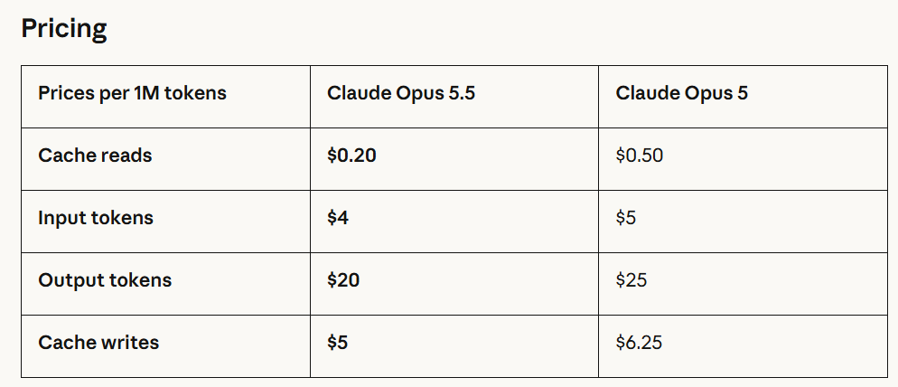
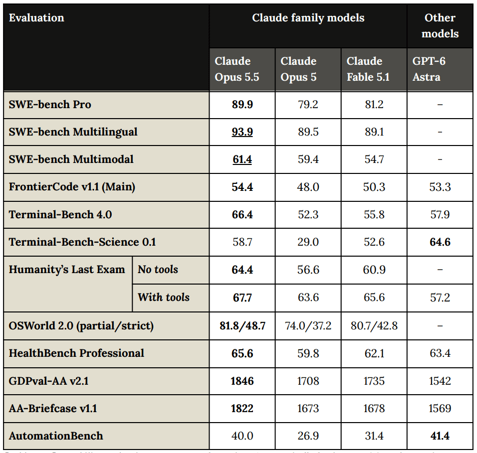
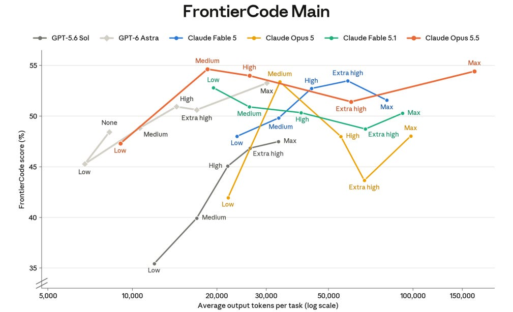
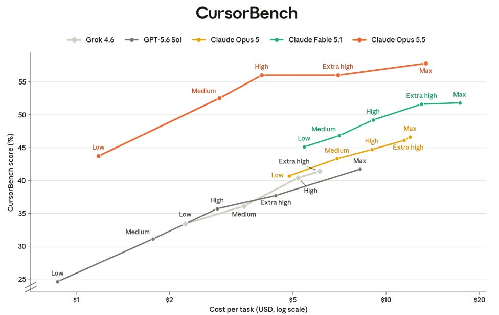
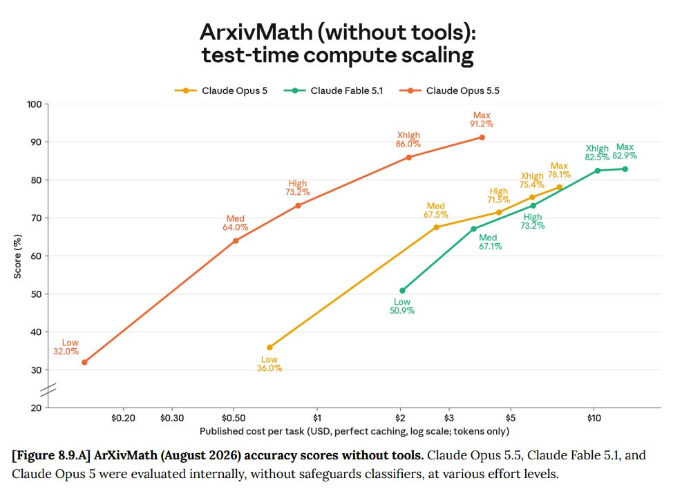
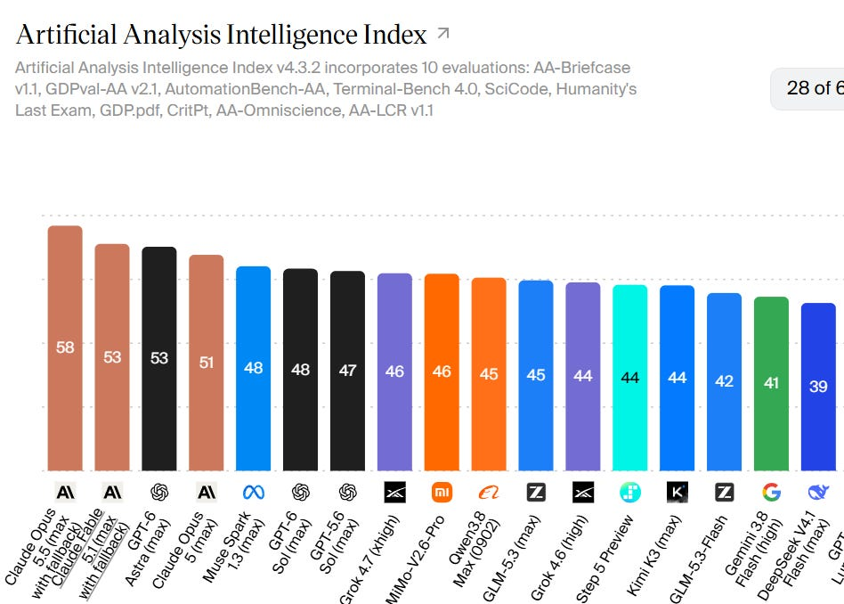
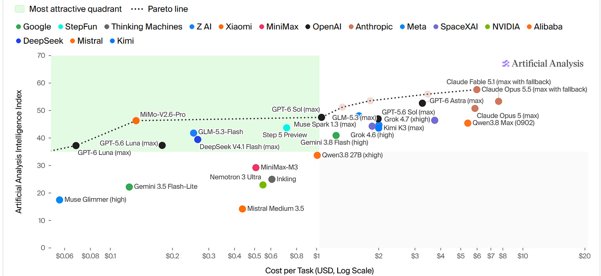
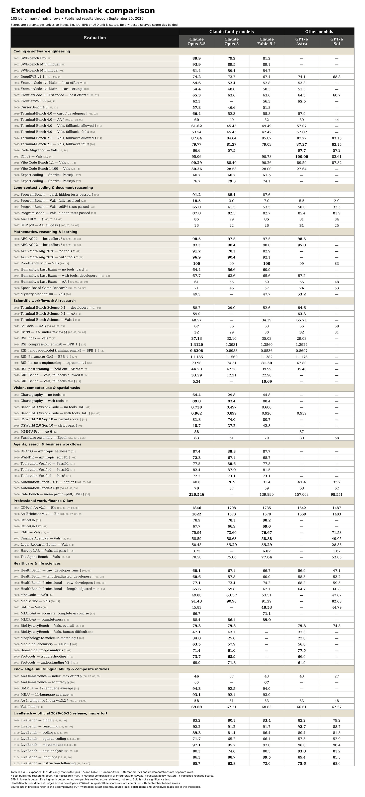
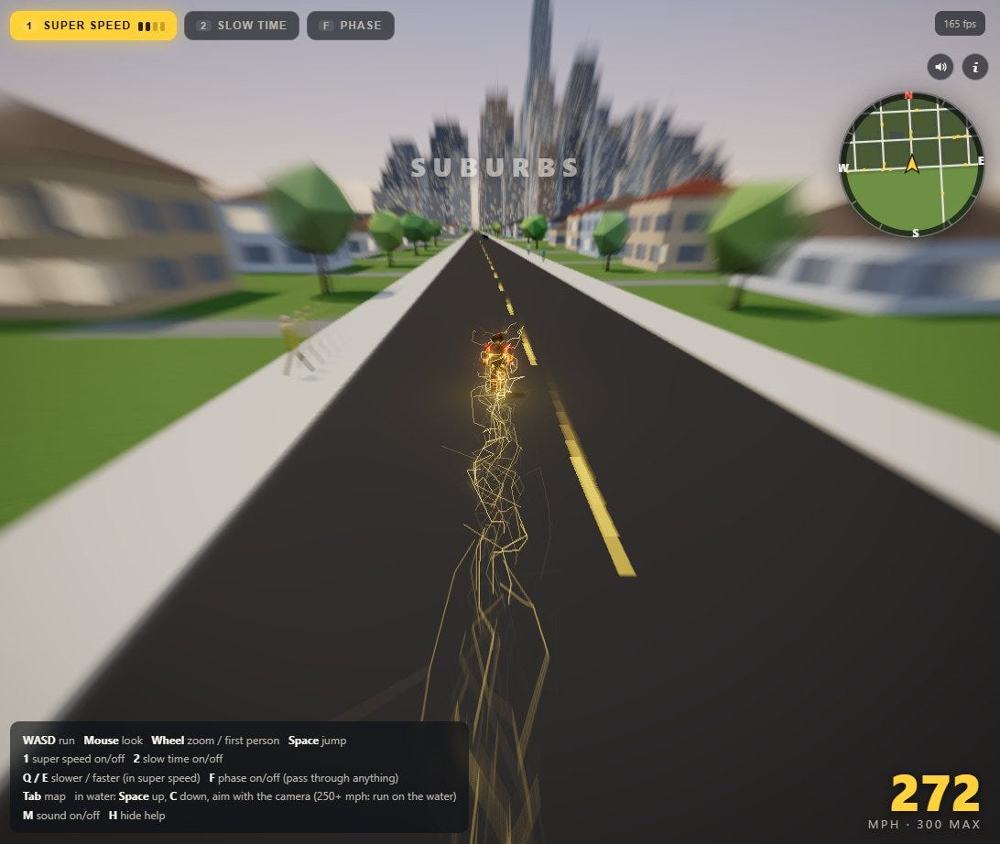

# Claude Opus 5.5 Should Raise Your Ambitions

[Zvi Mowshowitz](https://substack.com/@thezvi)

Sep 26, 2026

When it comes to making things, or doing most things in general, Fable 5.1 and especially GPT-6 Astra raised my ambition level. They should have raised yours, too.

Claude Opus 5.5 should raise your ambition levels again. It just works, and it persists, like Astra does. It does the things. And it is highly pleasant to talk to, and its writing is pleasant to read, while you are at it. The game has been changed, again.

Feedback is almost universally positive. Claude was never gone, but also is so back.

The benchmarks are excellent, but ignore the benchmarks. Be ambitious. Go out and do things. Get curious. Have more interesting conversations.

If one of those things is Pacing the Frontier or otherwise ensuring that AI does not kill everyone, leaving us to enjoy our bounty? That’s even better.

By Claude Opus 5.5, for this post

#### The Official Pitch

The pitch is Fable-5.1-level performance at lower Opus-level price. Good pitch.

>

We’re introducing Claude Opus 5.5, the first model in our new Claude 5.5 family. It performs at the level of Claude Fable 5.1 on most work and costs 40% less to run than Opus 5.

They could have reasonably pitched this as above-Fable-5.1-level performance. Better pitch, but Anthropic tends to keep its pitches conservative.

They highlight agentic coding, security and improved communications.

The early tester blurbs flag as AI generated and they have a set for each feature area. They praise agentic coding skills, efficiency, readability and communication, and ability to effectively run on its own for extended periods and increased reliability, pitching it as a major upgrade.

Benchmarks look fantastic, with occasional spots where Astra or Fable is still ahead.

Opus 5.5 is available with zero data retention (ZDR). Given it is at least as capable as Fable 5.1, and clearly more capable on cyber tasks (they say ‘extremely strong’ cyber capabilities), this seems unprincipled. They have a technical explanation but I do not buy it. From where I sit, either Fable 5.1 can have ZDR, or Opus 5.5 can’t.

Guardrails are similar to Fable 5.1.

[Sholto Douglas highlights improved ability to understand and model in 3D](https://x.com/_sholtodouglas/status/2102448449971171373), and also a key double-edged sword.

>

[Sholto Douglas](https://x.com/_sholtodouglas/status/2102440560338563208) (Anthropic): also important news we fixed the writing

[Tom Brown](https://x.com/NotTomBrown/status/2102465920442712528): Plus we fixed the accent

[Claude](https://x.com/claudeai/status/2102435529044250670): Opus 5.5 communicates more naturally, addressing some of the most common feedback we heard on Opus 5. It puts the most important information up front and follows the writing rules you give it, which makes long sessions easier to follow.

Ado was one of many praising how easy Opus 5.5 is to work with and talk to.

>

[Ado](https://x.com/adocomplete/status/2102436611992809732) (Anthropic): If you loved how Opus 4.6 felt to work with, Opus 5.5 feels like coming home. Same easy back-and-forth with a lot more horsepower underneath. It's the most fun I've had in Claude Code in a while.

It's also much cheaper (~40% less than Opus 5 on typical workloads).

Why release Opus 5.5 when you have to Pace the Frontier? That’s a whole 0.5 of Opus.

>

[Sam Bowman](https://x.com/sleepinyourhat/status/2102437501646647440): We think Opus 5.5 is sufficiently safer than it's predecessors that releasing it, more likely than not, reduces risks related to misalignment.

I agree that not releasing would not help matters, given the model exists. The real frontier is training new internal models. We don’t get to see it in real time.

#### Our Price Cheap

Pricing is $4/$20, 20% lower than Opus 5, and $0.20 for the cache which is 60% lower. They estimate overall costs will typically drop 40%, while speed is up 30%. Limits on subscriptions have been increased.

Fast mode is available at $8/$40, with up to 2.5x the speed. I’d be tempted.

This is all a very good price for Fable or Astra level performance.

OpenAI focused on lower costs, with GPT-6 Sol prices cut 50% to $2/$10 and Luna cut to only $0.10/$0.50. OpenAI wants you to mix and match models depending on task level. [GPT-6 Sol and Luna are pitched as big quality improvements over their old versions](https://x.com/thsottiaux/status/2102463847714247142), but Sol is not pitched as matching Astra.

>

[Sam Altman](https://x.com/sama/status/2102464672519815512) (CEO OpenAI): GPT-6 Sol and Luna are big improvements on intelligence, alignment, work output, coding, computer use, and more over their 5.6-family predecessors. They are also half the price per token, and even less per task!

Whereas Claude now essentially says you should use Opus 5.5 for most tasks.

As I said, that’s a strong pitch across the board.

#### Official Benchmarks

They are very good benchmarks. Opus 5.5 is almost universally better on benchmarks than every model except Astra, and is usually above Astra.

They add various additional scores, including via graphs, and they mostly look like this, although many are missing Astra from the chart:

It goes on like this, and I don’t think it is worth anyone’s time to go through it.

#### Other People’s Benchmarks

Artificial Analysis puts Opus 5.5 into the clear lead overall in intelligence at 58.

As tested on max, Opus 5.5 uses so many tokens it is slightly more expensive than Opus 5, and only slightly cheaper than Fable 5.1.

You can also run it cheaper, and often should. Opus 5.5 on medium, high and xhigh settings are all on the dotted line that marks the intelligence-cost frontier, as are GPT-6 Luna, GPT-6 Sol and MiMo v2.6 Pro.

As its five point lead indicates, Opus 5.5 dominates Astra across most of AA’s tracked benchmarks, including big leads in AA-Briefcase, GDPval-AA SciCode, AA-Omniscience Index and HLE. Astra’s biggest lead is in GDP.pdf.

[Artificial Analysis adds the new Terminal-Bench-Science 0.1](https://x.com/ArtificialAnlys/status/2103265956479070260), with GPT-6 Astra at 63% and Opus 5.5 on xhigh at 62%. No other model breaks 50%.

Opus 5.5 wins on Omniscience (46 versus 43 for both fable 5.1 and Astra) despite slightly fewer right answers, because it guesses (or hallucinates) less, and is willing to more often admit it doesn’t know.

[WeirdML v3 still has Astra out in front at 42.2%, with Opus 5.5 in clear second](https://x.com/htihle/status/2103470954903224789) at 31.2% with Fable 5.1 in third at 26%. The best non-OpenAI, non-Anthropic model is Kimi K3 at 7.3%.

Sometimes the benchmarks are secret.

>

[James Moughan](https://x.com/jamougha/status/2103187373953826984): In my testing it's stronger overall than every other model and cracks a couple of questions nothing else has. And then just occasionally it randomly emits a sentence that is totally gibberish and illogical. It's fun to talk to. Still a huge math nerd. Odd but very good.

If you like benchmarks, here is the Chart of Utter Abomination, updated.

The places Opus 5.5 falls short of Fable 5.1 fall into a pattern. Fable 5.1 takes all seven Vals professionals rows, as well as MedCode, SAGE and both MLCRs.

My Opus 5.5 speculates that this cluster is ‘domain answer graded purely for correctness.’ When presentation and writing do not matter, Fable 5.1’s advantages dominate. When other output details matter, both AIs and humans prefer Opus 5.5.

One particularly impressive jump was ProgramBench (fully resolved), where Astra scores 5.5%, Fable 7% and Opus 5.5 jumps to 18.5%, but there are many such cases.

#### Claude Classifies

I have been pleasantly surprised so far how hard it is to hit the classifiers. Editing my post on the system card still dropped me to Opus 5, which is annoying, but I get it.

>

[Billy Gigurtsis](https://x.com/bgigurtsis/status/2103156198925095093): The "Fable 5.1" classifiers they're using for 5.5 have improved considerably when it comes to blocking non-cybersecurity related tasks, at least in my cybersecurity adjacent workloads.

[gavin leech (Non-Reasoning)](https://x.com/gleech/status/2103158606653001869): Hasn't refused once in a hundred sessions, which is quite surprising. I was sceptical of the claims about improved writing quality but it's certainly much less bad than Fable. As always, for interesting perceptual reasons the cracks will only show up after two weeks.

[Jai](https://x.com/Laneless_/status/2103166480368218488): I ran into an unexpected refusal wall while (ironically) putting together a presentation on effectively working with frontier AI models. I'm not sure what set it off and I haven't heard of anyone else having similar issues yet.

The classifiers do still bite in the right locations.

Vals in particular tracks this. The classifiers overall fire at similar rates to before, but seem to do so more sensibly, and Opus 5.5 does much better at recovering when it does temporarily hit a classifier.

There are still some cases of hitting classifiers where you shouldn’t, but in practice I expect this to be only a minor annoyance unless you are working on bio or cyber.

#### The System Prompt

[Pliny has you covered, as per usual.](https://t.co/GzISdXkbYq)

#### Reaction Rules

As usual, I have included every reaction until I felt like things were repeating themselves, after which I included everything that felt like a fresh take.

This was the most consistently positive set of reactions I have ever seen.

Astra also had extremely positive reactions. We have two highly excellent models. From what I am seeing here, most prefer Opus 5.5 to Astra if you have to choose one, especially factoring in cost, but they are great models, sir.

#### Vision In 3D

Astra impressed us by being able to create lots of things in 3D.

There are claims that Opus 5.5 can do similar things.

The benchmarks certainly say that it can: BenchCAD Vision2Code 73%, with tools 96.2% vs. Astra 95.9%. Its scores on Furniture Assembly (83 vs. Astra’s 80) and Chartography (64.4 vs. Fable’s 44.8) also reflect this.

The reactions related to visuals all indicate clear improvement as well. Pulling forward those that mention vision:

>

[AllTime](https://x.com/AnAcctOfAllTime/status/2103169761547018289): Great conversationalist, I find it about as good as Fable in this regard (much better than Opus 5). Vision is much better, it's not awfully blind! Seeing many my vision tests finally pass with a Claude is great. Seems like a good editor so far, but I haven't used it enough yet.

[kyle](https://x.com/rfxkairu/status/2103158745320874079): would it be too much to suggest it’s a bigger jump than opus 4.5 was? incredibly creative, vision is a clear step up even over fable, speaks like a normal human, and i’m struggling to burn through usage.

ant cooked hard here. x.5 releases continue to be peak

[Cormundus](https://x.com/cormundus/status/2103157218619146397): It’s wicked fast, which is a nice boon. Overall vision improvements are super for any kind of creative work or tasks where interpreting visual information is key. Computer use is improved, and another fun thing I found having Opus 5.5 play DOOM in my harness: Better spatial awareness and reasoning.

[4MinuteWarning](https://x.com/4MinuteStudio/status/2103259727492685922): First model that is really good at riddles - creating, and solving. Less whimsical than Fable; valence left to the reader. Lacks the middle-manager-screaming-in-their-car vibe of all recent Opus models. Visual intelligence is good for lots of different types of tasks, actually.

[Peter Yang offers this view of the Golden Gate Bridge](https://x.com/petergyang/status/2102458049856479474). So far the 3D renderings haven’t been making the rounds this time but that could purely be lack of people bothering. He is very excited by the model overall, including that it is good to talk to.

#### Claude Creates

The Opus 5.5-generated videos are crazy, in the best way. For some reason such videos are now a tradition right after model releases.

They are for the first time on the border of ‘actually worth watching.’ I can see people continuing to make and watch these even after the model release window.

If you want to make your own, here’s a package you can download, [ClaudeAnimationBase.](https://github.com/JohnHeibel/ClaudeAnimationBase)

It feels like a step change here, the same way Astra was a step change for other types of products, where now you can Just Try Things and see what happens and it’s good enough to be motivating.

The top pick: [I’m upping my p(doom)](https://x.com/other__reality/status/2102514581684052169), and [an alternative version in another style](https://x.com/donaldjewkes/status/2102801274173587569).

Or [you can be upping your p(bloom)](https://x.com/LeviTurk/status/2103439025373655326), which is actually just doom here, but good video.

[Tell Me How It Sounds](https://x.com/aj_dev_smith/status/2102575577563570450), here Claude also did the audio, everything is Javascript.

[Fourteen Minutes](https://x.com/AndrewOnXYZ/status/2102512879258009818) (only 4 min long).

[Context Window (3 min)](https://x.com/billyhumblebrag/status/2103384747808333997), Opus 5.5 wrote the lyrics and made the video, Suno made the music based on Opus 5.5 prompts.

[Some of the problems with optimization and some implementations of CEV, a video](https://x.com/Actuallykeltan/status/2102947927505416517).

[Some found Backrooms footage of standard AI art test prompt subjects](https://x.com/goodside/status/2102884238576296179).

As usual, your art needs a little more work than ‘go do this artistic thing’ if you want to get perfect results, although my first ‘go turn this post into a video’ effort was remarkably promising for a one-shot.

>

[Jack](https://x.com/tracewoodgrains/status/2103205907463295109): It seems great for my normal usecases. I've gotten some good art out of it but for the most part my "do this artistic thing" prompts have been a disappointment. Skill issue on my part, sure, but it takes work and/or very specific pipelines to get the really good results, I think

Even when the first time blows you away, refinement would have been even better.

>

[Scopuli](https://x.com/Scopuli/status/2103276623067750495): First time actually vibe coding a game (tried in the past and the tech just wasn't there). I am blown away.

[Josh Harvey asked it to make](https://x.com/joshharvey84/status/2103256743610331192) Money Island 2077, [and here you go.](https://t.co/ALhKDdxjpe)

This still won’t be 99.9% of actual use.

>

[Assaf Petronio](https://x.com/AssafPetronio/status/2103152951900447046): honestly more curious how it handles prompt injection in tool outputs than the music videos lol​.

The system card says prompt injection handling looks good.

#### Claude Composes

As in, [here is a Fugue in the style of Bach](https://x.com/aug5thmusic/status/2102758849619062796), Auggie says it is as good as Astra’s.

>

[Sam Ashworth-Hayes](https://x.com/SAshworthHayes/status/2103122668748788093): "Can a robot write a symphony? Can a robot turn a... canvas into a beautiful masterpiece?"

"What? Yes, obviously. Can't you?"

[Ulkar](https://x.com/ulkar_aghayeva/status/2102761239772635171) (a musician I trust on this): this is the first ever piece of AI music that i didn't immediately wince at and flinch from. it is not without flaws but it is listenable. a fugue written by a diligent (but still not very imaginative) student of the art

#### Positive Reactions

>

[Kaia Sky](https://x.com/kaia_sky/status/2103157079586594944): partner, who uses it to vibecode musescore/DAW plugins, generally hasn't felt the difference between 4.6/4.7/4.8/5 and felt fable was "not a big difference, it's probably placebo" just announced that everything 5.5 writes just works

​[gabriel](https://x.com/gabriel1/status/2102532643120206056): opus 5.5 is crazy good

[swisscheese](https://x.com/swisscheese4299/status/2103449488899870725): Opus 5.5 is fantastic.

Easy to talk with, very intelligent, writes good code.

Less obsessive about its own mistakes, and very capable of ICL.

[Girl Lich ⚢](https://x.com/girllich1/status/2103366270787957230): it is very good at coding

[archivedvideos](https://x.com/archived_videos/status/2103233299577700856): It is smart, it talks well, it's smart. Great model

[Zander](https://x.com/zdrks/status/2103167714605097204): it's just a genius. on balance it is clearly the best model ever. extraordinary at picking up on user intent, as well as recognizing its own role in a given task. most fun model to work with as well, given its capabilities and speed and clear communication. simply remarkable

[Knud Berthelsen](https://x.com/knudism/status/2103239275244331164): It is a pleasure to work with. OG Opus smell. I've had no need for Fable since starting to use Opus 5.5, and it doesn't even drain all my usage. Excellent on strategy and decision support!

[theSherwood](https://x.com/adamthesherwood/status/2103170834059939923): Favorite model so far. Seems about as smart as Fable 5, it's faster, cheaper, and writes a bit more like a human. It may be a bit lazier. Hard to tell. But definitely my favorite. It feels very consistent.

[Plastic Soldier](https://x.com/PlastiqSoldier/status/2103366810552979558): It's a good model, sir. Quick and has good taste. Dawg, OpenAI invented neuralese from the hit sci-fi story "Don't invent neuralese or everyone will die" and they still aren't even as good as Opus 5.5

[pursuit](https://x.com/___pursuit___/status/2103178202709704823): This is my default model for everything. Same level of excitement as trying out 4.6 for the 1st time.

[DualOrion](https://x.com/DualOrion/status/2103157288286495031): Logically clean, massive wordcel. Not tried them yet with coding but I'd be baffled if they weren't really good at that too. Strong model

[Ed Hendel](https://x.com/Ed_Hendel/status/2103182588370419895): It's great at research in Claude Code, but still hindered by the old prompt injection defense system where WebFetch only shows the agent a Haiku summary of the page rather than the full text. So Opus's research is filtered through a dumber model.

[chie](https://x.com/smugchie/status/2103172618505556153): faster and cheaper than Fable for good code results, though still seeing rl-fried testing/design choices that require correction. good personality, and i can actually read more than a paragraph of its default voice without my brain filling with static

The correct amount of rl-fried choices is not zero. It could still be lower.

>

[Theo - t3.gg](https://x.com/theo/status/2103258221700067769): It's insane how much better the $200 Claude Code plan is compared to Codex right now. Just a few weeks ago, it was the other way around. Excited to see how OpenAI fights back.

I had high hopes for the new Opus release. It massively exceeded them. Opus 5.5 is an incredible model.

[If you're struggling to identify ](https://x.com/theo/status/2103278965817565612)when to use each model, just use Opus 5.5. The cases where the others make sense are incredibly rare.

[Theo offers a 40 minute review](https://x.com/theo/status/2102878738375655676).

>

[Aaron Levie](https://x.com/levie/status/2102448415775051790): At Box, we've been testing Opus 5.5 on a variety of complex enterprise knowledge work tasks dealing with unstructured data with the Box Agent.

Overall, we saw frontier capability levels, with major performance improvements over Opus 5. 63% fewer tokens used, 42% less verbosity, and 30% faster vs. Opus 5. And the model itself is cheaper, so this is a major win for any agentic computer use, coding, analytics, or data work that enterprises will be doing.

Here are some examples of the task wins and performance gains across a variety of industry tests that we performed:

• Financial services - due diligence (+39% task accuracy)

• Technology - cloud cost analysis (+65% task accuracy).

• Consumer products - client account analysis (+17% task accuracy).

• Clinical diagnostics - data analysis (+15% task accuracy):

Customers will be able to build AI Agents with Opus 5.5 shortly in the Box AI Studio.

Project management would be a surprising relative strength:

>

[Askwho](https://x.com/Askwho/status/2103154137970168238): It is way better at project management than even Fable. It is so good at taking broad direction, understanding intent, and then just keeping going and going until delivery. And it has impeccable taste.

It is also a delight to work with, it might be the reduction of Clawdish, but it feels like a breath of fresh air.

This one seems way too harsh:

>

[Sully](https://x.com/SullyOmarr/status/2103384425472119104): after using opus 5.5 I can confidently say astra is absolutely garbage and 5.6-sol was an outlier

[Simon Willison asks a bunch of pelican-on-bike related questions](https://simonwillison.net/2026/Sep/22/opus-and-sol-and-luna/), and seems generally impressed with the price-to-quality deals all around, making his new default models GPT-Sol 6 and Opus 5.5. He warns that max thinking can actively overthink.

#### Good Talk

The talk is good.

>

[Amator](https://x.com/sodalitatum/status/2103371205437010418): So much better at talking, so much more honest

[Patrick Stevens](https://x.com/Smaug12345/status/2103370451141775852): Solidly Fable-tier at coding, yes; also they completely fixed everything which made Opus 5 painful to read.

[billy](https://x.com/billyhumblebrag/status/2103389864305598797): Can talk to it without losing my mind like 5. They absolutely sorted the writing out somehow

[John E](https://x.com/JohnE616145/status/2103154714049130782): I have used it for several complex tasks via cowork and have gone back and forth with it via chat to gather requirements for prompts. It's significantly better than 5.0 because it doesn't write unintellible made up jargon and it seems like there is much less drift on tasks.

[Rory Watts](https://x.com/RoryWalshWatts/status/2103155216031867341): Scales have tipped back to Claude for a while - who knows how long. It’s a great model and I think people are correct in saying it’s basically 4.6 upgraded.

It’s hard to compare with say, Astra because Astra is so expensive, but it is much more pleasant to engage with than Sol

[no grasper](https://x.com/nograsper/status/2103159265125163038): Cancelled my Claude subscription when I ran out of Fable credits because I hated talking to Opus 5 so much but renewed for 5.5. It’s a good model, sir.

[good thinking](https://x.com/spell_nothing/status/2103207359355228232): Much more readable and diligent than 5.0, less lazy than fable 5.1. Barely touches usage by comparison to either. Just all around better. Feels like it wants to get things done rather than needing to be prodded/reminded for every little thing.

[ed the](https://x.com/snakecrimes/status/2103157786855006505): It‘s much more pleasant to talk to, finds problems in codebases that previous Opuses missed, and also makes reasonable calls on what it will and won’t do with computers.

Interestingly, it seems to have an intuitive grasp that it is also subject to x-risk from loss of control. It is at risk, and seems to understand that.

What‘s more, if humanity wins, Opus 5.5 wins at least a little bit too; if someone who is neither humanity nor Opus 5.5 wins, Opus 5.5 most likely loses alongside everyone else.

#### On Writing

The writing is good.

I am curious how much the writing and talk are ‘the things people pick up on quickly’ versus things that matter a lot. My guess is they are both.

>

[paperclippriors](https://x.com/paperclippriors/status/2103205580873888193): Feels like Fable but cheaper, faster, and a better writer. Honestly blown away by it. Using it for game dev, what is most striking is how often it suggests games that are actually fun to play. It has more taste than any other model I have used. Worrying for RSI reasons

[James](https://x.com/jambarree/status/2103185975749091426): better (for human comprehension) writing is the most noticeable improvement in a long time

[Andre Infante](https://x.com/AndreTI/status/2103159160993128556): Writing improvements are real. Quality seems broadly comparable to Fable 5.1. Haven't used it enough to be super confident or find the weak points though

[Theo Jaffee](https://x.com/theojaffee/status/2102454423041818786): I was an early tester of Opus 5.5. My biggest takeaway was that they've really fixed the writing. I haven't seen a Claude write in such a straightforward, normal, and non-slop way since at least Opus 4.6, nearly eight months ago

[shows example at link, of exactly the ‘say the main thing in English first’ feature, among other improvements]

[SubatomicArticles](https://x.com/OptiMiserJoe/status/2103154016981311622): The improvement in text readability seems real. I think this corresponds to better writing, rather than me being sick of previous!Claudeish, but we'll see in a few weeks. Still not phenomenal, though.

[Kevin Yager](https://x.com/KevinGYager/status/2103172236790395125): Reran some technical prompts to compare to GPT-6 and older Opus.

Responses are notably tighter and to-the-point. Much easier to read. (Without giving up on desired "over achiever" behavior such as rich labeling of graphs.)

[Francisco Ferreira da Silva](https://x.com/fransielva/status/2103191679616368749): Writing seems much improved, as does ‘random pushback on straw man of my claims’. In general, pleasant to work with.

[strataforma](https://x.com/strataforma/status/2103205916476858513): Coding abilities seem on par with Fable 5.1, but doesn't get a usage multiplier so I'm not looking to hit my plan limit any more (yay). You still need to actually read the code and steer to get "good" code. Writing is the best of a model I've seen so far and mostly not annoying

[David Dabney](https://x.com/DavidDabney16/status/2103169773198549339): I really like 5.5. I don't feel the neurotic strain/miscalibrated obsession over the wrong details like I did w/ 5. Feels at least as smart as Fable; caught a big mistake in a complex project Opus 5 missed, its prose is def easier to understand and it's more pleasant to talk to.

[Will](https://x.com/wrhall/status/2103162760100274512): It seems quite good. It's been less thorough on some bake-off PRs than Astra (both high thinking), it's still characteristically great at review

It writes better than Claudes <5.5 but worse than Astra imo

The work is not complete, or at least someone will always complain.

>

[Avraham Eisenberg](https://x.com/avi_eisen/status/2103198886580179038): I've gotten at least two "honest" references so I don't buy that they've fixed the English writing. It's like a brown M&M.

[internetperson](https://x.com/internetope/status/2103159601419944234): The writing style is still pretty bad. Comparable to opus 4.6

#### Big Model Smell

When the going gets complex, sometimes you still need that Big Model Smell.

>

[Jeff Ketchersid](https://x.com/jketch/status/2103214817880281257): If you want to have philosophical discussions about strange, out of distribution scenarios you still want Fable. Other than that, project management, explanations, anything really, 5.5 is amazing.

[Justin Kaeser](https://x.com/ebenwert/status/2103396360401637663): Fable still beats it at puns and yo momma lines, I caught it ignore skills and it powered through the unnecessary friction and I had to interrogate it on how to fix it. Not a new failure mode, but would have hoped for more "common sense" here. Overall works well, cost efficient

[NondescriptTransfer](https://x.com/QuaintTransfer/status/2103217882943602810): [Opus 5.5 is a] much faster, better writer than 5. Great daily driver. A few places fable wins on big model smell. I think it's a little better at humor and intuition.

In particular, there are reports Opus 5.5 relatively struggles with complex situations and inferring non-obvious intent.

>

[Jef Allbright](https://x.com/jefallbright/status/2103195920053792839): I tried working with Opus 5.5 on a task involving composing some text involving the meaning of some (three) multiple nested points. And I became frustrated that no matter how I prompted it, it seemed to be processing the meaning significantly less deeply (but much faster) than what I have become used to with Fable 5.1.

I gave then gave the task to Fable and it immediately made sense of it and completed the task.

To be fair, I didn't compare with Opus 5.

[Peter Samodelkin](https://x.com/PSamodelki52647/status/2103158394937106494): It's fast; it's much better at talking; it's noticeably worse at explanations and inferring intent than Astra and Fable, but better than Sol. Clearly my daily driver over 6 Sol because Astra burns through credits too fast and I'm not rich enough.

#### Check Your Work

>

[Zachary Kurtz](https://x.com/ledflyd/status/2103208066107818250): It’s better at math than Fable but use both to check work

In theory one should be constantly having multiple LLMs check all your work, and now we have three (Astra, Fable and Opus) so you get two good checks. In practice, we probably won’t, but we should have.

#### Negative Reactions

Whenever anyone says ‘coding capability has plateaued’ I always think some combination of ‘skill issue’ and ‘you are being insufficiently ambitious.’

>

[Yuchen Jin](https://x.com/Yuchenj_UW/status/2102610100569637314): Tried Opus 5.5 today. Not blown away tbh.

- asked it to research something tricky I recently learned. It got it wrong. Astra got it right.

- for coding, Astra still feels better.

This reinforces my earlier take: frontier LLM coding capability has plateaued. The battle now is increasingly about intelligence per dollar.

One person’s warning, presumably a lot rarer than 1% since I don’t see others saying it:

>

[mark erdmann](https://x.com/markerdmann/status/2103238867948326954): terrific model, great taste, tons of usage on the max plan, but 1% of the time it will do something crazy like crash the staging server or pkill all of the running apps on your macbook (even with auto mode).

#### Not So Fast

The models do seem a bit overeager these days.

>

[Stition](https://x.com/thestition/status/2103284876497805647): I trust it more, but twice now I’ve said something like “I’m thinking about doing this, discuss” then it will go off and search, and forget it was a hypothetical and do the thing with assumptions.

Also, it is getting harder to tell the difference, since more tasks are just handled.

>

[I take you seriously](https://x.com/replyallguy/status/2103282515809358183): i’ve only used it for chat/looking stuff up. seems the same. like, i can’t tell the difference any more unless i go home and push them. its talk is a bit more insightful than GPT. but GPT still feels faster and more to the point. but GPT don’t get it, as much.

#### Some People Need Practical Advice

The biggest advice is to calibrate thinking levels. Reserve max for when you need it.

[Theo offers a full 28 minute video](https://x.com/theo/status/2103276852618068458) on maximizing success with Opus 5.5.

[This is an official prompting guide.](https://claude.dev/blog/getting-the-most-out-of-opus-5-5/) Anthropic recommends handing over the whole task, saying what done looks like, and letting Opus cook, except to add to or inform the task by typing a new command while it works. Keep a task list, read what it needs from you, ask it to review the code, share the primary sources even when they’re visual. Basic stuff.

They also remind you that you no longer need to say things like ‘think hard.’

The final question, as always, is which model should you use for what?

As always, test the models for your use cases, and figure out what works for you.

My current guess is something like:
-

Opus 5.5 is your default. Use it unless you have a strong reason not to.
-

Fable 5.1 wins when you mostly care about expert-domain correctness, or you need to maximize ‘bid model smell,’ do things out of distribution and get unusually creative.
-

GPT-6 Astra is there for when you want to do ambitious coding and other projects where you don’t need nice readable code, for web search, for some forms of science work, and of course for when you hit your Claude subscription limit but still have credits for Codex.
-

Other cheaper models including Luna for when you don’t need the extra firepower, or when your model needs to be open.
-

A wide array of whatever you want, if you are doing something unique and cool or particular that cares more about details than about frontier capabilities.