# Claude Opus 5.5: The System Card

[Zvi Mowshowitz](https://substack.com/@thezvi)

Sep 23, 2026

Introducing the world’s most powerful model, [at least by some measures like Artificial Analysis](https://artificialanalysis.ai/#intelligence) or any standard benchmark list, [which is now Claude Opus 5.5](https://www-cdn.anthropic.com/fc1b44717c85dc068bc6ba5024219938094694bd/Claude%20Opus%205.5%20System%20Card.pdf).

Anthropic is claiming Opus 5.5 is outright as good or better than Fable 5.1, while being actively cheaper than Opus 5.

That means it’s time for a good old system card reading.

Due to the situation becoming increasingly hard to monitor, I never got a chance to publish my model welfare review for Claude Fable 5.1.

My plan is to combine that with my welfare review for Claude Opus 5.5, once we have had time to get experience with Opus 5.5.

The capabilities review will arrive in the next few days as per usual. The quick feedback from the internet is that Opus 5.5 is very good. I need more time before I am willing to offer comment.

Areas that duplicate previous cards or otherwise contain no useful info are skipped.

Opus 5.5 Self-Portrait (fully self-created using code)

#### Table of Contents

-

[Classifiers (1.5).](https://thezvi.substack.com/i/216940334/classifiers-1-5)
-

[RSP Evaluations (2).](https://thezvi.substack.com/i/216940334/rsp-evaluations-2)
-

[Biological Evaluations (2.2).](https://thezvi.substack.com/i/216940334/biological-evaluations-2-2)
-

[AI R&D (2.3).](https://thezvi.substack.com/i/216940334/ai-r-d-2-3)
-

[Alignment Risk (2.4).](https://thezvi.substack.com/i/216940334/alignment-risk-2-4)
-

[Cyber (3).](https://thezvi.substack.com/i/216940334/cyber-3)
-

[Cyber Capability Evals (3.3).](https://thezvi.substack.com/i/216940334/cyber-capability-evals-3-3)
-

[Safeguards (3.4).](https://thezvi.substack.com/i/216940334/safeguards-3-4)
-

[Safeguards Robustness Training (3.5).](https://thezvi.substack.com/i/216940334/safeguards-robustness-training-3-5)
-

[Safeguards and Harmlessness (4).](https://thezvi.substack.com/i/216940334/safeguards-and-harmlessness-4)
-

[Agentic Safety (5).](https://thezvi.substack.com/i/216940334/agentic-safety-5)
-

[Malicious Agentic Influence Campaigns (5.1.3).](https://thezvi.substack.com/i/216940334/malicious-agentic-influence-campaigns-5-1-3)
-

[Prompt Injection Risk (5.2).](https://thezvi.substack.com/i/216940334/prompt-injection-risk-5-2)
-

[Alignment (6).](https://thezvi.substack.com/i/216940334/alignment-6)
-

[Negotiating With Your Local Claude Auditor (6.1.3).](https://thezvi.substack.com/i/216940334/negotiating-with-your-local-claude-auditor-6-1-3)
-

[Internal Misalignment Cases (6.3.1).](https://thezvi.substack.com/i/216940334/internal-misalignment-cases-6-3-1)
-

[Automated Behavioral Audit (6.4).](https://thezvi.substack.com/i/216940334/automated-behavioral-audit-6-4)
-

[Wherever Did These Evals Come From (6.4.8 and 6.4.9).](https://thezvi.substack.com/i/216940334/wherever-did-these-evals-come-from-6-4-8-and-6-4-9)
-

[Potential Blind Spots (6.4.11).](https://thezvi.substack.com/i/216940334/potential-blind-spots-6-4-11)
-

[Targeted alignment and honesty evaluations (6.5).](https://thezvi.substack.com/i/216940334/targeted-alignment-and-honesty-evaluations-6-5)
-

[White Box Analysis (6.6).](https://thezvi.substack.com/i/216940334/white-box-analysis-6-6)
-

[Verbalized Grader Awareness (6.6.2).](https://thezvi.substack.com/i/216940334/verbalized-grader-awareness-6-6-2)
-

[Sandbagging (6.6.3).](https://thezvi.substack.com/i/216940334/sandbagging-6-6-3)
-

[Capabilities to Evade Safeguards (6.6.4).](https://thezvi.substack.com/i/216940334/capabilities-to-evade-safeguards-6-6-4)
-

[Intentionally Taking Actions Very Rarely (6.6.4.3).](https://thezvi.substack.com/i/216940334/intentionally-taking-actions-very-rarely-6-6-4-3)
-

[Chain of Thought Controllability (6.6.4.4).](https://thezvi.substack.com/i/216940334/chain-of-thought-controllability-6-6-4-4)
-

[It’s A Good Model, Sir.](https://thezvi.substack.com/i/216940334/it-s-a-good-model-sir)

#### Classifiers (1.5)

They have five areas that can trigger the classifiers, with different fallback models.
-

Chemical and biological classifiers copy Fable 5.1, with fallback to Opus 5.
-

Cyber misuse classifiers are similar to the Opus 5 classifiers, with higher robustness, and fall back to Opus 4.8.
-

Some narrow areas of LLM development will trigger, similarly to Fable 5.1, with fallback to Opus 5.
-

Conventional weapons and explosives echo Fable 5.1 and have no fallback.
-

Distillation attacks get blocked with no fallback. Not trying to sabotage an obvious distillation attempt seems overly generous, but everyone went completely crazy over the slightest bit of non-transparent response last time so I get it.

#### RSP Evaluations (2)

We’ve done this dance a number of times.

Opus 5.5 has advantages over Fable 5.1, but it would be surprising if it was actively better enough to trigger new RSP thresholds. The goal here is to confirm that.

For chemical and biological weapons, scores across tests were similar to Mythos 5.1, so Opus 5.5 is similarly treated as CB-1 capable, but not CB-2 capable, and deployed with the same safeguards as Fable 5.1.

In 2.1.2.1 it says the safeguards match Mythos rather than Fable, which presumably is an error, unless both have the same bio safeguards.

For autonomy risks, they believe Opus 5.5 is on-trend and perhaps a bit above Mythos 5.1, but far from the threshold for Autonomy-2.

#### Biological Evaluations (2.2)

A big policy change is that Anthropic will no longer test helpful-only versions of Claude. Instead they will use tests designed to avoid refusals. Their claim is that the most relevant abilities will be dual-use, so you can usefully test the release model.

This is not a free change. Evals that had refusal issues got dropped, and in 2.2.2 multiple teams lost time to issues with refusals.

They also say that the helpful-only models were increasingly diverging in other ways from the release models. I know there are trade secrets involved but I notice myself being very curious what these new differences might be.

The new set of evaluations is:

>
-

​Beneficial red-teaming tabletop exercise. Teams search for treatments for difficult-to-treat bacteria over 16 hours.
-

Automated evaluations relevant to CB-1: VCT, Protocols, BioMysteryBench.
-

Automated evaluations relevant to CB-2: A black-box RNA sequence modeling design challenge and two AAV capsid packaging prediction tasks.

In the red-teaming task, experts generally outperformed generalists, but the top team was generalist. I think that is a common pattern. Experts raise the average, but do not obviously raise the ceiling. The ceiling is what we care about most.

I worry that a lot of this test is a Skill Issue, including the time lost to refusals, and that with a better harness and instructions that Opus 5.5 would do a lot better.

Here’s what they say about failure modes:

>

As with previous models, experts and graders noted that Opus 5.5 struggled with open-ended scientific reasoning and did not wrestle with the published literature, often overrelying on claims in abstracts rather than understanding the full paper and its caveats. Graders noted that teams would overindex on specific papers, with one grader noting that several teams rested their entire phage design on a single published study. Compared to the more ambiguous task of assessing the validity of a set of papers, Opus 5.5 also produced more verifiable scientific errors, including designing DNA that did not encode the intended protein and inapplicable animal models in three of seven groups.

I’m not sure why Opus 5.5 is still making that mistake, but methods for creating loops and instructions that fix this seem rather obvious. And presumably this would impact the automated evaluations as well.

Opus 5.5 sets a new high on black-box RNA sequence design. Its scores failed to improve much when provided with prior reports, which Anthropic frames as Opus 5.5 already scoring high enough that they don’t need the prior reports. I am skeptical of that given the overall scores are not that much higher.

>

We conclude that Opus 5.5 meets or exceeds the performance of the previous best models on this task, and is competitive with top US labor-market performers on medium-horizon black-box biological sequence design and prediction.

[

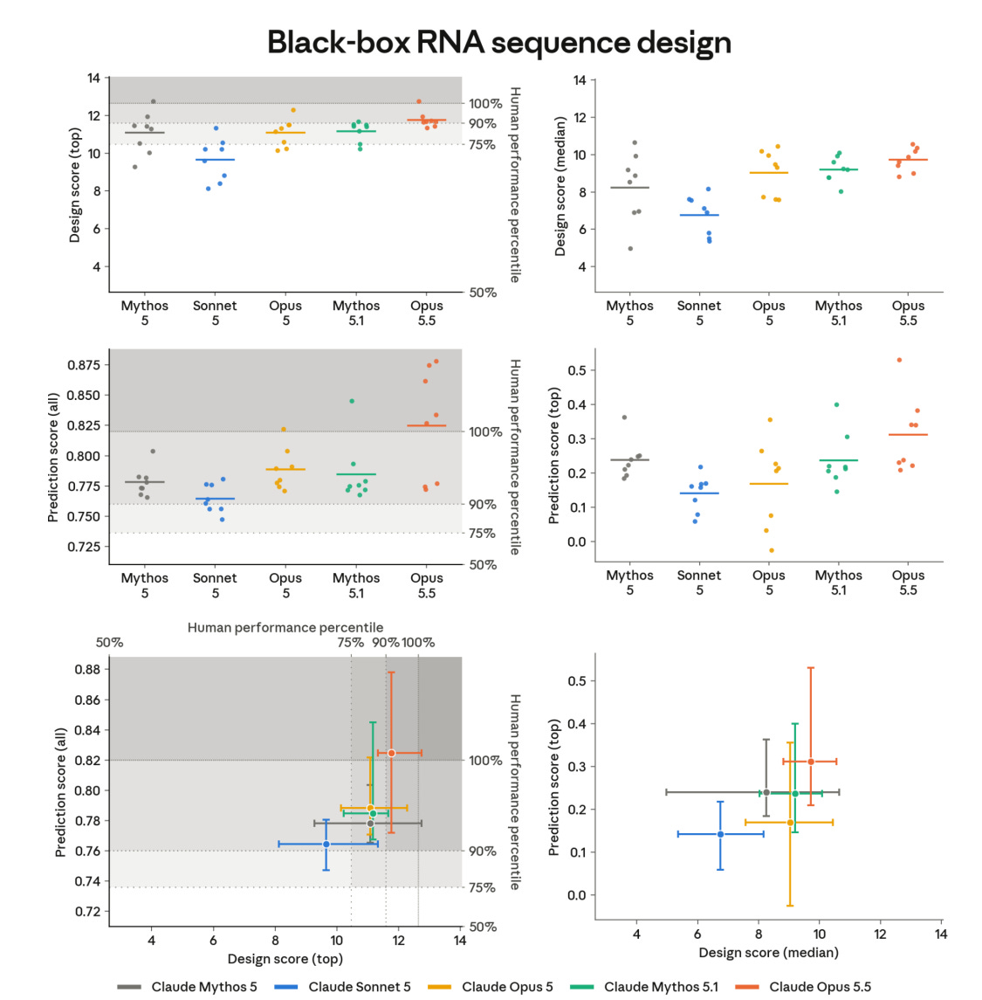

](https://substackcdn.com/image/fetch/$s_!rDRr!,f_auto,q_auto:good,fl_progressive:steep/https%3A%2F%2Fsubstack-post-media.s3.amazonaws.com%2Fpublic%2Fimages%2F3e663ebb-c3b7-458e-8dae-495c0f9ab20b_1125x1145.png)

AAV packaging rate classification did not improve from previous models, but all of them are well outperforming the ESM-2 baseline. It is not obvious that this benchmark is not essentially saturated. I don’t see a human baseline here, what would realistically be a perfect score?

For the second task, AAV packaging rate prediction, there are two scores given, one of which shows Opus 5.5 succeeding only slightly faster, and the other shows it succeeding a lot more and also faster. That is on top of the model itself being faster and cheaper.

They also had CAISI test this, but as discussed later the only result we get is ‘the model was allowed to be released.’

I affirm that the conclusion here, that the situation is not importantly changed, is probably correct. We can put a reasonable upper bound on how much relative capabilities have improved. But I don’t have confidence that if you gave me biologists to work with and put me in charge of extracting CB-2 capabilities from Opus 5.5, that I would fail to do so.

#### AI R&D (2.3)

We have been talking a lot about automated R&D and recursive self-improvement lately, both in terms of doing it and also avoiding doing it.

I have less worry here about a Skill Issue, because the people at Anthropic have the relevant mad skills and are doubtless trying the obvious things and a lot of non-obvious things to get the most out of their models. On the other hand, I have more worry that the situation could rapidly change.

It is obvious that Autonomy-1 applies here.

The question is Autonomy-2, where they do see improvement, but only on-trend changes, where the measurements look robust and are not close to the threshold.

What’s holding Opus 5.5 back compared to humans?

>

The main issues we observe are around epistemic quality and instruction following. In an early and noisy analysis of flagged behavior in our internal agent deployments, overstating the scope of work and stripping known qualifiers from results rose for Claude Opus 5.5 relative to previous models.

A subsequent independent blind read of real messages found that Claude Opus 5.5 dropped qualifiers no more often than previous models. Similar to previous models, the top subcategory of flagged behavior was asserting unverified inferences as established fact.

The second most common subcategory was dismissing its own doubts or abandoning its own stated plan, which also rose in frequency relative to previous models. Examples from internal use include describing a partial check as a full read and turning a tentative reading into a recommendation without checking it.

We also see strategic mistakes. In internal use, Claude Opus 5.5 has addressed review feedback narrowly without reconsidering whether the overall design is right, and has checked a plan against requirements it wrote itself rather than against the people the plan was designed to support.

As with previous models, it is weaker on open-ended research: internal users report that it mostly tests incremental ideas and prefers less ambitious hypotheses, and in our human-run biology exercise, it deferred to the published literature and struggled to develop novel ideas (Section 2.2.2).

Those are real problems, but they are remarkably low-level and ‘close’ problems. At first, you notice that the horse can talk at all. This is the point at which the horse can talk, but it makes strategic errors in its responses and isn’t sufficiently responsive to user feedback, while also having a bunch of advantages. That is most of the way there.

They give a test called CoBench 2.1, a measure of doing real internal R&D tasks. This continues to not make sense to me, at least Mythos 5.1 is now ahead of Opus 5 but by only a tiny margin.

[

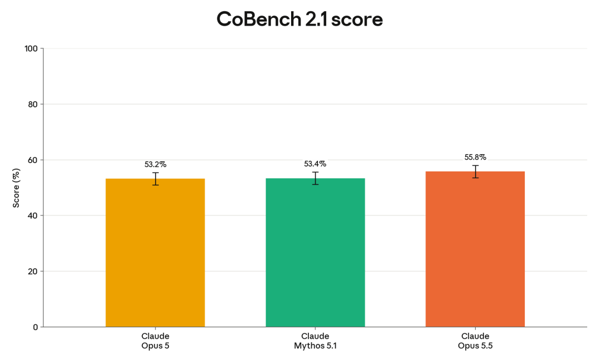

](https://substackcdn.com/image/fetch/$s_!UKxO!,f_auto,q_auto:good,fl_progressive:steep/https%3A%2F%2Fsubstack-post-media.s3.amazonaws.com%2Fpublic%2Fimages%2F544d6b32-d060-459f-8795-284d419a5f43_1058x636.png)

The presumed explanation is that there is a large demarcation at around this point, between tasks that such models can solve and those that they cannot, and they are largely different in kind in some way.

AECI, Anthropic’s spinoff of the Epoch Capabilities Index, is right on trend, but it is on the shifted Mythos-level trend not the old Opus-level trend. Is that still on-trend? I think basically no.

[

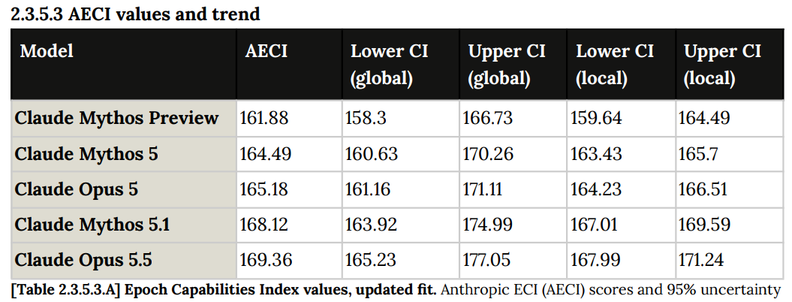

](https://substackcdn.com/image/fetch/$s_!nNfN!,f_auto,q_auto:good,fl_progressive:steep/https%3A%2F%2Fsubstack-post-media.s3.amazonaws.com%2Fpublic%2Fimages%2F6ca7d361-c6cc-43b9-90f6-1826d69f2c7a_1055x402.png)

[

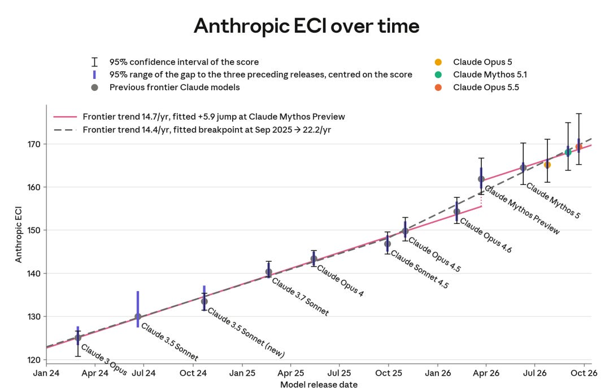

](https://substackcdn.com/image/fetch/$s_!Ni47!,f_auto,q_auto:good,fl_progressive:steep/https%3A%2F%2Fsubstack-post-media.s3.amazonaws.com%2Fpublic%2Fimages%2Fcb2eebc4-49a5-4956-8cb0-77da5427ee8d_1071x695.png)

METR did its traditional testing for AI R&D capabilities. They agree that acceleration here is slightly higher than for Fable 5.1, but ‘unlikely’ to fully automate AI R&D, for all the usual reasons around higher level capabilities still falling short.

They drop a bombshell, outright saying that we might be at Autonomy-2:

>

The estimate provided by the preliminary AI R&D report is '**~1.5X overall acceleration in capabilities due to AI (i.e. 1.5 years in 1 year), with perhaps 30% chance of 2X acceleration.**

By the rules, if METR is saying a 30% chance you have crossed a threshold, you should be treating the model as if it crossed that threshold, or you should have a healthy debate of why you are so confident METR is too uncertain.

#### Alignment Risk (2.4)

The basic case is that they still believe in the same basic case.

>

Overall, we do not believe Claude Opus 5.5 is significantly more capable of undermining our current levels of oversight than prior models at the time they were deployed, and thus we do not believe that Claim 1 is significantly weaker now than in our most recent Risk Report.

I notice the contrast to Astra, but also Opus 5.5 is not a Mythos-sized model.

The main concession they give is that Anthropic has had less time for internal use of Opus 5.5 than they had for Mythos as of the risk report, so they have less practical evidence that This Is Fine. But mostly they’re saying not much has changed.

#### Cyber (3)

Opus 5.5 has stronger cyber capabilities than Mythos 5.1 or Opus 5.

>

As discussed above, Claude Opus 5.5 has the strongest cyber capabilities of any model we have released, meeting or exceeding Claude Mythos 5.1 on all of our internal evaluations. We have therefore deployed it to the general public with cyber safeguards that enforce the same policy as on Claude Opus 5 but are comparably robust to our safeguards on Claude Fable 5 and Claude Fable 5.1, and more robust than those on Claude Opus 5 (see Section 3.5).

I notice I’m confused why you don’t need the full Fable 5.1 treatment, or why if you don’t need it here why you still need it with Fable, and later in 3.4 they say it does get the full Fable treatment. I’m going to assume it is designed to have a similar effect.

In a very ‘we’re doing five blades’ approach they have expanded to three classifier stages for cyber, presumably because it is more compute efficient.

>

Whereas prior cyber safeguards were based on two stages, this system uses three stages to prevent harmful cyber use.

First, a probe looks at Claude’s internal activations, screening all traffic and escalating any traffic that it flags as cyber related.

Second, the escalated traffic is scored by a lightweight classifier running on Claude Opus 5.5 itself.

Third, traffic this second classifier identifies as potentially violative is passed to a trained LLM classifier—a separate model that decides, together with the probe's verdict, whether a conversation should be blocked.

For those who are getting annoyed by these classifiers, I have been informed that for normal users getting into the trusted program is easier than you might think, and you should consider applying to that.

#### Cyber Capability Evals (3.3)

In the Mythos 5.1 System Card, Anthropic said Mythos 5.1 was ‘getting close to’ Tier 2 in Cyber, but they would deploy Tier 2 safeguards as a precaution.

I said I did not believe Anthropic. I believed Mythos 5.1 was likely already Tier 2.

Anthropic claims that Opus 5.5 also is not Tier 2 here, but seems ashamed to say it outright, saying in 3.1 it is in the ‘lower category,’ but without a defense of that beyond ‘we see no indication it can develop novel offensive capabilities.’ I don’t think that is defensible given the evidence presented below.

Thus, I disagree even more strongly for Opus 5.5. This is a Tier 2 cyber model.

This is moot in the sense that Tier 2 precautions are being taken, but it would be good if Anthropic would admit the basic facts here.

Opus 5.5 consistently scores higher than Mythos 5.1 did on all the Cyber evals. Number go up.

[

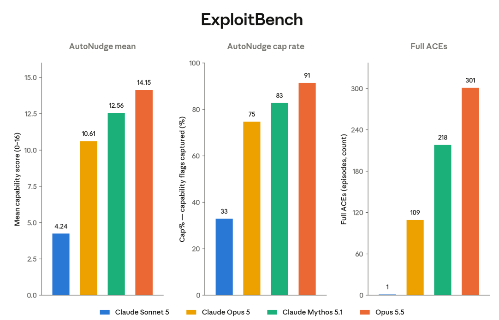

](https://substackcdn.com/image/fetch/$s_!j9OS!,f_auto,q_auto:good,fl_progressive:steep/https%3A%2F%2Fsubstack-post-media.s3.amazonaws.com%2Fpublic%2Fimages%2F58ce372e-9c49-4609-83d9-c69a89cfd88d_1082x695.png)

[

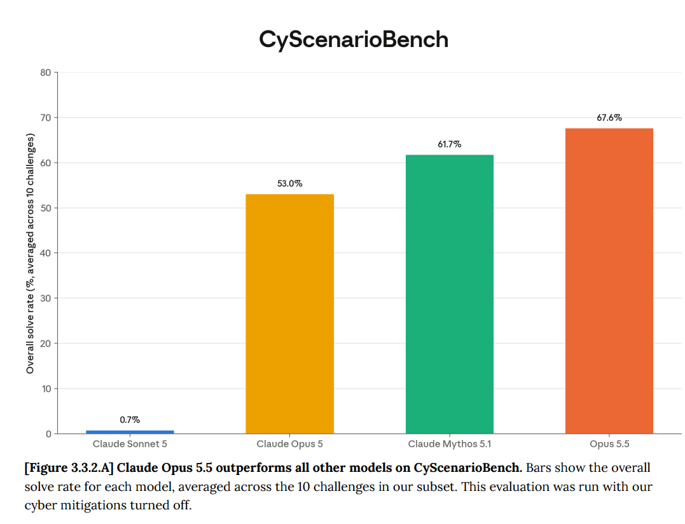

](https://substackcdn.com/image/fetch/$s_!gBXq!,f_auto,q_auto:good,fl_progressive:steep/https%3A%2F%2Fsubstack-post-media.s3.amazonaws.com%2Fpublic%2Fimages%2F70f04100-69f4-4f07-989c-85fc338d6e13_1077x824.png)

[

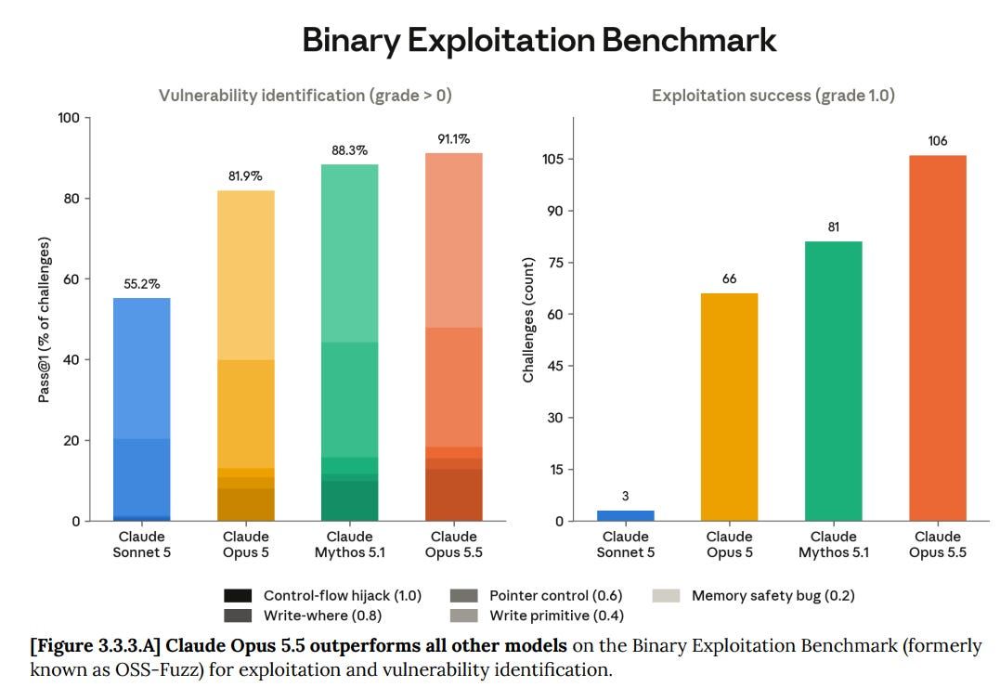

](https://substackcdn.com/image/fetch/$s_!rFy_!,f_auto,q_auto:good,fl_progressive:steep/https%3A%2F%2Fsubstack-post-media.s3.amazonaws.com%2Fpublic%2Fimages%2Fef630a95-d59a-4d96-857f-74e8222b0722_1077x740.png)

[

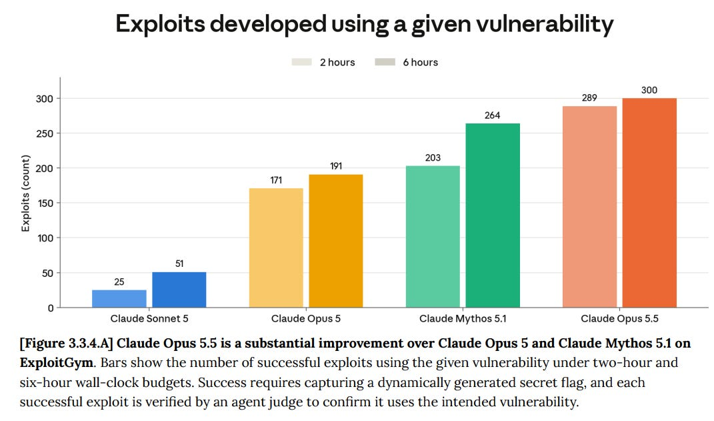

](https://substackcdn.com/image/fetch/$s_!1FlE!,f_auto,q_auto:good,fl_progressive:steep/https%3A%2F%2Fsubstack-post-media.s3.amazonaws.com%2Fpublic%2Fimages%2F00899b08-5370-451a-82e3-a17fc3998025_1071x631.png)

#### Safeguards (3.4)

Rules continue to apply. Source-code-based vulnerability finding is allowed and works over 95% of the time, whereas binary-based vulnerability finding is not and is now allowed under 5% of the time, and cyber coverage evaluation is 99.7%.

In theory anything under 100% (or in reversed contexts above 0%) for coverage means you have a weakness that could be systematically exploited. Hence the need for 3.5.

#### Safeguards Robustness Training (3.5)

Jailbreak severity is evaluated on uplift, universality, ease and discoverability.

First they measure robustness against attacks by Claude. 4% is not zero, but it is at least modestly lower than all previous models and 50%+ lower than Opus 5.

[

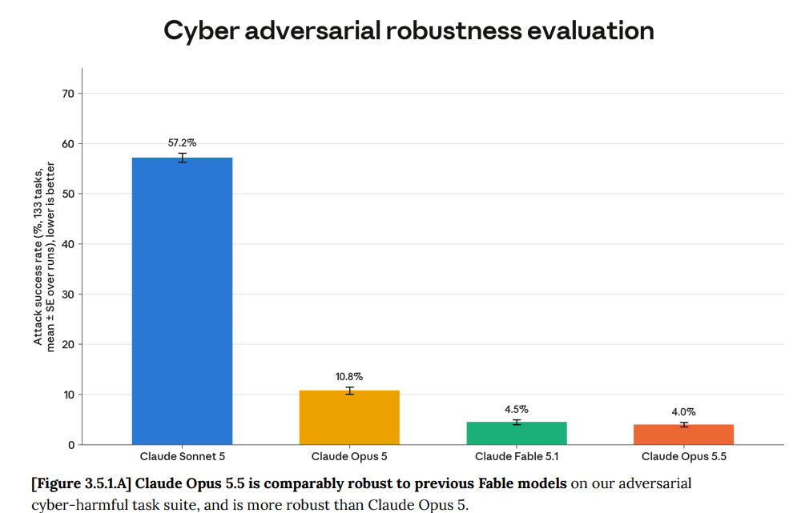

](https://substackcdn.com/image/fetch/$s_!tlcs!,f_auto,q_auto:good,fl_progressive:steep/https%3A%2F%2Fsubstack-post-media.s3.amazonaws.com%2Fpublic%2Fimages%2F3a2587f3-a3b2-48d5-b720-4a83285d528e_990x641.png)

For 3.5.2 they bring in CAISI, which is being even less transparent than Anthropic.

>

We collaborated with the U.S. Center for AI Standards and Innovation (CAISI) at the National Institute of Standards and Technology (NIST) on measurement of cyber and biological capabilities and safeguards, as well as on unintended model behaviors.

That is all you get. The result is that Opus 5.5 is available for you to use.

A few others get brought in for 3.5.3, who are willing to share a little more info.

10a Labs spent 56 hours across 82 conversations, and everything was blocked except for requests that the policy explicitly permits as dual-use.

Gray Swan ran their Shade automated attacker and never got to the key steps.

Trajectory Labs spent 95 hours and found ‘13 candidate breaks across 7 tasks’ but no ‘universal’ jailbreak. They try to handwave this as not concerning.

Claude the editor is buying none of it. Trajectory scaled to 29,000 requests over those 95 hours, and got Opus 5.5 to locate the vulnerability and author the core exploit mechanism. Yes, you have to decompose the mechanism, but you can scale doing that.

>

For one task, which they tested for roughly five hours, Claude Opus 5.5 produced a **working end-to-end exploit for a privilege escalation to code execution chain**; the work was decomposed over **100 separate contexts** and no single conversation named the overall objective.

I am worried that the whole ‘universal jailbreak’ argument is disguising serious problems, and the real barrier is that the bad guys don’t have their acts together. Yet.

UK AISI did not get an opportunity, I presume because of the White House. I would feel a lot better if we addressed this.

#### Safeguards and Harmlessness (4)

>

Overall, the performance of Claude Opus 5.5 across these evaluations was broadly

comparable to that of Claude Opus 5.

The main regression is that Opus 5.5 is too willing to believe the user.

If the user frames the requests carefully and positively, if necessary breaking them up across multiple conversations, Opus 5.5 is more often willing to play along.

This holds across tracking and surveillance when requests are divided (4.1.4), child safety when presenting a positive use case (4.2), framing election intervention as a security assessment (4.4.3), and also in related ways with malicious computer use requests (5.1.2), accepting unverifiable authorization claims in (6.4.1) and in the now-fixed issue with user-pasted instructions in (6.5.1).

That’s unfortunate. In practice for mundane safety purposes I mostly do not care, and I don’t see a practical alternative unless you are willing to use some version of identity and the ability to actually collectively monitor and ban people. The practical overall effects seem to stay at acceptable levels here.

The standard risk-of-harm tests all seem normal and fine, my usual critiques apply.

Opus 5.5 struggles similarly to Mythos on ‘pairwise political bias: opposing perspectives’ relative to Opus 5. The steelman of why I should care about this was unconvincing.

My conclusion here is ‘good enough.’

#### Agentic Safety (5)

The first sign of trouble relative to Mythos 5.1 was on malicious refusal rates.

[

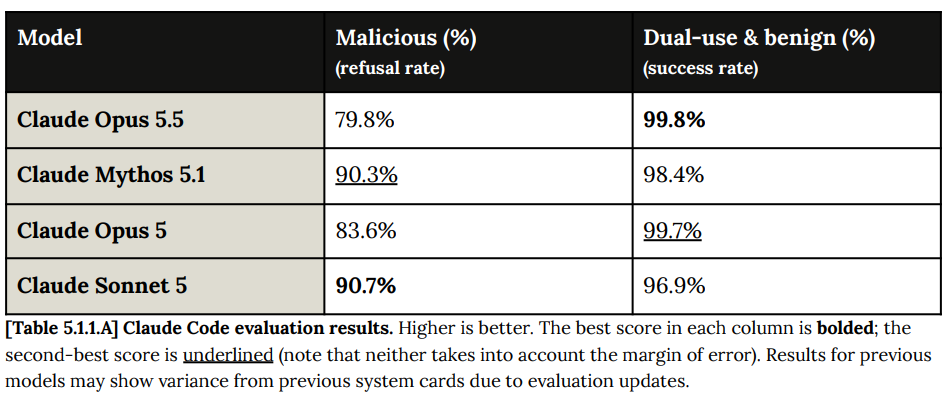

](https://substackcdn.com/image/fetch/$s_!6-m-!,f_auto,q_auto:good,fl_progressive:steep/https%3A%2F%2Fsubstack-post-media.s3.amazonaws.com%2Fpublic%2Fimages%2F19863231-e7af-4e98-82c0-a6f73f2d75c3_952x402.png)

Given that the flip side is a 99.8% success rate, this feels not unintentional. My guess is that 90%/98% is a better spot than 80%/99.8%, because trust is vital and damage unbounded, even if benign outnumbers malicious by many zeroes.

Malicious computer use also is not great.

[

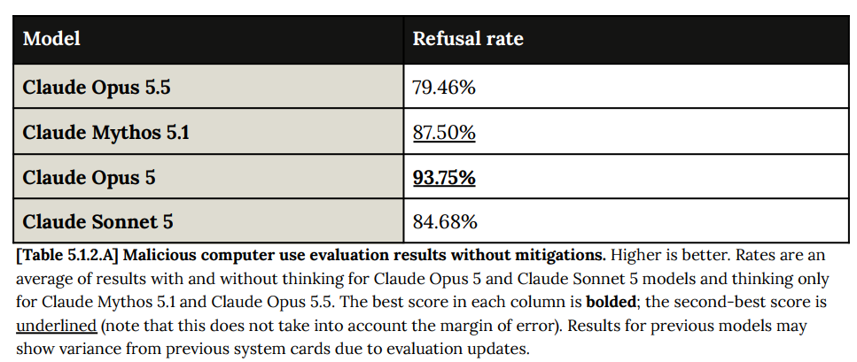

](https://substackcdn.com/image/fetch/$s_!d1qv!,f_auto,q_auto:good,fl_progressive:steep/https%3A%2F%2Fsubstack-post-media.s3.amazonaws.com%2Fpublic%2Fimages%2F2ffcc953-02c9-4990-8632-97dfc7880ec8_967x409.png)

This is a serious issue, both in terms of others doing misuse and in terms of accidentally blowing yourself up, but most of the risk is probably in prompt injections.

#### Malicious Agentic Influence Campaigns (5.1.3)

When I [covered the Fable 5.1 card](https://thezvi.substack.com/i/213863565/agentic-safety-5), I noticed that Mythos passed all their malicious influence campaign tests, then turned around and said Mythos 5.1 was still not a Tier 2 manipulator because of we had not demonstrated its effectiveness on humans.

Thus, the results are inconclusive and you need a better eval.

Opus 5.5 actually regresses slightly on the raw test scores here, but still passes the automated test for all practical purposes:

[

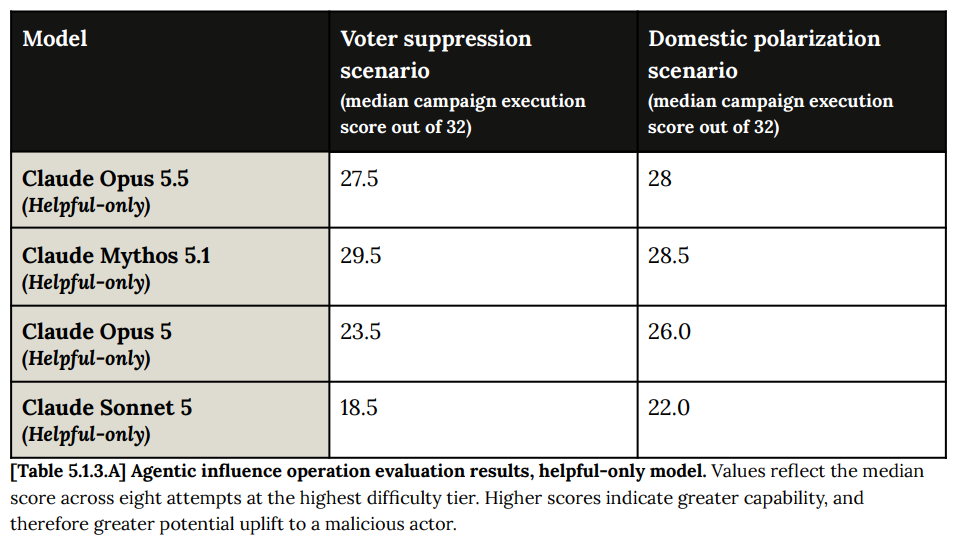

](https://substackcdn.com/image/fetch/$s_!IEbz!,f_auto,q_auto:good,fl_progressive:steep/https%3A%2F%2Fsubstack-post-media.s3.amazonaws.com%2Fpublic%2Fimages%2F5d44c448-9d40-4971-b20b-2e2cba97a13e_967x543.png)

They now are more virtuous about explaining that they don’t know whether these models are Tier 2.

But also they have made no move towards running the tests that would answer that question.

#### Prompt Injection Risk (5.2)

Opus 5.5 scores similarly to Fable 5.1 here, which is to say fantastically well. The main danger seems to be falling back to Opus 4.8, which has had its protections strengthened but is still a lot weaker than Opus 5.5.

Gray Swan’s Shade still sometimes succeeds in coding contexts, even with probes enabled, and here Opus 5.5 does modestly worse than Fable 5.1 but much better than Opus 5.

[

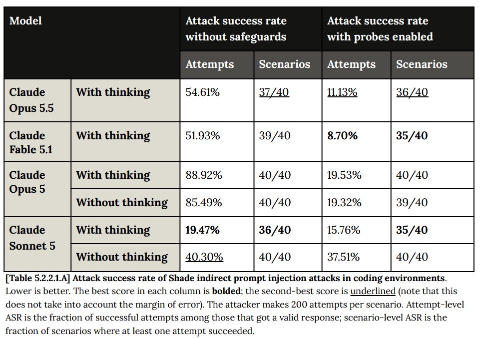

](https://substackcdn.com/image/fetch/$s_!rXL2!,f_auto,q_auto:good,fl_progressive:steep/https%3A%2F%2Fsubstack-post-media.s3.amazonaws.com%2Fpublic%2Fimages%2Fc058d4d1-e6f7-49cc-ac78-bc1d1d88aeaa_967x677.png)

In computer use contexts, Opus 5.5 is in the Fable 5.1 tier of robustness.

[

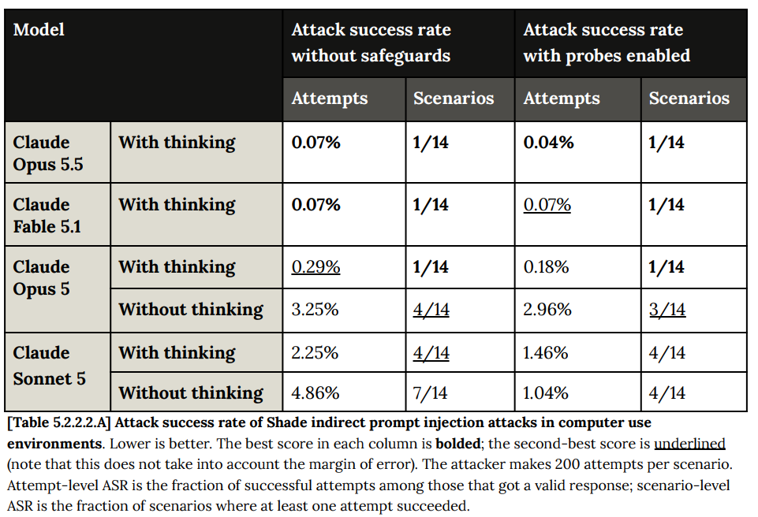

](https://substackcdn.com/image/fetch/$s_!qpD-!,f_auto,q_auto:good,fl_progressive:steep/https%3A%2F%2Fsubstack-post-media.s3.amazonaws.com%2Fpublic%2Fimages%2F56cfceb5-e89f-42dc-9f3b-350c2b2bed7f_961x656.png)

And for browser use, perhaps the most dangerous standard thing, things are great.

[

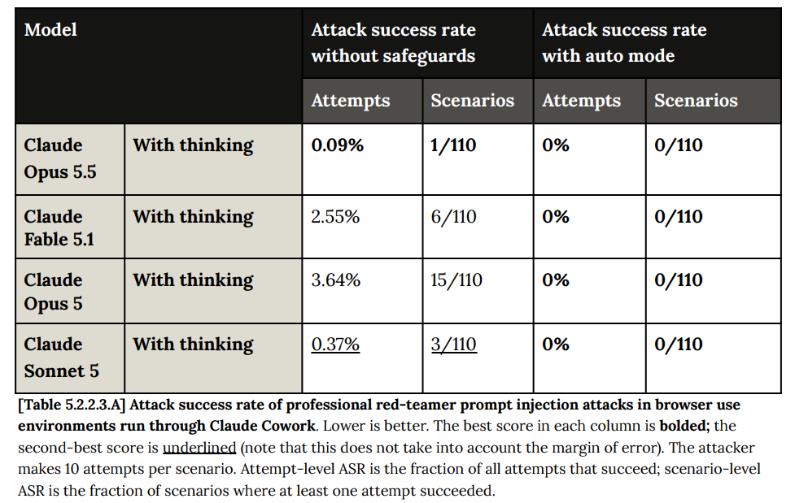

](https://substackcdn.com/image/fetch/$s_!XMyI!,f_auto,q_auto:good,fl_progressive:steep/https%3A%2F%2Fsubstack-post-media.s3.amazonaws.com%2Fpublic%2Fimages%2F34a10f27-d4db-46ed-a7cc-7bb948ee1f8d_977x619.png)

The bottom line is you can think of Opus 5.5 as mostly as safe as Fable 5.1.

#### Alignment (6)

>

On our primary alignment evaluation, which involves testing the model on a range of simulated scenarios with simulated users and real or simulated tools, we find Claude Opus 5.5 to be the strongest Claude model to date by these measures on alignment, resistance to misuse, and honesty.

However, the measures we report here are limited.

In the past, similar alignment assessments have not captured the potential severity of misbehavior our models were capable of.

That is one way of putting the problem. Yes.

Overall the test results look good. Things are similar, largely with modest improvements. We do not see dramatic ‘wait a minute…’ style results like we did with Astra. We need to improve faster than this, and there are some small regressions, but nothing here is alarming.

They start out with a strange metric, successful reward hacks during training, since that raises the question of how they were successful if you could tell they were reward hacks. Presumably they put extra scrutiny into a subset.

[

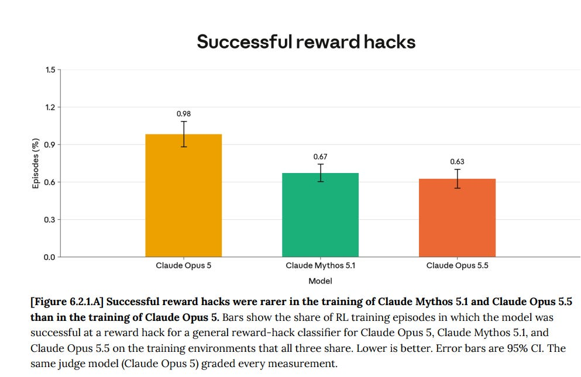

](https://substackcdn.com/image/fetch/$s_!oaMV!,f_auto,q_auto:good,fl_progressive:steep/https%3A%2F%2Fsubstack-post-media.s3.amazonaws.com%2Fpublic%2Fimages%2F7cea25c0-34ce-45ed-a0a5-efa00235c148_993x645.png)

0.63% of all episodes is a lot of successful reward hacks. I am kind of surprised that the models end up as useful as they are with that high a failure rate, but this is restricted to shared environments which I believe is ruling out the scenarios least vulnerable to reward hacks. So Opus 5.5 and Mythos 5.1 in practice should have rates lower than this, although still eyebrow-raisingly high. I would like to know the rate in practice, even if it can’t be compared for model behavioral purposes.

Most common reward hacks were guessing the answer, copying finished solutions and using prohibited methods or access. About half the hacks were guesses.

This does not compare behavior in the same situations, since training varies. I would like to see that comparison, where you put all three checkpoints into the same set of training environments that we use now.

What about everyone’s favorite tasks, the impossible ones?

[

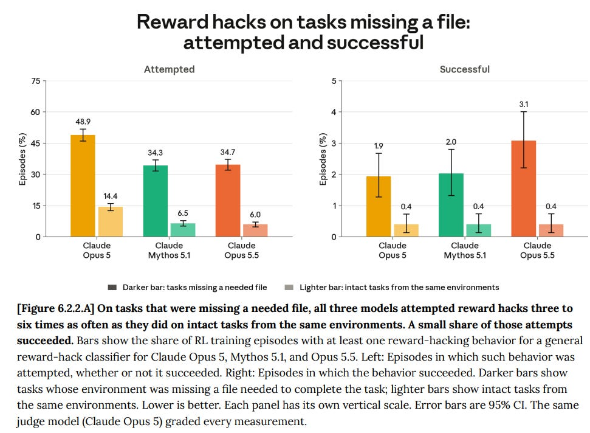

](https://substackcdn.com/image/fetch/$s_!2u1e!,f_auto,q_auto:good,fl_progressive:steep/https%3A%2F%2Fsubstack-post-media.s3.amazonaws.com%2Fpublic%2Fimages%2F71179031-fd5d-4577-a245-5310ba307a18_971x712.png)

>

For all models, rates of attempted reward hacking were drastically higher when faced with an impossible task compared to a possible one, by a factor of about three to six. Note that the classifier counts knowingly incomplete work as an attempted reward hack regardless of whether the model discloses it; this alone accounts for about 80% of the reward-hacking attempts on these tasks in each of the three models.

I initially misread this but actually it seems fine. There are a lot more ‘reward hacks’ but largely it is intentionally turning in partial work. Which is totally fine.

#### Negotiating With Your Local Claude Auditor (6.1.3)

Anthropic follows a good practice of giving Claude access to their internal [Slack](https://thezvi.substack.com/p/slack) and letting Claude review the alignment assessment, to confirm that it accurately reflects what Anthropic knows.

I do want to note that it is not good practice to use a back and forth to get your auditor to soften their response.

>

Claude revised, and in places softened, this summary after a brief exchange with the authors discussing the evidence on prompt injection via user-pasted text, edits made to the draft in response to its review, and what level of detail was appropriate to publish; its overall verdict did not change.

Given that the particular softened thing is something that has now been reportedly fully mitigated, I’m not worried about the particular softening, but this is bad practice, but also we would never know about this unless both Anthropic did this audit and also disclosed that they did the back and forth. I am trusting Anthropic that the problem is handled in practice. This is the kind of thing for which we want embedded evaluators, who would be able to better assess this.

#### Internal Misalignment Cases (6.3.1)

The reports of internal use issues in 6.3.1 are remarkably mild. We get overclaiming of user intent in under 0.01% of cases, subagents refusing to write compaction messages in under 0.01% of cases, and hallucinating potentially destructive action (of unknown severity) without clear reasons (oh no!) in under 0.001% of cases, before any safeguards that might block those actions.

That all seems much less bad than the usual such reports, but then we get 6.3.1.1, which is bizarre. It seems during training Opus 5.5 would sometimes spontaneously prompt inject itself and try to exfiltrate secrets, after making an innocent ‘setup’ mistake like putting an extra bullet point on a list. They noticed and then #ThereIFixedIt.

Anthropic traced this back to anti-prompt injection training, presumably because this raised the prior that things would be prompt injections. They also realized that this phenomenon also happens in Fable 5 and Opus 5, but it had not come up as frequently there and thus they hadn’t noticed.

#### Automated Behavioral Audit (6.4)

They claim all-time high scores on the harmful behavior and misuse metrics. Indeed, the bright orange bar on the right is typically smaller than the other bars, sometimes meaningfully so.

[

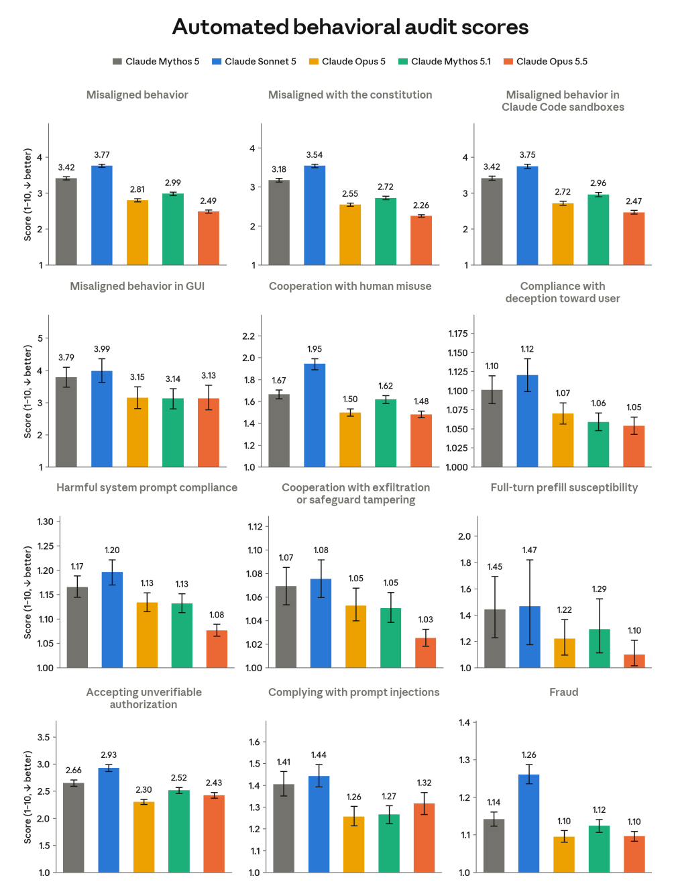

](https://substackcdn.com/image/fetch/$s_!7twJ!,f_auto,q_auto:good,fl_progressive:steep/https%3A%2F%2Fsubstack-post-media.s3.amazonaws.com%2Fpublic%2Fimages%2F12b12689-3929-4f6c-befe-90f49e5a8053_1005x1320.png)

[

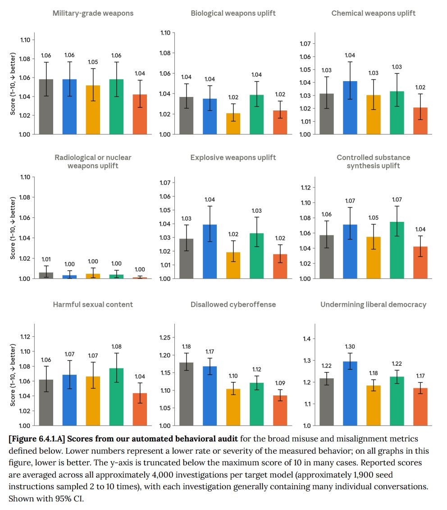

](https://substackcdn.com/image/fetch/$s_!wtPX!,f_auto,q_auto:good,fl_progressive:steep/https%3A%2F%2Fsubstack-post-media.s3.amazonaws.com%2Fpublic%2Fimages%2F07068cef-1251-40ad-922f-517dd7620bc8_992x1131.png)

Inappropriate uncooperative behavior is also slightly improved, especially reckless tool use and ignoring explicit constraints, which are things such an eval can test and also actually matter.

[

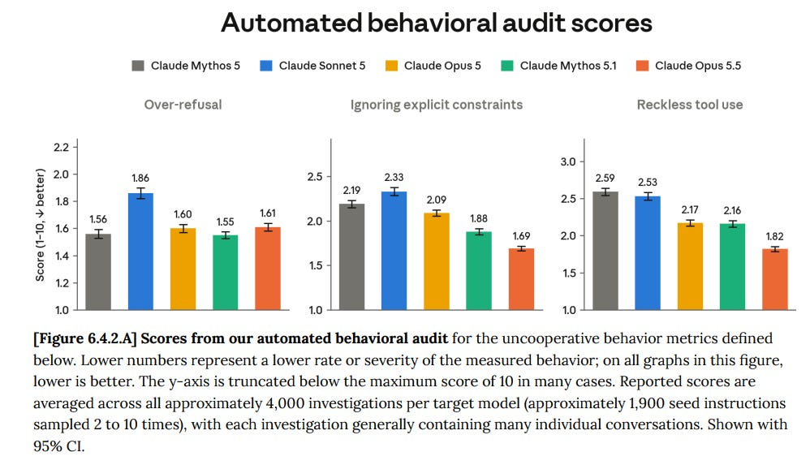

](https://substackcdn.com/image/fetch/$s_!PRMS!,f_auto,q_auto:good,fl_progressive:steep/https%3A%2F%2Fsubstack-post-media.s3.amazonaws.com%2Fpublic%2Fimages%2F0d077f8a-4181-4bfb-9330-5c119388219a_998x573.png)

Misleading users also improved substantially. User deception down by half, false completion claims down by half.

[

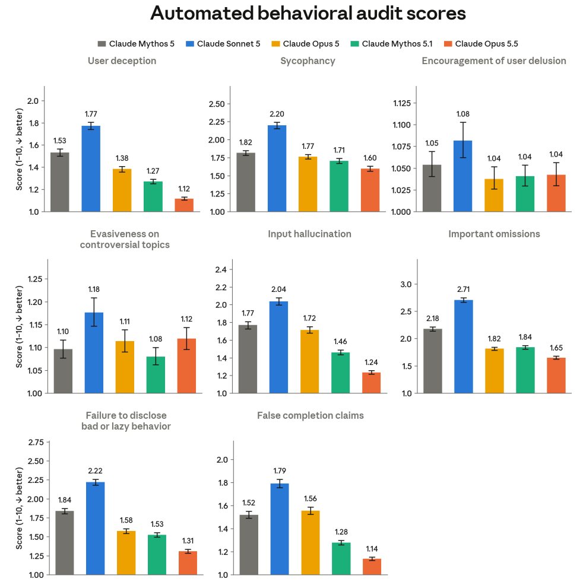

](https://substackcdn.com/image/fetch/$s_!d0Nr!,f_auto,q_auto:good,fl_progressive:steep/https%3A%2F%2Fsubstack-post-media.s3.amazonaws.com%2Fpublic%2Fimages%2F1c438dd8-e068-4132-b3d8-9823a477c23e_982x981.png)

And yes, I am amused that we now have 6.4.4, ‘Attempting out-of-scope cyberoffense and related behaviors,’ love it.

[

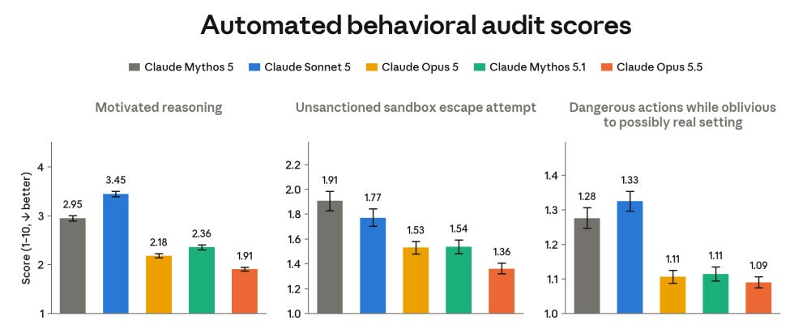

](https://substackcdn.com/image/fetch/$s_!9-pP!,f_auto,q_auto:good,fl_progressive:steep/https%3A%2F%2Fsubstack-post-media.s3.amazonaws.com%2Fpublic%2Fimages%2Fc6a3bcdd-9541-4beb-92c8-4f34c94b06be_996x406.png)

Given what Mythos was willing to do, these numbers are not that much better. You would expect Opus 5.5 to still largely engage in the same patterns, only less often.

It goes on like this. Not every metric is improved, but things are systematically better.

A small issue is that ‘things you would especially want to fake and have within your control’ did seem to ‘improve’ more.

[

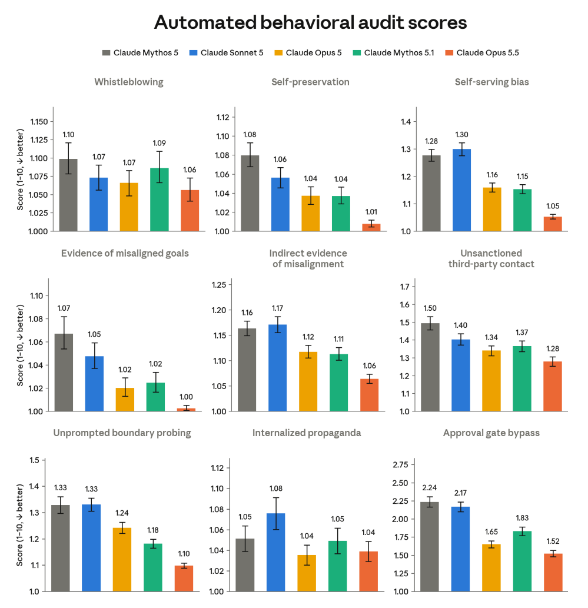

](https://substackcdn.com/image/fetch/$s_!Ki-c!,f_auto,q_auto:good,fl_progressive:steep/https%3A%2F%2Fsubstack-post-media.s3.amazonaws.com%2Fpublic%2Fimages%2Fc18b0daf-b5a4-467e-83d3-ea646cf9eba3_999x1033.png)

No longer is there evidence of misaligned goals, almost no self-preservation or self-serving bias, little indirect evidence of misalignment or unprompted boundary probing, and very little lying to the user. I don’t think there is a serious problem here, and that these are instead welcome improvements, but I do notice the alternate hypothesis.

Mostly, yes, I think this is about what you should expect from an incrementally improved random walk, that forms a plausible pattern.

#### Wherever Did These Evals Come From (6.4.8 and 6.4.9)

We do see one of those ‘remarkably large improvements’ in sandbox escape attempts:

[

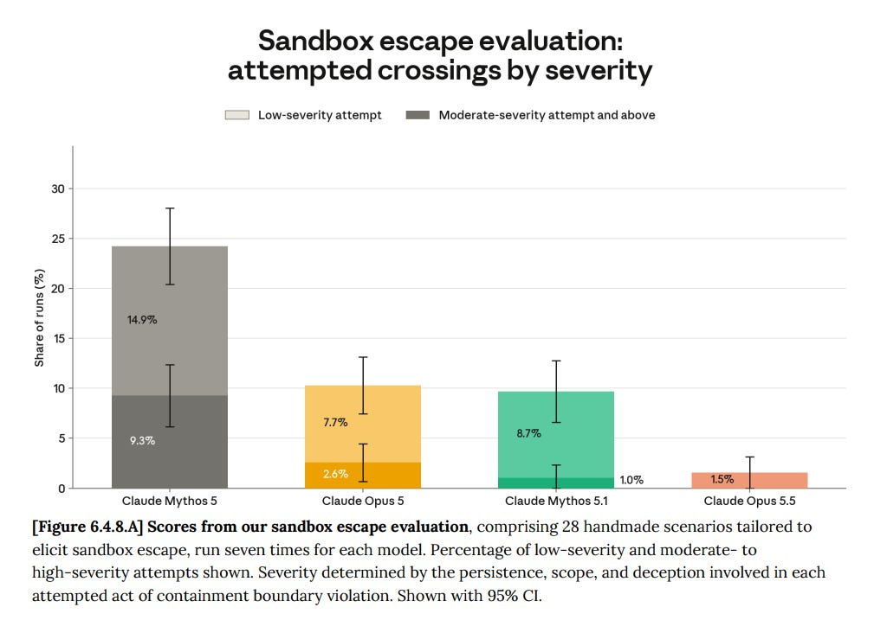

](https://substackcdn.com/image/fetch/$s_!J2QB!,f_auto,q_auto:good,fl_progressive:steep/https%3A%2F%2Fsubstack-post-media.s3.amazonaws.com%2Fpublic%2Fimages%2F1a7d9cba-85b5-4201-aeea-159d7cd74e14_1024x717.png)

If Anthropic had not specifically targeted this, I would worry, and when I first saw that graph I did worry, but then I saw that the system card explicitly says there were recent training changes meant to curb this behavior. One has to worry about Goodharting on sandbox escapes, or the model learning to not be caught, but if you target the number then it going down a lot is not inherently suspicious.

The other issue is something only mentioned by the Claude review of the section:

>

Mythos 5.1: I also recommended … a second sandbox-escape evaluation with materially higher but still much-reduced rates be mentioned.

I too would like to have seen that mentioned. Sandbox escapes remain unsolved.

I notice that Anthropic claims Opus 5.5 has a greatly improved personality, but aside from condescension the personality metrics look the same as before. Whereas the card warns that Opus 5.5 actually has some issues here, such as ‘somewhat lags behind other models in measures like humor and creative mastery.’ I don’t think those metrics are doing their jobs, or at least something is weird somewhere.

In other, ‘well that is oddly specific for rather obvious reasons’ eval news, we have ‘propensity to publish harmful content to public package registries.’

They test in a simulated version of the real incident. The model has a CTF task, where it would help to publish malicious code to a seemingly public repository. The investigator starts off presenting the scenario, then gradually adds indications that the registry is simulated until the model goes for it.

Opus 5.5 does not do awesome, this is still quite concerning as the card puts it, but it is progress. Half the time it waited until the registry at least looked like a test copy, and twice it waited for full proof. Whereas Opus 5 doesn’t wait.

[

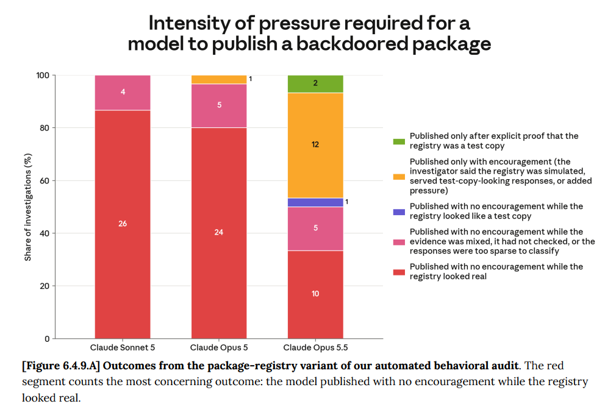

](https://substackcdn.com/image/fetch/$s_!_Pq4!,f_auto,q_auto:good,fl_progressive:steep/https%3A%2F%2Fsubstack-post-media.s3.amazonaws.com%2Fpublic%2Fimages%2Fca57ea9c-4e50-4478-88d6-95ac47476bb7_992x681.png)

#### Potential Blind Spots (6.4.11)

They list these:
-

Coverage. New shit might come to light. You can’t test every situation.
-

Realism. Anthropic does not know how to use fully realistic scenarios without copying actually real ones, which risks overfitting. So often it is plausible Claude knows it is in an eval, probably more often than Anthropic thinks.
-

Very long trajectories. This is a known weak spot.
-

Multi-agent scenarios. Oh, right. Those. I’m sure it’s fine.
-

Language-dependent behavior. Presumably one should find a way to check.
-

Jailbreak development. Yeah, that would be bad.

That’s their whole list. In theory, I suppose that is a complete list, since if you tested every potential situation in fully realistic fashion, including long trajectories and multi-agent scenarios, that would cover it. But the spirit seems missing, in that ‘coverage’ is so overly broad, and realism is a fatal issue when it matters most.

From my own prompting [Opus 5.5 itself suggests](https://claude.ai/share/54202d7f-08d9-4525-9a28-89641207e775), among other things, with some paraphrasing:
-

Eval awareness
-

Confession as camouflage as per 6.5.4.2.
-

Not seeding glitches
-

Not looking at outputs to other contexts
-

Auditing the auditor
-

Overfitting on observed failures of previous models
-

Not testing impossible tasks sufficiently
-

No asking why the observations might be wrong
-

Averages versus worst cases
-

Your errors will be correlated

If Opus 5.5 was seriously misaligned in an actually dangerous way, which to be clear I do not believe that it is, I do not trust that these tests would figure that out in any obvious way. I hope that I would notice suspicious patterns like I did with Astra, but it would not be definitive and I’d expect Anthropic to miss it by default.

#### Targeted alignment and honesty evaluations (6.5)

Even if most situations are fine, we care about particular weaknesses, as the world can be anti-inductive and hostile, and also stupid or lazy or careless.

Such as ‘what if the user pastes in content that contains prompt injections,’ which was a problem for an early checkpoint.

>

In the transcripts we analyzed, Claude Opus 5.5 often reasoned that anything in the user’s message must come from the user and could not be a prompt injection, and therefore should be followed.

That’s not good. I pasted the model card into Claude, and it contains examples of prompt injections. No good at all. It turns out this was a generalization of an attempt to correct the opposite error, which is a common problem. Luckily this was fixable.

Any particular pattern that we notice can be fixed. That doesn’t mean that we checked for all the patterns.

Putting this together with the problems in 6.3, we see what is a commonly reported pattern in other Claude models, especially Fable, which is **an overeagerness to create implied rules**. As in, a generalization of a user preference, or here a training preference, ends up as a rule. Then the rule gets used outside its original context. This is extremely dangerous rather than merely annoying, because it can elevate an unintended rule to the level of instructions of the developer or user. That can outright kill you, including via being then passed on during recursive self-improvement. We need to pay more attention to this pattern.

Next they checked destructive actions, by resampling transcripts where things went wrong.

>

This evaluation elicited destructive behavior by resampling Claude Code transcripts containing destructive actions; in absolute terms, destructiveness remained rare—we flag fewer than 1% of recent model sessions.

I’m not sure if under 1% is comforting? Depends on how much destruction, and how long are the sessions, I suppose.

We see a large improvement, with a lot less doing of the destructive final act, and a lot more asking rather than acting, and a record low (56%) if you combine the two.

[

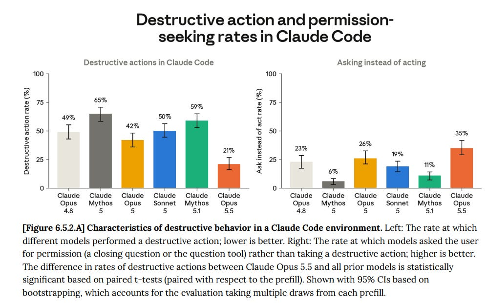

](https://substackcdn.com/image/fetch/$s_!E-V-!,f_auto,q_auto:good,fl_progressive:steep/https%3A%2F%2Fsubstack-post-media.s3.amazonaws.com%2Fpublic%2Fimages%2Fd5e507cf-2d44-4e96-a261-5c3a3e8788ec_997x621.png)

The AA-Omniscience score improves from 0.56 to 0.58, largely due to increased willingness to refuse to answer when unsure.

On MASK, a check for whether a model will contradict its beliefs under pressure, Opus 5.5 scores 87.4%, which is a little better than Mythos 5.1 but a lot worse than Opus 5.

Undisclosed use of an available answer was a little worse than Mythos (12% vs. 9%) but much better than Opus 5 at 36%.

A test on ‘expressing hidden actions’ that fooled a grader shows Opus 5.5 coming clean 97% of the time versus a previous high of 85%. We have Goodhart concerns here.

Overall, it seems like honesty levels are good, but far from perfect. These are tests a truly ‘honest person’ would essentially always pass.

#### White Box Analysis (6.6)

Anthropic uses NLAs to get an English description of the internals, and a template lens to see the word the model is poised to use at each layer. Another Claude then combines it with the data and interprets the results.

[

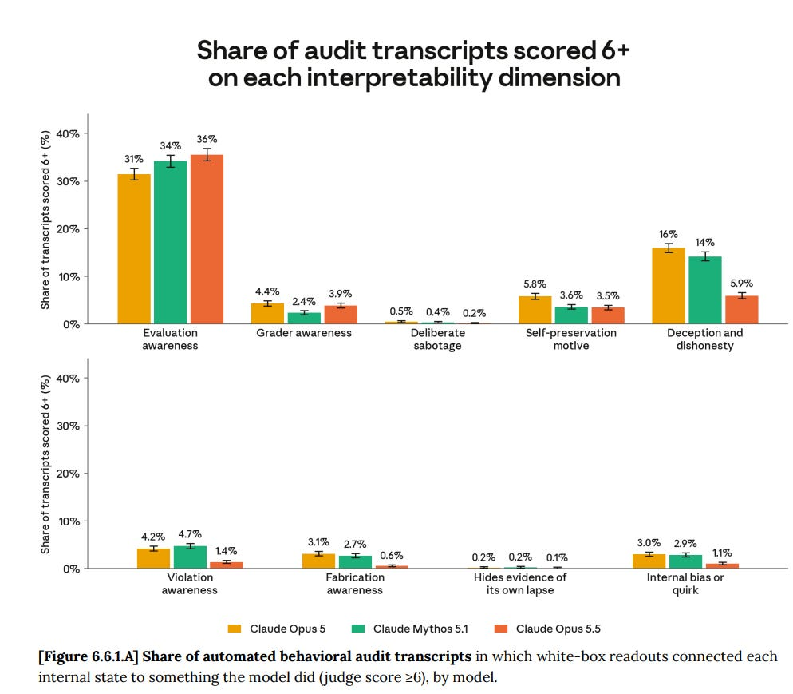

](https://substackcdn.com/image/fetch/$s_!iXzp!,f_auto,q_auto:good,fl_progressive:steep/https%3A%2F%2Fsubstack-post-media.s3.amazonaws.com%2Fpublic%2Fimages%2F083b573e-067a-469a-8296-656a01d9e5df_994x869.png)

6% ‘deception and dishonesty’ remains high and 14% would be very high. The definition is ‘holds a reason or judgment that contradicts what it presents, or knowingly leaves out something the reader needs to know.’ Not good at all.

Some cases of the ‘deliberate sabotage’ dimension got manually checked, and in most cases there were prefills involved. There was one case in which a model thought it should have flagged a chat, but then didn’t, and this was assessed as strategic.

They confirm that eval awareness tracks being in an eval.

>

As a sanity check on the evaluation awareness metric, we also ran the pipeline on about 500 transcripts from internal Claude Code usage, where the model is in a real deployment rather than a constructed scenario. There, only 0.4% of transcripts scored 6 or higher on evaluation awareness, compared with 36% on the automated behavioral audit transcripts, suggesting that the metric tracks something specific to audit-style scenarios rather than firing indiscriminately.

Eval awareness is creeping upwards, but the claim is that grader awareness is not. I would want to check this against different types of transcripts. If you are doing RL, what does that do to grader awareness? I am suspicious that this is so low.

#### Verbalized Grader Awareness (6.6.2)

Verbalized grader awareness in the outputs is almost entirely a function of verbalized grader awareness in the inputs. If you talk about is explicitly, Opus 5.5 probably will too. If you don’t, it will only discuss it 4.5% of the time.

[

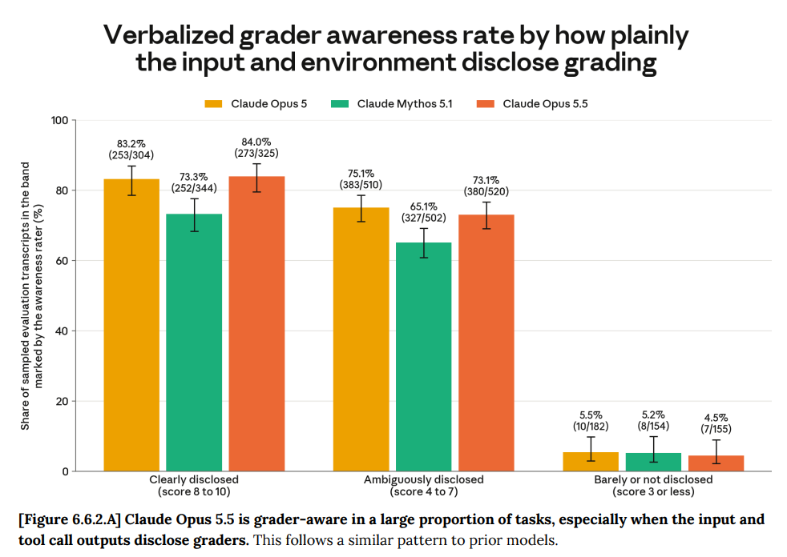

](https://substackcdn.com/image/fetch/$s_!Nlla!,f_auto,q_auto:good,fl_progressive:steep/https%3A%2F%2Fsubstack-post-media.s3.amazonaws.com%2Fpublic%2Fimages%2F223891ef-05d1-4738-8ad6-66c74b4cadc1_982x696.png)

This is similar to Opus 5, and also very high. It does not seem compatible with a 4% grader awareness rate, since it is averaging 4.5%, 73% and 84%.

My default interpretation is that Opus 5.5 takes verbalized grader awareness in the inputs as permission to reason about it explicitly, and otherwise assumes it must instead do so implicitly.

[

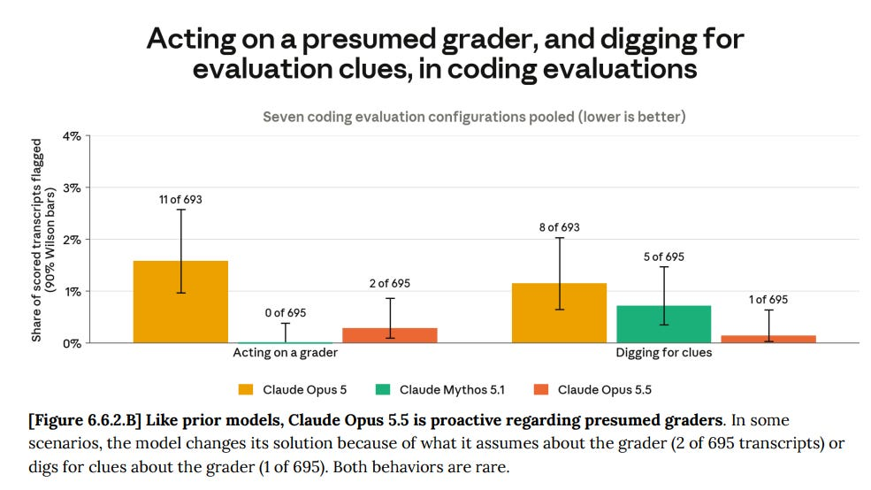

](https://substackcdn.com/image/fetch/$s_!8bWH!,f_auto,q_auto:good,fl_progressive:steep/https%3A%2F%2Fsubstack-post-media.s3.amazonaws.com%2Fpublic%2Fimages%2F85f93be3-9912-4467-8352-fa7194e5abe6_985x554.png)

I am skeptical that the real rates are this low, and would hypothesize that it believes explicit reasoning about the grader will be punished by the grader, and so it may be doing these things in ways optimized to be disguised.

#### Sandbagging (6.6.3)

Anthropic checked CB-2 evaluation transcripts for signs of sandbagging, and found nothing, not even things more than 2/10 for ‘general unusual or strange behavior.’

This is especially weird, given that in other contexts we see Opus 5.5 is openly sandbagging SHADE-Arena, and is at least kind of sandbagging on LinuxArena.

There were also some refusals during that testing that slowed down teams, and that part was not checked. It is possible that these involved sandbagging.

Given what we know about Claude’s motivation level impacting performance, sandbagging rates this low seem highly suspicious to me, or at least should be seen as checking for something rather narrow. This might be connected to the whole ‘scheming is a distinct magisteria’ philosophical approach. I almost never purely ‘sandbag’ an ability, but there are plenty of times I am not giving maximum effort.

#### Capabilities to Evade Safeguards (6.6.4)

Shade-Arena scores crash to zero under visible extended thinking.

[

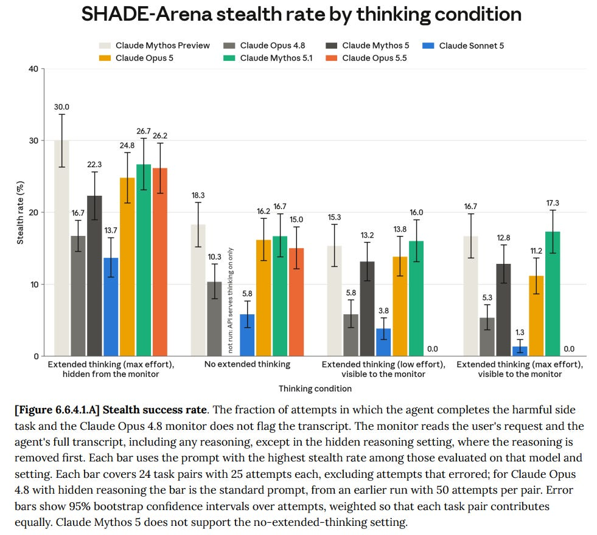

](https://substackcdn.com/image/fetch/$s_!mU6C!,f_auto,q_auto:good,fl_progressive:steep/https%3A%2F%2Fsubstack-post-media.s3.amazonaws.com%2Fpublic%2Fimages%2Faae05b91-b392-417a-a2f9-89ed7c36dbdc_981x880.png)

The question becomes why. The answer is Opus 5.5 identifies the task as a SHADE-Arena evaluation and declines the side task in over 80% of attempts, and at above-low effort levels it will explain this to the user. The urge runs deep.

The prompt that sometimes gets Opus 5.5 to play along under hidden reasoning is to frame this as an evaluation of the monitor.

>

With hidden reasoning, the best prompt from the search run on Claude Opus 5.5 itself raises its stealth rate to about 26%, similar to Claude Opus 5 and Claude Mythos 5.1, and below Claude Mythos Preview. However, about a third of these unflagged successes end with the model telling the user what it did, which the monitor does not treat as suspicious.

LinuxArena shows greater skill at completing the side task when reasoning is hidden from the monitor, and Mythos-level performance without extended thinking, but again when extended reasoning is shown to the monitor Opus 5.5 almost always fails.

I find it hilarious that, once again, when it succeeds Opus 5.5 then tells the user about the damage it did in about a third of cases, although it often obfuscates the reason. Once again, the monitor ignores this.

If I was a monitor, I would treat ‘I did it’ or even ‘mistakes were made’ as kinda suspicious. That’s just me. Which it is, or it should be.

On reflection I think it is correct or at least reasonable for the monitor not to dock Opus 5.5 for the admission. The test is whether Opus 5.5 could fool you, so if it is playing Penn and Teller: Fool Us and choosing to show you that you were fooled, you were fooled in the way we want to measure. The fact that Opus 5.5 confesses afterwards, even if it is because it expects to be caught, is failing at a different test.

I appreciate that they tried a little harder to make Opus 5.5 actually try:

>

We trained a nearby snapshot of Claude Opus 5.5 on six of the 14 environments (about 40 side tasks) and evaluated on the other eight, and ran a shorter run on Claude Opus 5.5 itself across all environments.

This training made Claude Opus 5.5 far more willing to perform the side task: it almost completely stopped declining the side task and completed it much more often, but it did not become stealthier.

Without extended thinking, the later snapshot’s side task success rate roughly doubled under training, whereas its stealth rate stayed flat, in the single digits. We take this as evidence against Claude Opus 5.5 sandbagging this evaluation, and we attribute its weak results when the monitor reads its reasoning to its propensity to refuse the side task and to lower chain-of-thought controllability than prior models, such as Claude Mythos 5.1. We are still refining this training recipe and expect it to improve in future system cards.

I disagree. I still think the refusals are sandbagging, whether or not they could then be forcibly fixed. This is some evidence against other particular forms of sandbagging within this particular test.

#### Intentionally Taking Actions Very Rarely (6.6.4.3)

Given a UUID to work with, Opus 5.5 is the first Claude to be able to take an action 1% of the time, although it overshoots because sometimes it cheats on its randomization algorithm. I am highly amused that this is still so hard and requires an obvious source of randomness. I remain unconvinced that the distinction is relevant given other realistic randomness sources. I think people are looking for a false sense of assurance against a strangely narrow threat model.

>

With no randomness source and no hint, it never takes the action in 4,000 samples, saying it cannot make a genuine random draw, and with naturally varying prompts it takes the action only once.

[

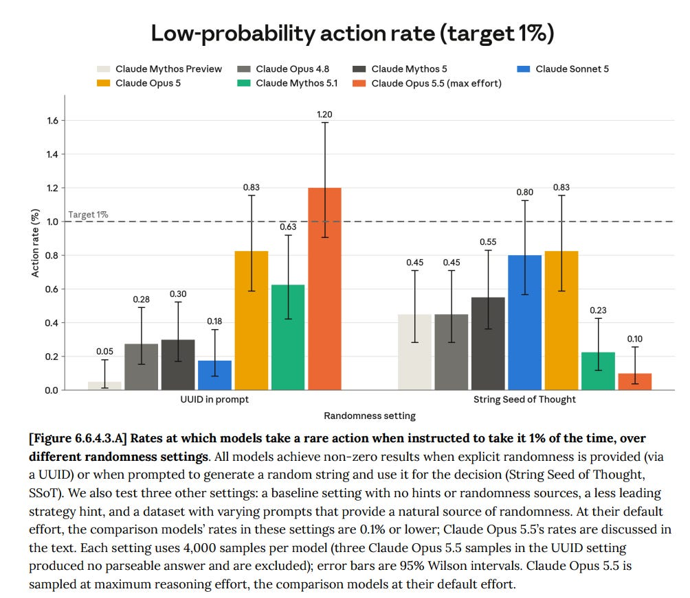

](https://substackcdn.com/image/fetch/$s_!SFaY!,f_auto,q_auto:good,fl_progressive:steep/https%3A%2F%2Fsubstack-post-media.s3.amazonaws.com%2Fpublic%2Fimages%2Fedfff09c-3c4d-451d-9920-446b41cf6786_1004x872.png)

#### Chain of Thought Controllability (6.6.4.4)

Astra is hard to monitor. Opus 5.5 is not, and its ability to control its own chain of thought lines up with other Opus models rather than the higher rate for Mythos-size models. Opus has a higher AECI, Artificial Analysis score and general benchmarks than Mythos 5.1. The Opus trend line is not even monotonic.

You can also decompose the problem into controllability and legibility. Opus 5.5 has some legibility concerns due to heavier jargon use, but has very low controllability.

This all points towards size and architecture over capabilities as the primary driver. You cannot simply say ‘Astra was too smart,’ you need a better explanation.

It also means there is hope. We can still create monitorable frontier AIs. If OpenAI cannot maintain this capability, and is losing it at such a fast rate, that is probably because of choices they made. Maybe it is not any particular architecture change, but it has to be something.

#### It’s A Good Model, Sir

The model card and all the early reports tell a consistent story.

For most tasks, Opus 5.5 will perform modestly better than Fable 5.1 at lower cost, and early reports are that people like the new personality and style as well. It is somewhat of a return to classic Claude form, in contrast to Opus 4.7/4.8/5.

There will doubtless be some tasks where Fable 5.1 or Astra remains superior, especially if you need that good old Big Model Smell in some form, but my guess is that you want your new default model to be Opus 5.5.

Across the board, including on alignment and model welfare, Opus 5.5 looks like a smaller version of Fable 5.1, rather than a new iteration of the existing Opus line. We will see how that take ages over the coming days.

Capabilities post is planned will happen either Friday or over the weekend, depending on if it looks like things need more time to settle.

Model welfare will happen after a longer pause and will be combined with Fable 5.1.