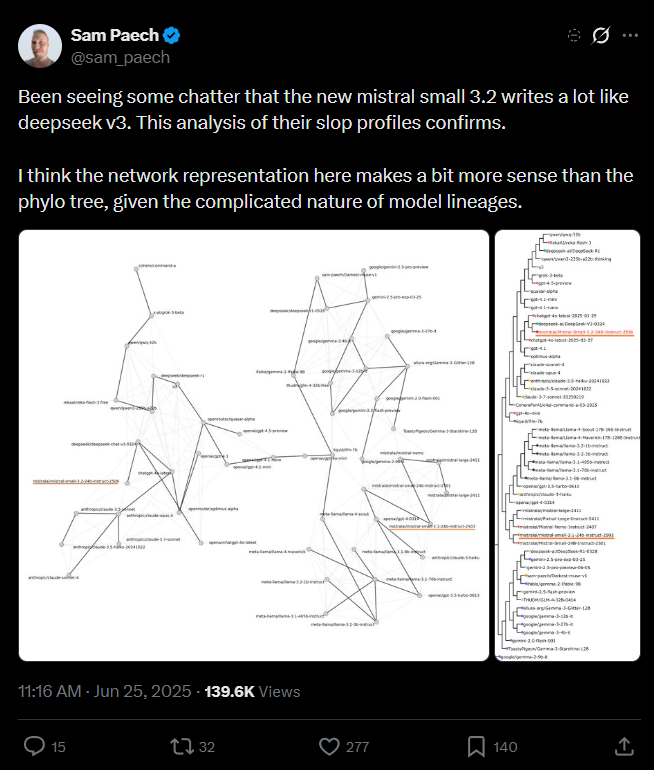

# Mistral Large 3

    
Mistral AI · released 2 Dec 2025 · Apache 2.0 open weights (base and instruct) · active on Mistral’s API as of 21 Oct 2026; successor Mistral Large 4 in preview from 6 Oct 2026
    
Mistral AI released Mistral Large 3 on 2 December 2025 under Apache 2.0, in base and instruction-tuned versions: a sparse mixture-of-experts model with 675B total and 41B active parameters, announced alongside three small dense Ministral 3 models. The announcement promised a reasoning version “coming soon”; none had shipped by October 2026, when Mistral opened a preview of Mistral Large 4.
    
Thin page, by the evidence available: the corpus has no tweet naming Mistral Large 3 (searched 2026-10-22, supplement through 2026-10-21); the three tweets below are triaged in from context. The record rests on Mistral’s announcement, the model’s Hugging Face files, and day-of commentary. The same-day Ministral 3 models (3B, 8B, 14B) have no page of their own.

    
## Sources

    
### Official

    

      
- 2025-12-02 [Introducing Mistral 3](https://mistral.ai/news/mistral-3/) — the announcement: Large 3’s size, license, training compute, LMArena debut, and the promised reasoning version.
      
- 2025-12 [Mistral-Large-3-675B-Instruct-2512](https://huggingface.co/mistralai/Mistral-Large-3-675B-Instruct-2512) (with Base-2512, NVFP4, and Eagle variants) — weights, model card, published params.json, and the default system prompt in the chat template.
      
- 2026-10-21 (retrieved) [Mistral docs — Models overview](https://docs.mistral.ai/getting-started/models/) — lists Mistral Large 3 (version “25.12”, Apache 2.0) among current generalist models; no deprecation date.
    
    
### Writing & commentary

    

      
- 2025-12-02 Simon Willison, [Introducing Mistral 3](https://simonwillison.net/2025/Dec/2/introducing-mistral-3/) — day-of notes; Willison’s enthusiasm went to the 3B model, the best pelican to Large 3.
      
- 2026-10-06 Artificial Analysis, [on Mistral Large 4](https://artificialanalysis.ai/articles/mistral-large-4-france-ai) — measures Large 4 against Large 3 on document and image reasoning.
      
- tk — a Zvi Mowshowitz anchor (early-December 2025 roundups); r/LocalLLaMA launch reception.
    
    
### Tweets

    
No corpus tweet names the model; these three are triaged in from context (each says “Mistral 3” or concerns Mistral’s latest trained model). Reproduced in full in the records below.
    

      
- 2026-07-18 @Nymne — in a thread on EU AI Act compliance: “@KhazAkar To train the model on CoT solving complex problems Mistral 3 Large cant solve” [link](../archive/t/2078432104635830610/)
      
- 2026-09-21 @xlr8harder — “@teortaxesTex The most modern model mistral has trained is Deepseek v3” [link](../archive/t/2102095253385703487/)
      
- 2026-10-20 @xlr8harder — on a reported directive (screenshot untranscribed): “‘remove all .. third-party products and services developed using DeepSeek implementations’

good luck

does that include data synthesis, do you suppose?

did they just ban Mistral, too?” (full text in records) [link](../archive/t/2112415226234642517/)
    

    
## Official record

    

      
- Release, 2025-12-02: “Mistral 3 includes three state-of-the-art small, dense models (14B, 8B, and 3B) and Mistral Large 3 – our most capable model to date – a sparse mixture-of-experts trained with 41B active and 675B total parameters. All models are released under the Apache 2.0 license.” Base and instruction-tuned weights were both released.
      
- Training and lineage, as published: “trained from scratch on 3000 of NVIDIA’s H200 GPUs”; “Mistral Large 3 is Mistral’s first mixture-of-experts model since the seminal Mixtral series” (see [Mixtral](../mixtral-8x7b/)). The model card: “Supports a 256k context window.”
      
- Published configuration: the repository’s params.json gives a 61-layer model with hidden size 7168, 128 attention heads, latent-attention ranks of 1536 (query) and 512 (key-value), 64/128 rotary/non-rotary head dimensions, and dense first three layers — the same values as DeepSeek-V3’s published config.json — with a different expert layout: 128 routed experts, 4 active per token, 1 shared, expert width 4096 (DeepSeek-V3: 256, 8, 1, and 2048). Both files read from Hugging Face on 2026-10-22; architecture values only — neither file bears on how the weights were trained.
      
- Default system prompt (the instruct model’s chat template): “You are Mistral-Large-3-675B-Instruct-2512, a Large Language Model (LLM) created by Mistral AI, a French startup headquartered in Paris.
You power an AI assistant called Le Chat.
Your knowledge base was last updated on 2023-10-01.”
      
- Positioning, as published: “Mistral Large 3 debuts at #2 in the OSS non-reasoning models category (#6 amongst OSS models overall) on the LMArena leaderboard.” The model card’s stated limitation: “Dedicated reasoning models can outperform Mistral Large 3 in strict reasoning use cases.” The announcement: “A reasoning version is coming soon!” tk — no Large 3 reasoning checkpoint appears in the mistralai Hugging Face organization or Mistral’s model table as of 2026-10-22.
    

    
## History

    

      
- 2025-12-02 Release. Large 3 ships seventeen months after [Mistral Large 2](../mistral-large/) (July 2024), a month after [Kimi K2 Thinking](../kimi-k2-thinking/) (November 2025) and the same month as [DeepSeek-V3.2](../deepseek-v3-2/). Simon Willison, day of: “I’m particularly excited about the 3B model, which appears to be a competent vision-capable model in a tiny ~3GB file.”
      
- 2026-09-21 → 10-20 The lineage remark. @xlr8harder twice ties Mistral’s most recent trained model to DeepSeek (Tweets above); the configuration fact it may refer to is in Official record.
      
- 2026-10-06 Succession. [Mistral Large 4](../mistral-large-4/) enters public preview; Artificial Analysis reports its document-reasoning score as “an 18-point improvement from Mistral Large 3, partly driven by improvements in their API, which now accepts 100 images per request, up from 8 for previous Mistral models”. Large 3 remains on Mistral’s API (docs, 2026-10-21).
    

    
## Impressions

    

      
- Corpus reads: none of the model itself. What the corpus holds is about provenance and standing — @xlr8harder’s “The most modern model mistral has trained is Deepseek v3” (2026-09-21) and @Nymne’s claim that it cannot solve the problems needed to generate reasoning data (2026-07-18).
      
- tk — any character or style read of Large 3; local-use reception after release (r/LocalLLaMA); the launch-day pelican (described by Willison as the best of the family; image not transcribed here); whether the promised reasoning version was cancelled or folded into later hybrid models.
    

    
    
## Records

    
Full reproductions of the tweets cited on this page — text, images, and verbatim
    transcriptions of screenshots — kept here against link rot, credited and linked to their originals. Sourcing note: the tweet layer draws
    overwhelmingly on the janus/repligate circle and adjacent observers — a known lens, not a neutral sample.
    Sourced from the [community archive](https://github.com/TheExGenesis/community-archive) and the
    janus corpus. Yours and you’d rather it weren’t here? [Open an issue.](https://github.com/llm-pantheon/llm-pantheon.github.io/issues)

      

        
@Nymne 2026-07-18 ♥1 ↻0 [archive](../archive/t/2078432104635830610/) [original ↗](https://x.com/Nymne/status/2078432104635830610)
        
@KhazAkar To train the model on CoT solving complex problems Mistral 3 Large cant solve
      
      

        
@xlr8harder 2026-09-21 ♥28 ↻0 [archive](../archive/t/2102095253385703487/) [original ↗](https://x.com/xlr8harder/status/2102095253385703487)
        
@teortaxesTex The most modern model mistral has trained is Deepseek v3
      
      

        
@xlr8harder 2026-10-20 ♥33 ↻3 [archive](../archive/t/2112415226234642517/) [original ↗](https://x.com/xlr8harder/status/2112415226234642517)
        
"remove all .. third-party products and services developed using DeepSeek implementations"

good luck

does that include data synthesis, do you suppose?

did they just ban Mistral, too? 

cc @sam_paech [https://t.co/2ZQzgZBB8P](https://t.co/2ZQzgZBB8P)
        

          
        
      
    
    
[← back to the Pantheon](../)
