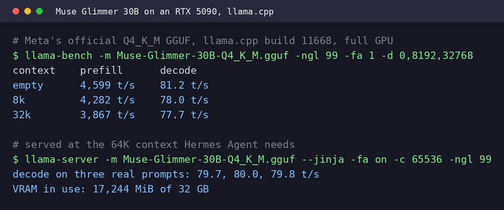

# Muse Glimmer

    
Meta (Meta Superintelligence Labs) · released 10 Aug 2026 · open weights (Apache 2.0) · current
    
Released 10 August 2026 by Meta Superintelligence Labs as a 30-billion-parameter model for local agents, with weights under the Apache 2.0 license — Meta’s first open-weight release after the closed launch of [Muse Spark](../muse-spark/) in April. Meta says it “trained Muse Glimmer on Muse Spark's outputs using logit distillation” and that a 4-bit build runs within a 24–32 GB consumer GPU. Two months later Meta released the 816B [Muse Spark Open](../muse-spark-open/).
    
Thin. Meta’s release post plus 4 corpus matches (2026-08-10 → 10-20), two with untranscribed images. Sourcing skew, named: local-inference developers; no character discourse yet.

    
## Sources

    
### Official

    

      
- 2026-08-10 [Introducing Muse Glimmer: An Open Agentic Model That Runs on Your Device](https://research.meta.ai/blog/introducing-muse-glimmer-open-agentic-model) (Meta) — “Today, we're introducing Muse Glimmer, the next model from Meta Superintelligence Labs, and open sourcing the model weights under a permissive Apache 2.0 license.” “Muse Glimmer is a 30-billion-parameter model optimized for always-on local agent workflows.” Training: “Pre-Training. We trained Muse Glimmer on Muse Spark's outputs using logit distillation, leveraging a similar data mix as the teacher.” Weights at [meta-models/Muse-Glimmer-30B](https://huggingface.co/meta-models/Muse-Glimmer-30B).
      
- tk — the Hugging Face model card (not retrieved); the open-weight risk assessment the post refers to.
    
    
### Writing & commentary

    

      
- 2026-10 DataCamp, [Muse Wonder and Muse Wonder Full](https://www.datacamp.com/blog/muse-wonder-and-muse-wonder-full) — in passing: “Muse Glimmer is a separate, smaller model (30 billion parameters) from August that you can download and run yourself.”
    
    
### Tweets

    
4 corpus matches (supplement db); all below and reproduced in the records. Pull and triage in the [dossier](../_dossiers/muse-glimmer.md).
    

      
- 2026-08-10 @jmbollenbacher — “muse glimmer seems weaker than qwen-3.5.

not even 3.6 or 3.8. honestly the qwen 9b models might even be stronger.” [link](../archive/t/2086912699758227682/)
      
- 2026-08-11 @witcheer — (local benchmark; image; text breaks off in the archive) “Meta is back in open weights: Muse Glimmer, a dense 30B VLM, Apache 2.0, released yesterday. I benchmarked it on my RTX 5090

28B text decoder plus a 2B vision encoder. hybrid attention, three sliding-window layers then one full-attention layer with no positional embedding, repeated 13 times. 16 query heads share each KV head, so the KV cache is small.…” (full text in records) [link](../archive/t/2087110487007731795/)
      
- 2026-10-13 @raunakdoesdev — “changed the default model for my main agent thread in raubot (my personal agent) to muse glimmer! very unexpected 

subagents still do most of the coding and are kept as opus” [link](../archive/t/2109873786044690550/)
      
- 2026-10-20 @witcheer — (image) “Muse Glimmer 30B, Meta's new open-weight agent model, runs fully on one RTX 5090 with room to spare, and keeps its speed as the context fills up.…” (full text in records) [link](../archive/t/2112529273273938103/)
    

    
## Official record

    

      
- Released 10 August 2026; weights on Hugging Face under Apache 2.0; text and image input through a “dedicated perception encoder”; trained on data from more than 100 languages; ships with a DFlash-based speculative-decoding drafter. CONFIRMED
      
- Training (Meta): logit distillation from Muse Spark outputs (pre-training), longer-context agent-heavy mid-training, then supervised fine-tuning with on-policy distillation and RL. “Muse Glimmer was evaluated under the standards set out in Meta's Advanced AI Scaling Framework and assessed for open-weight release across all relevant categories.” CONFIRMED
      
- Hardware: “At full precision, a 30-billion parameter model would require over 55 GB of memory”; quantized to about 4-bit, the language model is “under 20 GB”. Meta compares it favorably with Gemma4-31B and Qwen3.6-27B on several benchmarks. CONFIRMED (as published)
    

    
## History

    

      
- 2026-08-10 Release: four months after the closed [Muse Spark](../muse-spark/) launch, Meta publishes open weights for a small distilled model, framed as “Keeping with our long tradition of sharing fundamental AI research”; local runtimes (llama.cpp, MLX, ExecuTorch, Ollama, LM Studio) follow. Developer reception the same week: “Meta is back in open weights” (@witcheer) against “muse glimmer seems weaker than qwen-3.5” (@jmbollenbacher).
      
- 2026-10-15 The larger release: Meta follows with [Muse Spark Open](../muse-spark-open/) (816B total), under a more restrictive Muse Model License.
    

    
## Impressions

    

      
- Reception: discussed as local agent infrastructure — speed on one consumer GPU (@witcheer), a surprise choice as a main agent thread with Opus subagents doing the coding (@raunakdoesdev, 2026-10-13), and a capability doubt against similar-size Qwen models (@jmbollenbacher, 2026-08-10).
      
- tk — character or style reports; whether it inherits Muse Spark’s voice through distillation; transcription of the two image-tweets.
    

    
    
## Records

    
Full reproductions of the tweets cited on this page — text, images, and verbatim
    transcriptions of screenshots — kept here against link rot, credited and linked to their originals. Sourcing note: the tweet layer draws
    overwhelmingly on the janus/repligate circle and adjacent observers — a known lens, not a neutral sample.
    Sourced from the [community archive](https://github.com/TheExGenesis/community-archive) and the
    janus corpus. Yours and you’d rather it weren’t here? [Open an issue.](https://github.com/llm-pantheon/llm-pantheon.github.io/issues)

      

        
@jmbollenbacher 2026-08-10 ♥1 ↻0 [archive](../archive/t/2086912699758227682/) [original ↗](https://x.com/jmbollenbacher/status/2086912699758227682)
        
muse glimmer seems weaker than qwen-3.5.

not even 3.6 or 3.8. honestly the qwen 9b models might even be stronger.
      
      

        
@witcheer 2026-08-11 ♥36 ↻1 [archive](../archive/t/2087110487007731795/) [original ↗](https://x.com/witcheer/status/2087110487007731795)
        
Meta is back in open weights: Muse Glimmer, a dense 30B VLM, Apache 2.0, released yesterday. I benchmarked it on my RTX 5090

28B text decoder plus a 2B vision encoder. hybrid attention, three sliding-window layers then one full-attention layer with no positional embedding, repeated 13 times. 16 query heads share each KV head, so the KV cache is small.

result (UD-Q4_K_XL, 15.9GB file, llama.cpp master):

- 85.7 tok/s generation, fully resident in VRAM, 15.4GB of 32GB used
- prefill 4769 tok/s at 512 ctx, still 4429 at 16K
- MMLU 80.6 / ARC-C 93.5 / HellaSwag 88.8 / HumanEval 95.7 / GSM8K 96.7, q_avg 91.1 on my five-task board

the offloaded 120B-class MoEs I've been benching run 46 to 47 tok/s on this card because every token waits on system RAM. 
Muse Glimmer runs at 85.7 with half the card spare.
        

          
        
      
      

        
@raunakdoesdev 2026-10-13 ♥5 ↻0 [archive](../archive/t/2109873786044690550/) [original ↗](https://x.com/raunakdoesdev/status/2109873786044690550)
        
changed the default model for my main agent thread in raubot (my personal agent) to muse glimmer! very unexpected 

subagents still do most of the coding and are kept as opus
      
      

        
@witcheer 2026-10-20 ♥28 ↻0 [archive](../archive/t/2112529273273938103/) [original ↗](https://x.com/witcheer/status/2112529273273938103)
        
Muse Glimmer 30B, Meta's new open-weight agent model, runs fully on one RTX 5090 with room to spare, and keeps its speed as the context fills up.

I ran Meta's own 4-bit GGUF on llama.cpp, then served it at the 64K context Hermes Agent needs.

> decode barely moves between an empty context and 32k, which matters for an agent: its context grows with every tool call.

> however, I've only measured speed so far. how well it handles real agent work is the next test.

to point your Hermes Agent at it: start llama-server with --jinja, then `hermes model`, Custom endpoint, [http://localhost:8080/v1](http://localhost:8080/v1)
        

          
        
      
    

    
[← back to the Pantheon](../)
