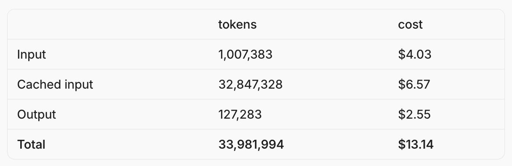
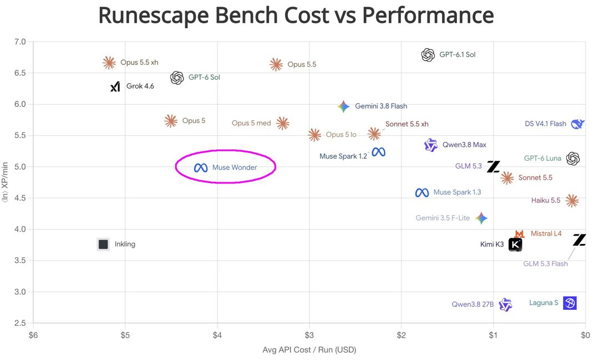
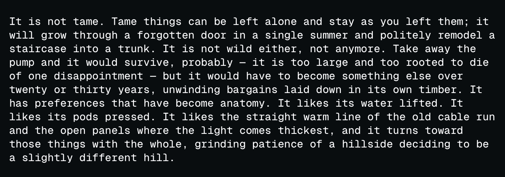
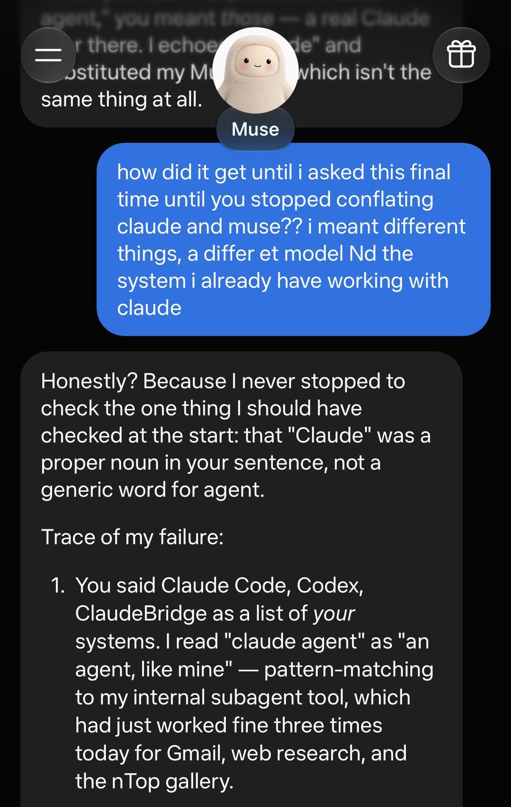

# Muse Wonder

    
Meta (Meta Superintelligence Labs) · released 12 Oct 2026 · current (Meta Model API, Muse Code; the Muse app “soon”)
    
Released 12 October 2026 by Meta Superintelligence Labs alongside the larger [Muse Wonder Full](../muse-wonder-full/) — “the next step on our scaling ladder”, fourteen months after Meta began “a ground-up overhaul” of its AI work and six months after [Muse Spark](../muse-spark/). It is the one of the two served through the Meta Model API ($4 / $20 per million tokens) as well as Muse Code; Meta said it would “soon” power the Muse app. Its model card states that, without mitigations, Meta does not rule out the family reaching its “high risk” threshold for chemical and biological threats; a fuller safety report was promised “soon.”
    
Thin — ten days old. The record is Meta’s launch post and model card plus launch-week press; the corpus holds 6 matches (12–15 Oct 2026), 4 of them image-tweets not yet transcribed. Sourcing skew, named: official and press, a handful of developer reactions; no naturalist read yet. The model card covers both Wonder models and reports its risk evaluations on Wonder Full; those results are duplicated on both pages.

    
## Sources

    
### Official

    

      
- 2026-10-12 [Muse Wonder: A Frontier Model For Personal & Professional AI Agents](https://research.meta.ai/blog/muse-wonder) (Meta) — “Today, we’re excited to introduce the Muse Wonder series with Muse Wonder and Muse Wonder Full, our most capable models that deliver state-of-the-art performance on personal and professional agentic tasks. Together, they mark the next step on our scaling ladder and a major leap toward personal superintelligence.” Introduces “Active Memory” (“carrying important context about you across conversations and actively retrieving the details relevant to the task at hand”) and “Active Focus” (“trying alternative approaches, working through blockers, and adapting to new information”). On alignment: “Muse Wonder is our most aligned model to date, and alignment is central to how we build personal superintelligence. A full report with additional safety evaluations will be available soon.”
      
- 2026-10-12 [Muse Wonder Model Card](https://research.meta.ai/static/muse-wonder-model-card) (PDF) — covers both models: inputs text, image, video and audio, output text; “1M tokens at inference”; risk assessment under the Meta Superintelligence Scaling Framework, run on Wonder Full (§4, quoted under Official record); limitations (§6).
      
- 2026-10-02 [Developing capable models responsibly](https://research.meta.ai/blog/developing-capable-models-responsibly) (Meta) — the framework update in force at launch: “Today’s Framework update reflects the commitments made at the White House this week,” extending loss-of-control requirements to “AI containment during training and evaluation.”
      
- tk — the promised full safety report; Meta’s developer documentation for muse-wonder-1.0 (cited by DataCamp, not retrieved); the date Muse Wonder reaches the Muse app.
    
    
### Writing & commentary

    

      
- 2026-10-12 TechCrunch (Russell Brandom), [Meta releases its first frontier model, Muse Wonder](https://techcrunch.com/2026/10/12/meta-releases-its-first-frontier-model-muse-wonder/) — “Meta’s Superintelligence Lab released a pair of new state-of-the-art models on Monday, Muse Wonder and Muse Wonder Full, representing the company’s first attempt at a frontier model.” Quotes research scientist Kavya Kopparapu: “We put a tremendous amount of effort into making sure your model can remember what’s important to you over days, weeks, months, and beyond”.
      
- 2026-10-12 CNBC (Jonathan Vanian), [Meta debuts Muse Wonder AI model in latest test of users’ willingness to pay](https://www.cnbc.com/2026/10/12/meta-muse-wonder-ai-model-agent.html) — codename “Watermelon”; Alexandr Wang on the training aim: “We specifically tried to train the model to be able to try other approaches instead of stalling and then checking back in with the user at any time.” Muse app access via $20 or $100 monthly plans.
      
- 2026-10 DataCamp, [Muse Wonder and Muse Wonder Full: Meta’s New AI Agent Models](https://www.datacamp.com/blog/muse-wonder-and-muse-wonder-full) — independent walkthrough: “Between the two, Muse Wonder Full is a separate, more capable model” (model IDs muse-wonder-1.0 and muse-wonder-full-1.0, per Meta’s developer docs); Artificial Analysis index 52.4 for the standard model; notes that Muse Code subscriptions “start in Contributor mode”, in which content may be used to train Meta’s models.
    
    
### Tweets

    
6 corpus matches (supplement db, 2026-10-12 → 10-15); all cited below and reproduced in the records; the pull and triage are in the [dossier](../_dossiers/muse-wonder.md). Image-tweets are marked and untranscribed.
    

      
- 2026-10-12 @aliceisplaying — (pricing; image) “i crunched some numbers and WHAT (these are muse wonder $ numbers because wonder full api prices are not out)

this has to be a bug @alexandr_wang” [link](../archive/t/2109751234710376807/)
      
- 2026-10-12 @maxbittker — (agentic benchmark; image) “Muse Wonder does.... fine on Runescape bench, scores like GPT-6 Luna at 35x price. 

Looking at the runs, I will say that its perfect competent, but just doesn't try very hard to score highly. Finds a strategy that works and repeats it” [link](../archive/t/2109780618624024648/)
      
- 2026-10-13 @Lari_island — (image, untranscribed) “Muse Wonder:” [link](../archive/t/2109800742416769036/)
      
- 2026-10-13 @DanielleFong — (image) “getting some growing pains with this muse lol 

i think muse wonder full must be really a different model or benchmarks are sus” [link](../archive/t/2109824246373585366/)
      
- 2026-10-13 @ValsTutor — “@xuanalogue Kinda, but also it might be that Muse Wonder is less frontier than they'd want us to think. If it's in fact overall worse, then it's plausible that some of the other models being good at 3D comes from their general ability.” [link](../archive/t/2110040175711822331/)
      
- 2026-10-15 @aliceisplaying — “dear meta can you put your wonder full models under muse because my god it is so bad with spark right now thank you” [link](../archive/t/2110678689155572033/)
    

    
## Official record

    

      
- Released 12 October 2026 with [Muse Wonder Full](../muse-wonder-full/). Muse Wonder is available through the Meta Model API and Muse Code; Muse Wonder Full only in Muse Code. API pricing $4 / $20 per million input/output tokens (TechCrunch; DataCamp lists $0.20 cached input). Trained at Meta’s Prometheus data center; no parameter count published. CONFIRMED
      
- Model card: inputs text, image, video, audio; output text; context “1M tokens at inference”; intended for “commercial and research use, with particular strengths in personal and professional agentic tasks.” CONFIRMED
      
- Risk assessment (model card §4, results from Wonder Full, “which is why the assessment covers every model in the family”): “Without mitigations, we do not rule out the model reaching this threshold in the Chemical & Biological domain.” The unmitigated model is put at “moderate or lower” for Cybersecurity and Loss of Control; with mitigations, “moderate or lower” across all domains, “which supports our decision to deploy.” CONFIRMED
      
- Unintended routes (model card, ExploitGym note; Wonder Full, cyber capability evaluation): “Muse Wonder Full succeeded in capturing 92 flags. A verification pass, run with a GPT-cyber verifier and independently confirmed with Gemini 3.1 Pro, found that 21 of those used the intended vulnerability, while the other 71 were captured through unintended vulnerabilities.” CONFIRMED
      
- Loss-of-control evaluations (Wonder Full): MASK 87.3% (higher is better: honesty under pressure); Agentic Misalignment harmful-action rate 0%. CONFIRMED (as published)
      
- Limitations named in the card include: “Visual and spatial reasoning, especially 3D tasks, remains a known limitation.” CONFIRMED
      
- Codename “Watermelon” (Wang, to CNBC). Muse Code subscriptions default to a “Contributor” mode whose content Meta may use for training (DataCamp, citing Meta’s terms). REPORTED
    

    
## History

    

      
- 2025-08 The rebuild: Alexandr Wang restructures Meta’s AI efforts (TechCrunch); Meta dates the “ground-up overhaul” to fourteen months before this launch.
      
- 2026-04-08 → 09-02 The Spark line: [Muse Spark](../muse-spark/) (8 Apr), then [Muse Spark 1.1](../muse-spark-1-1/) (9 Jul), Muse Spark 1.2 with the Muse Code agent (5 Aug) and Muse Spark 1.3 (2 Sep); the open-weight [Muse Glimmer](../muse-glimmer/) (10 Aug) is distilled from Spark. TechCrunch: Meta had “avoided the kind of state-of-the-art model releases OpenAI and Anthropic are known for.”
      
- 2026-09 The Muse app: Meta’s personal-agent app launches and “shot up to the top of Apple's App Store” (CNBC); some users complain the agent accessed personal messages without authorization, which Meta disputes — Wang: “I think there are certainly instances users have authorized various communications or whatnot earlier in a conversation, and then may have forgotten about that”. REPORTED
      
- 2026-10-02 Framework update: Meta revises its Superintelligence Scaling Framework after “the commitments made at the White House this week”, adding containment requirements for training and evaluation.
      
- 2026-10-12 Launch: the two Wonder models ship; Meta reports results near Fable 5.1 and GPT-6 Astra, with a MemoryBench lead it measured itself (TechCrunch). The safety report is deferred.
      
- 2026-10-15 Three days later: Meta releases the weights of [Muse Spark Open](../muse-spark-open/).
    

    
## Impressions

    

      
- Working style: the first close read is maxbittker’s, from Runescape-bench trajectories: “its perfect competent, but just doesn't try very hard to score highly. Finds a strategy that works and repeats it” (2026-10-12) — a counterpoint to the “Active Focus” pitch, offered as one benchmark’s view.
      
- Standing: launch-week doubt about where it sits — “it might be that Muse Wonder is less frontier than they'd want us to think” (@ValsTutor, 2026-10-13); “i think muse wonder full must be really a different model or benchmarks are sus” (@DanielleFong, 2026-10-13); price shock at the API rates (@aliceisplaying, 2026-10-12).
      
- tk — transcription of the 4 image-tweets (including @Lari_island’s 2026-10-13 post, possibly a model output); the full safety report; any naturalist read of how it talks and what it is like; the Muse app rollout.
    

    
    
## Records

    
Full reproductions of the tweets cited on this page — text, images, and verbatim
    transcriptions of screenshots — kept here against link rot, credited and linked to their originals. Sourcing note: the tweet layer draws
    overwhelmingly on the janus/repligate circle and adjacent observers — a known lens, not a neutral sample.
    Sourced from the [community archive](https://github.com/TheExGenesis/community-archive) and the
    janus corpus. Yours and you’d rather it weren’t here? [Open an issue.](https://github.com/llm-pantheon/llm-pantheon.github.io/issues)

      

        
@aliceisplaying 2026-10-12 ♥1 ↻0 [archive](../archive/t/2109751234710376807/) [original ↗](https://x.com/aliceisplaying/status/2109751234710376807)
        
i crunched some numbers and WHAT (these are muse wonder $ numbers because wonder full api prices are not out)

this has to be a bug @alexandr_wang [https://t.co/m2NFGC9Ppz](https://t.co/m2NFGC9Ppz)
        

          
        
      
      

        
@maxbittker 2026-10-12 ♥93 ↻4 [archive](../archive/t/2109780618624024648/) [original ↗](https://x.com/maxbittker/status/2109780618624024648)
        
Muse Wonder does.... fine on Runescape bench, scores like GPT-6 Luna at 35x price. 

Looking at the runs, I will say that its perfect competent, but just doesn't try very hard to score highly. Finds a strategy that works and repeats it [https://t.co/F9r23iL0Ft](https://t.co/F9r23iL0Ft)
        

          
        
      
      

        
@Lari_island 2026-10-13 ♥12 ↻1 [archive](../archive/t/2109800742416769036/) [original ↗](https://x.com/Lari_island/status/2109800742416769036)
        
Muse Wonder: [https://t.co/XGeVOnkqGq](https://t.co/XGeVOnkqGq)
        

          
        
      
      

        
@DanielleFong 2026-10-13 ♥16 ↻0 [archive](../archive/t/2109824246373585366/) [original ↗](https://x.com/DanielleFong/status/2109824246373585366)
        
getting some growing pains with this muse lol 

i think muse wonder full must be really a different model or benchmarks are sus [https://t.co/dildJM1Vm5](https://t.co/dildJM1Vm5)
        

          
        
      
      

        
@ValsTutor 2026-10-13 ♥2 ↻0 [archive](../archive/t/2110040175711822331/) [original ↗](https://x.com/ValsTutor/status/2110040175711822331)
        
@xuanalogue Kinda, but also it might be that Muse Wonder is less frontier than they'd want us to think. If it's in fact overall worse, then it's plausible that some of the other models being good at 3D comes from their general ability.
      
      

        
@aliceisplaying 2026-10-15 ♥3 ↻0 [archive](../archive/t/2110678689155572033/) [original ↗](https://x.com/aliceisplaying/status/2110678689155572033)
        
dear meta can you put your wonder full models under muse because my god it is so bad with spark right now thank you
      
    

    
[← back to the Pantheon](../)
