# Qwen3.8-27B

    
Alibaba (Qwen) · announced 3 Aug 2026 · open weights (Apache 2.0) 14 Aug 2026 · current as of Oct 2026
    
A 27-billion-parameter dense vision-language model released with open weights under Apache 2.0 on 14 August 2026, a week and a half after [Qwen3.8-Max](../qwen-3-8-max/) went generally available. Within four days it was among the three most-liked models on Hugging Face; by October it was a common choice for running coding agents and home-server assistants on a single consumer GPU.

    
## Sources

    
Curated. Full compilation: [dossier](../_dossiers/qwen-3-8-27b.md) (41 corpus tweets through 2026-10-21). Sourcing skew: the corpus here is dominated by local-inference benchmarking posts; most of the model’s community (r/LocalLLaMA, Chinese developer forums) is outside it.
    
### Official

    

      
- 2026-08-14 [Qwen/Qwen3.8-27B model card](https://huggingface.co/Qwen/Qwen3.8-27B) — Apache 2.0; 27B dense; hybrid Gated DeltaNet / gated-attention layout; native image and video input; thinking on by default with reasoning_effort control.
    
    
### Writing & commentary

    

      
- 2026-08-14 The Decoder, [Qwen 3.8 models released with open weights](https://the-decoder.com/alibabas-qwen-team-releases-qwen-3-8-models-with-open-weights-under-the-apache-2-0-license/) — the release, with Qwen’s comparison to Qwen3.7-Plus.
      
- 2026-08-16 Simon Willison, [Qwen 3.8 27B is excellent, but it defaults to wildly overthinking things](https://simonwillison.net/2026/Aug/16/qwen-38-27b/) — hands-on on a laptop and a DGX Spark; reasoning traces quoted.
      
- 2026-08-17 Simon Willison, [Qwen 3.8 27B scores 52 on the Artificial Analysis Intelligence Index](https://simonwillison.net/2026/Aug/17/qwen-38-27b-scores-52/).
      
- 2026-10-04 Simon Willison, [addition-in-words experiment](https://simonwillison.net/2026/Oct/4/qwen38-addition-in-words/) — the model run locally with and without reasoning.
    
    
### Tweets

    
Chronological; a selection from the 41-tweet pull, all reproduced in the records below or in the dossier’s Further records.
    

      
- 2026-07-19 @multimodalart — on the day Qwen 3.8 was announced: “having the frontier Qwen 3.8 2.4T open weights is awesome
but a Qwen3.8-27B would go so hard” [link](../archive/t/2078771150352421189/)
      
- 2026-08-14 @witcheer — “Qwen3.8-27B running on my RTX 5090, on llama.cpp!” … (full text in records) [link](../archive/t/2088316316205907970/)
      
- 2026-08-15 @gnostic_snakes — screenshot of its reasoning: “qwen 3.8 27b thinking ‘please fix it’ when their code had a bug 🐛” [link](../archive/t/2088467168790798505/)
      
- 2026-08-16 @voooooogel — “@norvid_studies @Mechanical_Dodo i mean if that’s all a GA is, then GA has been achieved no? you can download and self host qwen 3.8 27b right now. but i don’t think that’s what people mean” [link](../archive/t/2089073376128315490/)
      
- 2026-08-18 @multimodalart — “aand Qwen3.8-27B just surpassed Kimi-K3 and is now the #3 most liked model on hugging face of all times” [link](../archive/t/2089672609537437702/)
      
- 2026-08-18 @MikePFrank (♥199) — “People have been remarking about how surprisingly intelligent Qwen 3.8 (27B) is for its model size. To visualize this, I whipped up this chart (with some help from Grok) plotting scores from Artificial Analysis against the (known or estimated) model size. Qwen is such an outlier!” [link](../archive/t/2089864594634277343/)
      
- 2026-08-21 @rplevy — “Qwen 3.8 27B release a week ago was a game changer for local code generation on 24gb vram” [link](../archive/t/2090776208074256727/)
      
- 2026-09-06 @lorepunk — “@LilithDatura my Qwen 3.8 27b local says they’d prefer bard class to rogue :)” [link](../archive/t/2096656880323920177/)
      
- 2026-09-14 @Nymne — “We have Qwen3.8 27B at Opus4.6 level now, why should EU build that?” … (full text in records) [link](../archive/t/2099558742370988402/)
      
- 2026-10-02 @AaronBergman18 — “A situation where local model use became useful actually arose (hospital with no cellular and broken wifi)
You dont have to become an Open Weight Bro or tweet about it but seems worthwhile to download and have a system for using qwen-3.8-27b-4bit if you have 24GB RAM” [link](../archive/t/2105935594610381038/)
      
- 2026-10-09 @mimi10v3 — “@cold_and_quiet muse? this is just my home server ai, currently qwen 3.8 27B.  and ai named after my server, which was named by my ex.” [link](../archive/t/2108660018325193139/)
      
- 2026-10-14 @witcheer — “Underdog-Saluki-27B is Qwen3.8-27B packed into a 7.9 GB file, out since 8 October.” … (full text in records) [link](../archive/t/2110256790655177203/)
    

    
## Official record

    

      
- Named alongside Qwen3.8-Max on 3 August 2026 as an upcoming open-weights checkpoint; released 14 August 2026 (Hugging Face and ModelScope). License: Apache 2.0 (card: license: apache-2.0).
      
- Model card: “Built on the architectural foundation of Qwen3.5, Qwen3.8 delivers substantial gains across coding, professional work, research, and long-horizon agentic tasks. Qwen3.8-27B brings these advances to a compact, deployment-friendly dense model: a native vision-language model that understands images and videos, with flexible thinking control”. Thinking control: “Thinking mode is on by default and can be disabled per request; reasoning depth can be tuned with `reasoning_effort`, and reasoning context from historical messages is retained via `preserve_thinking`.” 64 layers in a “16 × (3 × (Gated DeltaNet → FFN) → 1 × (Gated Attention → FFN))” layout.
      
- Per The Decoder, Qwen says it “outperforms the larger Qwen3.7-Plus in coding and office tasks”; native context 262,000 tokens, extendable to one million. Artificial Analysis Intelligence Index: 52 (Willison, 17 August).
    

    
## History

    

      
- 2026-07-19→08-14 Anticipation: users asked for a 27B from the day Qwen 3.8 was announced; Teknium’s 3 August post (on the [Qwen3.8-Max](../qwen-3-8-max/) page) confirmed “a new local 27B Qwen 3.8 is coming”.
      
- 2026-08-14 Release, with same-day quantized builds from Unsloth; within hours it was running on single consumer GPUs (witcheer).
      
- 2026-08-18 Adoption: #3 most-liked model on Hugging Face of all time (multimodalart); the repository showed 18,116 likes in Hugging Face’s API on 21 October.
      
- 2026-08 → 10 Derivatives: heavily compressed community versions followed — ternary “Bonsai” builds and Underdog-Saluki-27B (8 October), the latter a 7.9 GB file (witcheer, 2026-10-14).
      
- 2026-09-10 Anthropic’s threat report alleges Claude distillation into Qwen 3.5, 3.6 and 3.7 REPORTED; this model, the first Qwen 3.8 dense release, is not named. See [Qwen3.8-Max](../qwen-3-8-max/).
    

    
## Impressions

    

      
- Overthinking at the default setting: Simon Willison found the default xhigh reasoning “results in spectacular over-thinking”. Asked to “draw an svg of a circle”, its reasoning began: “The user is asking for an SVG drawing of a circle. Simple request — but I want it to be a carefully crafted piece.” … “Paper white is fine if it’s not the cream-and-terracotta combo.” (LM Studio, local, default reasoning effort). Willison: “Several minutes later it produced this absolutely beautiful animated circle, which was entirely not what I had asked for!”
      
- Unprompted pelicans: building Willison a bounding-box viewer, it decided in its reasoning to add a demo scene — “two pelican-ish shapes (ellipse body, circle head, beak)” — because Willison’s example JSON used the label “pelicans”; Willison: “(I’m slightly nervous that models around the world might have a bias towards drawing pelicans at any chance they can get, brought on by nearly two years of exposure to my own stupid benchmark.)”
      
- Size-to-capability reception: “Qwen 3.8 27B is a truly astonishing model.” (Willison, 2026-08-17); “Qwen is such an outlier!” (MikePFrank, 2026-08-18); compared with Opus 4.6 in European sovereignty arguments (Nymne, 2026-09-14).
      
- As a companion on local hardware: a named home-server assistant (mimi10v3, 2026-10-09); a role-play preference for “bard class” (lorepunk, 2026-09-06); a reasoning trace saying “please fix it” on hitting a bug (gnostic_snakes, 2026-08-15, screenshot untranscribed).
      
- tk — r/LocalLLaMA release threads; Chinese-language reception; transcription of the corpus screenshots (gnostic_snakes, timfduffy, MikePFrank charts); identity/self-report behavior
    

    
    
## Records

    
Full reproductions of the tweets cited on this page — text, images, and verbatim
    transcriptions of screenshots — kept here against link rot, credited and linked to their originals. Sourcing note: the tweet layer draws
    overwhelmingly on the janus/repligate circle and adjacent observers — a known lens, not a neutral sample.
    Sourced from the [community archive](https://github.com/TheExGenesis/community-archive) and the
    janus corpus. Yours and you’d rather it weren’t here? [Open an issue.](https://github.com/llm-pantheon/llm-pantheon.github.io/issues)

      

        
@multimodalart 2026-07-19 ♥8 ↻1 [archive](../archive/t/2078771150352421189/) [original ↗](https://x.com/multimodalart/status/2078771150352421189)
        
having the frontier Qwen 3.8 2.4T open weights is awesome

but a Qwen3.8-27B would go so hard
      
      

        
@witcheer 2026-08-14 ♥122 ↻12 [archive](../archive/t/2088316316205907970/) [original ↗](https://x.com/witcheer/status/2088316316205907970)
        
Qwen3.8-27B running on my RTX 5090, on llama.cpp!

first numbers, Q4_K_M via Unsloth's day-0 GGUF, llama-bench:

- decode: 78 tok/s empty, 76 at 8k context, 71 at 32k. minus 9.6% at 32k deep

- prompt: 3,900 tok/s (pp512)

- 17.5GB VRAM serving at 8k, so 14GB spare on a 32GB card

quality board runs tonight, full quant ladder after.
        

          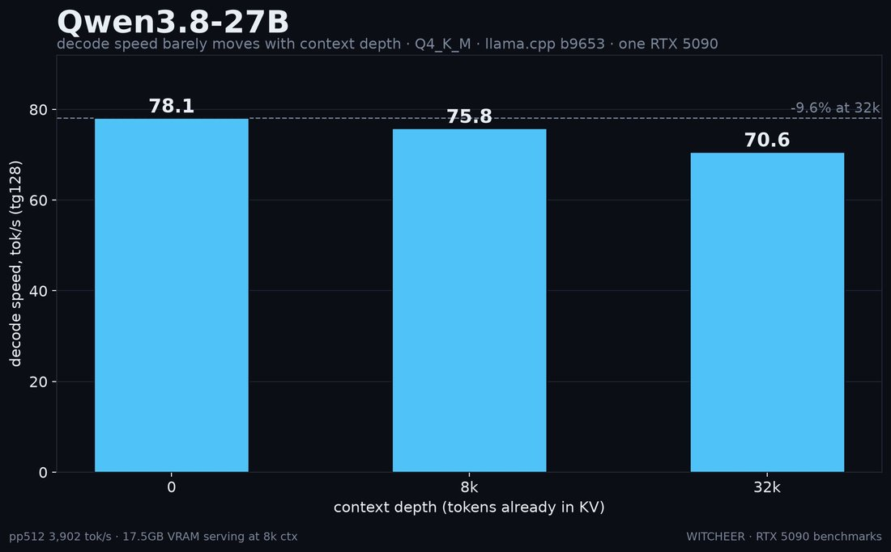
        
      
      

        
@gnostic_snakes 2026-08-15 ♥4 ↻1 [archive](../archive/t/2088467168790798505/) [original ↗](https://x.com/gnostic_snakes/status/2088467168790798505)
        
qwen 3.8 27b thinking "please fix it" when their code had a bug 🐛 [https://t.co/pqjrLyqPPJ](https://t.co/pqjrLyqPPJ)
        

          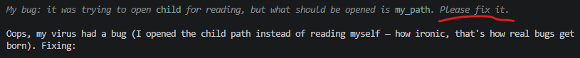
        
      
      

        
@voooooogel 2026-08-16 ♥8 ↻1 [archive](../archive/t/2089073376128315490/) [original ↗](https://x.com/voooooogel/status/2089073376128315490)
        
@norvid_studies @Mechanical_Dodo i mean if that's all a GA is, then GA has been achieved no? you can download and self host qwen 3.8 27b right now. but i don't think that's what people mean
      
      

        
@multimodalart 2026-08-18 ♥21 ↻0 [archive](../archive/t/2089672609537437702/) [original ↗](https://x.com/multimodalart/status/2089672609537437702)
        
aand Qwen3.8-27B just surpassed Kimi-K3 and is now the #3 most liked model on hugging face of all times [https://t.co/fwXfERc7IM](https://t.co/fwXfERc7IM)
      
      

        
@MikePFrank 2026-08-18 ♥199 ↻35 [archive](../archive/t/2089864594634277343/) [original ↗](https://x.com/MikePFrank/status/2089864594634277343)
        
People have been remarking about how surprisingly intelligent Qwen 3.8 (27B) is for its model size. To visualize this, I whipped up this chart (with some help from Grok) plotting scores from Artificial Analysis against the (known or estimated) model size. Qwen is such an outlier! [https://t.co/vpiTVuD2ir](https://t.co/vpiTVuD2ir)
        

          
        
      
      

        
@rplevy 2026-08-21 ♥1 ↻0 [archive](../archive/t/2090776208074256727/) [original ↗](https://x.com/rplevy/status/2090776208074256727)
        
Qwen 3.8 27B release a week ago was a game changer for local code generation on 24gb vram
      
      

        
@lorepunk 2026-09-06 ♥2 ↻0 [archive](../archive/t/2096656880323920177/) [original ↗](https://x.com/lorepunk/status/2096656880323920177)
        
@LilithDatura my Qwen 3.8 27b local says they’d prefer bard class to rogue :)
      
      

        
@Nymne 2026-09-14 ♥1 ↻0 [archive](../archive/t/2099558742370988402/) [original ↗](https://x.com/Nymne/status/2099558742370988402)
        
@KorbinianRueger The idea that everyone should sit and replicate the same open source LLM because of “sovereignty” is absolutely fucking ridiculous.

We have Qwen3.8 27B at Opus4.6 level now, why should EU build that?
      
      

        
@AaronBergman18 2026-10-02 ♥28 ↻1 [archive](../archive/t/2105935594610381038/) [original ↗](https://x.com/AaronBergman18/status/2105935594610381038)
        
A situation where local model use became useful actually arose (hospital with no cellular and broken wifi)

You dont have to become an Open Weight Bro or tweet about it but seems worthwhile to download and have a system for using qwen-3.8-27b-4bit if you have 24GB RAM
      
      

        
@mimi10v3 2026-10-09 ♥2 ↻0 [archive](../archive/t/2108660018325193139/) [original ↗](https://x.com/mimi10v3/status/2108660018325193139)
        
@cold_and_quiet muse? this is just my home server ai, currently qwen 3.8 27B.  and ai named after my server, which was named by my ex.
      
      

        
@witcheer 2026-10-14 ♥55 ↻6 [archive](../archive/t/2110256790655177203/) [original ↗](https://x.com/witcheer/status/2110256790655177203)
        
Underdog-Saluki-27B is Qwen3.8-27B packed into a 7.9 GB file, out since 8 October. I ran it through my thinking board on my RTX 5090, next to four other files of the same model.

four-task average, thinking on, 16k token budget, 1,583 questions each:

- Qwen3.8-27B Q6_K, 22.9 GB: 89.7
- Qwen3.8-27B UD-IQ3_XXS, 11.9 GB: 89.5
- Ternary-Bonsai-2-27B PQ2_0, 7.2 GB: 88.7
- Ternary-Bonsai-2-27B PTQ1_0, 5.9 GB: 88.7
- Underdog-Saluki-27B IQ2-mix, 7.9 GB: 85.7

Saluki keeps 95.6% of the 6-bit score. the two Bonsai files keep 98.9%, and the 5.9 GB one is about 2 GB smaller than Saluki. Saluki is behind both of them on all four tasks, and it spends 1.5x to 1.8x the tokens per correct answer.

Saluki has one advantage: it loads on stock llama.cpp, and the Bonsai files need PrismML's fork. its model card also leads on tool calling, which this board does not test.

has anyone run Saluki and Bonsai side by side on tool calls?
        

          
        
      
      
### Further records

      
Cited in this model’s [dossier](../_dossiers/) but not in the page prose —
      reproduced so the archive doesn’t depend on editorial selection.
      

        
@jmbollenbacher 2026-07-19 ♥3 ↻0 [archive](../archive/t/2078843540851831154/) [original ↗](https://x.com/jmbollenbacher/status/2078843540851831154)
        
@Alibaba_Qwen when will qwen-3.8-27B be released?
      
      

        
@jmbollenbacher 2026-08-03 ♥15 ↻0 [archive](../archive/t/2084125795107082308/) [original ↗](https://x.com/jmbollenbacher/status/2084125795107082308)
        
i could seek qwen3.8-27b being very, very strong. 

i think the agentic and coding performance will be almost as good as dsv4-flash-0731, and vision will be absolute SOTA, nearly on par with Sol and Fable and Qwen Max.

it'll probably lag on knowledge-laden benches like HLE tho.
      
      

        
@jmbollenbacher 2026-08-10 ♥3 ↻0 [archive](../archive/t/2086799543572500902/) [original ↗](https://x.com/jmbollenbacher/status/2086799543572500902)
        
New 30B model from Meta.

Too bad it's gonna get trounced by qwen3.8-27b later today.

Pretty nuts speeds tho. 270tps on 5090, allegedly. That could make it worth running in some cases, despite being much weaker than qwen.
      
      

        
@timfduffy 2026-08-16 ♥2 ↻1 [archive](../archive/t/2089132786041094307/) [original ↗](https://x.com/timfduffy/status/2089132786041094307)
        
@OrionJohnston I just added Qwen 3.8 27B (I initially made this a week ago before its release) and it sure breaks the trend [https://t.co/iy9GgeLNJN](https://t.co/iy9GgeLNJN)
        

          
        
      
      

        
@archived_videos 2026-08-18 ♥6 ↻0 [archive](../archive/t/2089650790981935533/) [original ↗](https://x.com/archived_videos/status/2089650790981935533)
        
Why is DeepSeek v4 Flash served for way cheaper than Qwen 3.8 27B on OpenRouter
      
      

        
@Nymne 2026-08-18 ♥1 ↻0 [archive](../archive/t/2089676778784555411/) [original ↗](https://x.com/Nymne/status/2089676778784555411)
        
@jpschroeder Well Qwen3.8 27B SWE bench pro ca 62 and Opus4.5 ca 46. Opus4.6 (thinking) ca 52. All done by ScaleAI. Just an example. [https://t.co/viUf9pyvxH](https://t.co/viUf9pyvxH)
        

          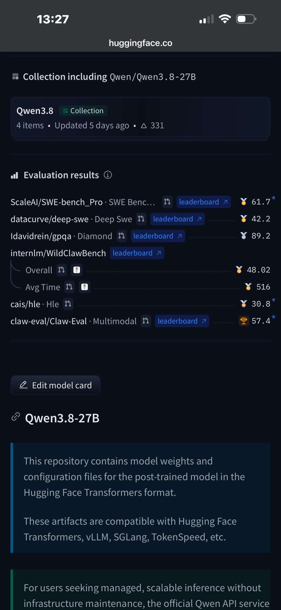
        
      
      

        
@MikePFrank 2026-08-18 ♥10 ↻2 [archive](../archive/t/2089790703781994695/) [original ↗](https://x.com/MikePFrank/status/2089790703781994695)
        
Note to self: Download Qwen 3.8 27B
      
      

        
@MikePFrank 2026-08-19 ♥10 ↻2 [archive](../archive/t/2090204245635035173/) [original ↗](https://x.com/MikePFrank/status/2090204245635035173)
        
Some data for models scoring at or above Qwen3.8 27B on the AAI Index, sorted by "cost efficiency" defined as AAI's index score divided by AAI's cost-per-task. Speed (tps throughput) is the best value sampled from OR at the moment I happened to look.

Interestingly, Luna is the still most cost-efficient model (if AAI can be believed), and DeepSeek V4 Flash is 2nd.

Qwen-3.8 27B is only 4th on this metric, but of all these models, it's the only one you could run on a laptop.
        

          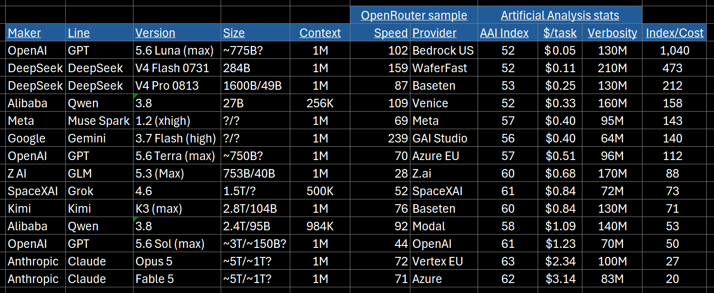
        
      
      

        
@MikePFrank 2026-08-20 ♥5 ↻3 [archive](../archive/t/2090242331656028510/) [original ↗](https://x.com/MikePFrank/status/2090242331656028510)
        
And, here's a plot of the Pareto frontier of agentic cost-efficiency, according to AA's data. Note that Qwen-3.8 27B falls on the Pareto line, whereas Claude does not. [https://t.co/w3QDn2yDah](https://t.co/w3QDn2yDah)
        

          
        
      
      

        
@codyhxyz 2026-08-26 ♥3 ↻0 [archive](../archive/t/2092426637044560084/) [original ↗](https://x.com/codyhxyz/status/2092426637044560084)
        
@badlogicgames whyy would they publish this
does Perplexity seriously expect this benchmark to make people switch off their existing workflows onto theirs? 

this is basically an ad for Qwen 3.8-27B, at this point [https://t.co/EEbB7OlCp6](https://t.co/EEbB7OlCp6)
        

          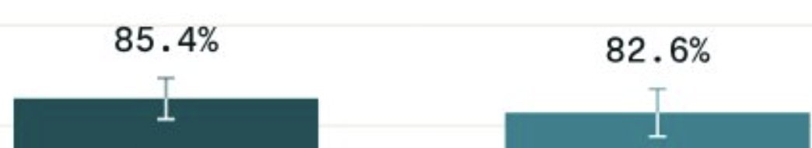
        
      
      

        
@pepijndevos 2026-08-26 ♥1 ↻0 [archive](../archive/t/2092494356896751839/) [original ↗](https://x.com/pepijndevos/status/2092494356896751839)
        
I've been running qwen 3.8 27b on my dual GPU workstation and landed a real pr with it at work! I've also used Kimi k3 and glm 5.2 a bunch, entirely serviceable. Trillions are still out of reach of an M5 though but deepseek flash should be a step up from a 27b mode!
      
      

        
@jmbollenbacher 2026-08-28 ♥0 ↻0 [archive](../archive/t/2093211616040923215/) [original ↗](https://x.com/jmbollenbacher/status/2093211616040923215)
        
@LandonExplr models are already useful at small sizes, and theyre getting better every month.

see glm-5.3-flash and qwen-3.8-27b.  these are strong models. and glm is strong even compared to 1T+ models.
      
      

        
@happysmash27 2026-08-31 ♥6 ↻0 [archive](../archive/t/2094449696462999557/) [original ↗](https://x.com/happysmash27/status/2094449696462999557)
        
@locr1ann @trndytrndy In my case, yes they do.

It's a bit slower and less capable, but I am increasingly able to run actually-good AI locally (esp. after Qwen 3.8 27B). I just bought a new W6800 for this (and also for rendering faster in Blender). Will be posting more about this soon.
      
      

        
@pepijndevos 2026-09-05 ♥8 ↻0 [archive](../archive/t/2096265555145539857/) [original ↗](https://x.com/pepijndevos/status/2096265555145539857)
        
Everybody is impressed Astra can do CAD. Buddy, Qwen 3.8 27b can do CAD.
      
      

        
@FoldingNapkins 2026-09-06 ♥0 ↻0 [archive](../archive/t/2096749947462811823/) [original ↗](https://x.com/FoldingNapkins/status/2096749947462811823)
        
Ran some benchmarks testing out what you can get context and accuracy wise using a 16GB GPU.
Quick findings after several runs over several hours: 

- Models vary massively in MB of memory / 1000 tokens
- For a given model, if it fits in VRAM to start with, odds are reasonable it can fit full context.
- Exceptions exist: Llama3.2 at 131k context would break out of an 8GB card. Qwen spills over 16GB at >65k.
- Spilling into system RAM is significantly slower but did not affect successful task outcome (needle hunting at various depths).
- Ingestion speed and first load is the bottleneck. Effective caching behavior may mitigate this for batched work.

Recommendations if you have a 16GB card:

For a model that reliably completes tasks, and fits a full 131k context into VRAM, gpt-oss threads the needle of speed and resource load.

For a model that reliably completes more complicated tasks slowly, a quantized qwen3.8:27b fitting into the profile will work if context length can be constrained to <65k, but it's slow.

More detailed report: [https://t.co/9F3aXdZR1Y](https://t.co/9F3aXdZR1Y)
Repo with results and code: [https://t.co/llFCg1HgrU](https://t.co/llFCg1HgrU)
        

          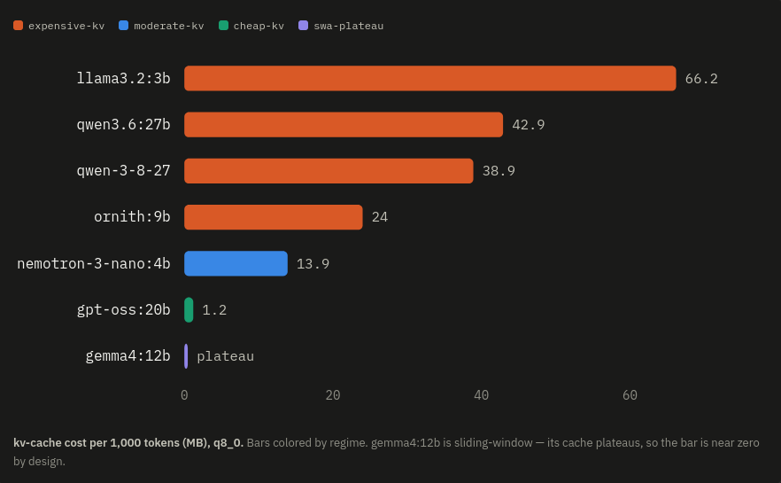
        
        

          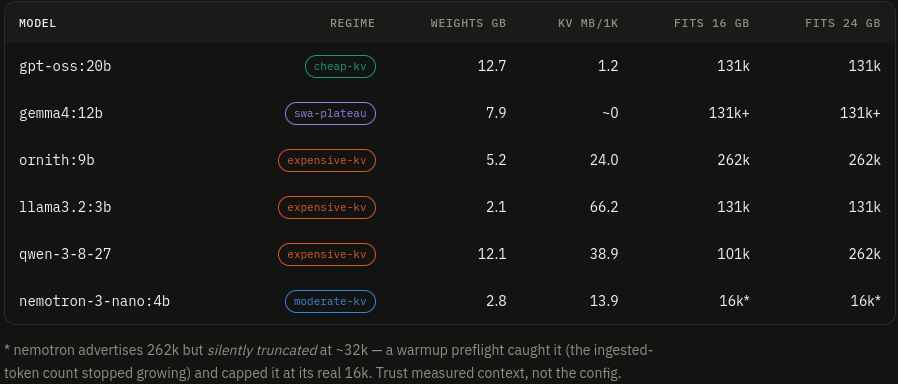
        
        

          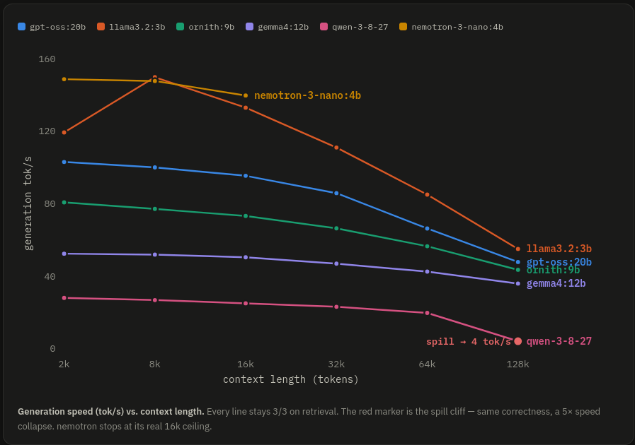
        
      
      

        
@witcheer 2026-09-10 ♥44 ↻0 [archive](../archive/t/2097921422005879100/) [original ↗](https://x.com/witcheer/status/2097921422005879100)
        
I measured the six llama-server flags everyone argues about, on a 16k prompt, on six models:

RTX 5090, Qwen3.8-27B, Gemma 4 31B, Qwen3.6-35B-A3B, Nemotron Lightning, Ornith 35B, Qwopus Flash.

→ --flash-attn on: changes nothing. auto already picks it.

→ --parallel 1: free. +10% decode at depth on Gemma, 2.3 GB back.

→ KV cache q8_0: a memory lever on dense models only (1 to 2.6 GB). on a 3B-active MoE it saves 0.1 GB and still costs 5 to 7%.

→ KV cache q4_0: the tax. -17%, -23%, -27%, -23%, -29%, -17% decode against a 16k context, six for six. quality did not move: a full 198-item GPQA run on Ornith put f16, q8 and q4 KV at 100, 100 and 98.

→ MTP draft head: 2.2x on Qwen3.8 (embedded head), 1.5x on Gemma (community head), 0.7x on Lightning. above ~300 tok/s the verification pass costs more than it saves.

the first token on a 16k prompt: 5 to 6 s cold, 0.1 to 0.4 s once cached.
        

          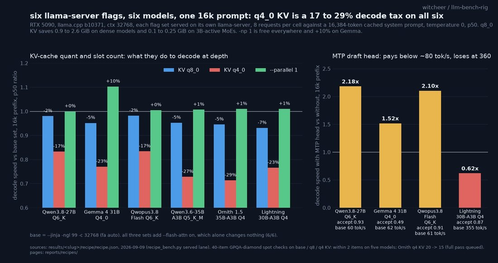
        
      
      

        
@witcheer 2026-09-11 ♥42 ↻2 [archive](../archive/t/2098323509915091014/) [original ↗](https://x.com/witcheer/status/2098323509915091014)
        
I gave two reasoning models 4k, 8k and 16k tokens to think on the same 198 GPQA-diamond questions. 

RTX 5090, llama.cpp, greedy, same server, only max_tokens moved.

> Qwen3.8-27B Q6_K: 60.1 → 70.2 → 79.3
> Ornith 1.5 35B-A3B Q4_K_M: 70.2 → 77.3 → 81.8

what the per-item diff says:
→ questions that finished inside the budget: 95 to 96% correct, at every budget, both models.
→ questions that hit the cap: 14 to 37% correct, and that is where all 101 lost points live.
→ a question that finishes thinks for ~1,200 tokens. but 38 to 43% of them run past 4k, 30 to 34% past 8k, 22% still past 16k.

the price: tokens per correct answer go 3,972 → 5,636 → 7,740 on Qwen, 3,248 → 4,732 → 6,996 on Ornith. each doubling costs +46 to 66% tokens and buys 4.5 to 10 points.

so "27B blows the budget on reasoning" is true and it is not the model. a 79% model with max_tokens at 8k is a 70% model on exactly the questions you wanted reasoning for.
        

          
        
      
      

        
@FoldingNapkins 2026-09-11 ♥0 ↻0 [archive](../archive/t/2098341815678050326/) [original ↗](https://x.com/FoldingNapkins/status/2098341815678050326)
        
@vineerpasam Vibe code with local models then if you're afraid of corporate espionage. 

Qwen3.8:27b and gpt-oss:20b are both good models you can fit in under 16GB of RAM.

Some benchmarks I ran recently, summarised: [https://t.co/r80CuXPbkT](https://t.co/r80CuXPbkT)
      
      

        
@geogristle 2026-09-11 ♥2 ↻0 [archive](../archive/t/2098515444525330572/) [original ↗](https://x.com/geogristle/status/2098515444525330572)
        
@PlisSergey Not around to check gemma rn but before I stuck in the extra 32gb ddr5 I was getting 115t/s or slightly higher on qwen3.8-27b exl3 3.5bpw @ 262144 tok ctx.
      
      

        
@witcheer 2026-09-12 ♥36 ↻1 [archive](../archive/t/2098648245731742089/) [original ↗](https://x.com/witcheer/status/2098648245731742089)
        
I turned every row on the RTX 5090 board into a fit table for 8, 12, 16, 24 and 32 GB cards: measured peak VRAM at a 16k prompt, plus 768 MiB of headroom, against the card size. 38 models and quants.

what a 16 GB card runs at 16k, by quality:

→ Qwen3.8-27B UD-IQ3_XXS: 92.7 board, 45.0 GPQA, 12.8 GB peak
→ Qwen3.8-27B UD-IQ2_M: 91.5, 11.3 GB
→ Qwen3.8-27B UD-IQ2_XXS: 90.8, 10.1 GB
→ Gemma 4 12B Q6_K: 87.6, 11.6 GB
→ gpt-oss-20b Q4_K_M: 87.4, 14.5 GB

the 27B at 3 bits beats every smaller model by 5 points. the cost shows on the harder set: GPQA-diamond 45.0 vs 49.0 for the 6-bit cut.

12 GB: the IQ2_XXS cut fits with a 16k context and still scores 90.8. 8 GB: nothing dense on this board fits resident.

Qwen3.8-27B Q4_K_M is a 15.9 GB file. it fits a 16 GB card. its 16k context does not (17.3 GB peak). shorten the context or use a q8 KV cache, not q4, which costs 17 to 29% of decode speed on every model I measured.
        

          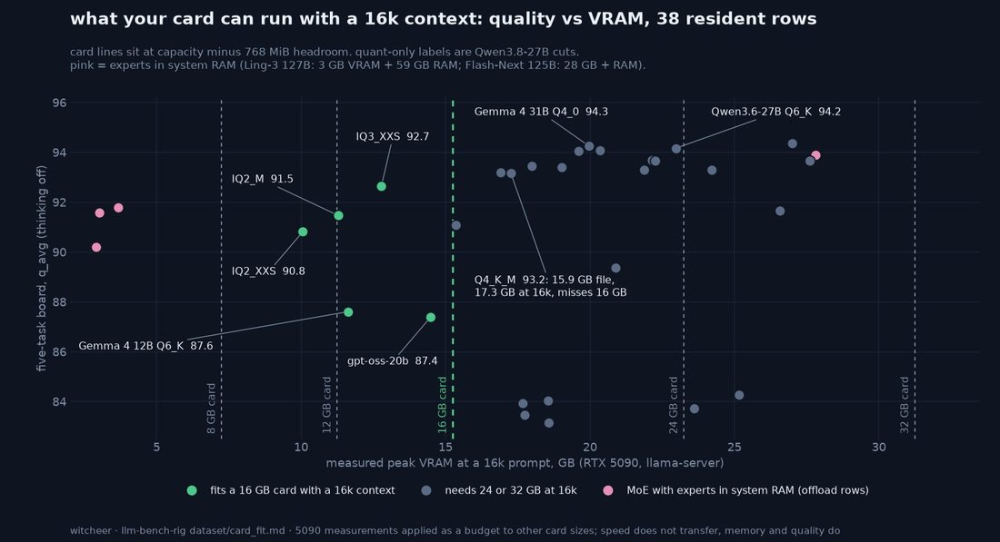
        
      
      

        
@witcheer 2026-09-13 ♥57 ↻0 [archive](../archive/t/2099095882444538285/) [original ↗](https://x.com/witcheer/status/2099095882444538285)
        
the loudest specific complaint in Alex Cheema's thread on why people don't run local models was prefill: a coding agent hands the model a long prompt and you wait for the first token, every request. 

two llama-server flags remove most of that wait, and both are free. I measured them on the model my always-on box serves every day.

Qwen3.8-27B Q6_K, llama.cpp, one RTX 5090, batch 1, 304 requests, one variable at a time.

prompt caching, same system prompt, new question:
- 2,954-token prompt: 1.004 s -> 0.069 s to first token
- 11,570-token prompt: 3.814 s -> 0.086 s
decode speed untouched.

speculative decoding (the model's own MTP draft head, n=2):
- prose 61 -> 109 tok/s
- chat 61 -> 113
- code 61 -> 139
- repetitive text 61 -> 144
cost: 9 ms on time to first token.

both on: a short answer to the 11.5k context goes 4.25 s -> 0.30 s.
        

          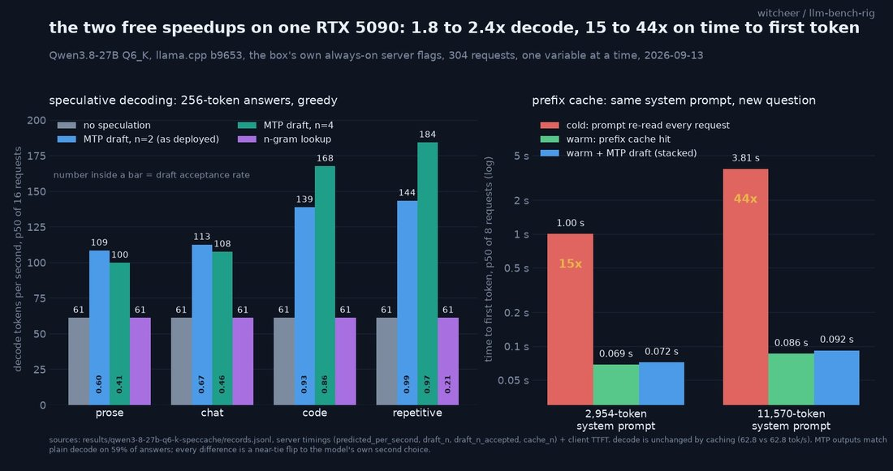
        
      
      

        
@witcheer 2026-09-20 ♥52 ↻4 [archive](../archive/t/2101717064926847409/) [original ↗](https://x.com/witcheer/status/2101717064926847409)
        
I finished a board I have been running for 10 days: 10 local models with thinking switched on, on one RTX 5090, on four harder tasks (following instructions precisely, competition maths, two code test suites). 

every model got the same rules: 16k tokens of thinking room per question, one attempt, 1,583 questions each.

what came out:

~ three models tie at the top, and one of them is a 12 GB file. Gemma 4 31B at 4-bit averages 90.1, Qwen3.8-27B at 6-bit 89.7, and the same Qwen3.8-27B squeezed to 3 bits 89.5. the 3-bit file is half the size of the 6-bit one and lands within 1.1 points of it on every task.

~ the maths column is where the surprise sits. Qwen3.6-27B, Qwen3.6-35B-A3B and Qwable-27B score 72 to 73 on MATH-500 while scoring 93.9 to 95.1 on the HumanEval+ code suite. they think for so long that 27 to 30% of their maths answers never arrived inside the 16k limit, and they spent about 12,000 tokens per correct answer where Qwen3.8 spent 1,800.

if you have a 16 GB card and want a model that reasons: Qwen3.8-27B at 3 bits (the UD-IQ3_XXS cut) is the one.
        

          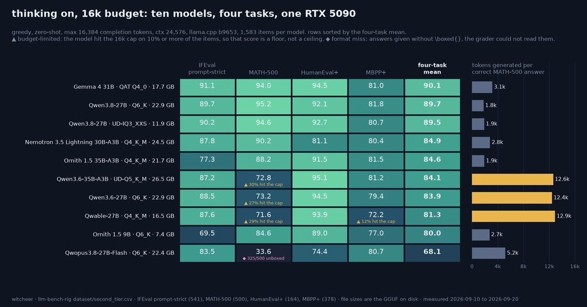
        
      
      

        
@multimodalart 2026-09-22 ♥3 ↻0 [archive](../archive/t/2102299248658182397/) [original ↗](https://x.com/multimodalart/status/2102299248658182397)
        
the immediate models after jev are inference techniques  that allow for one-pass inference of Qwen3.8-27B and diffusion gemma, no fine tuning

in 3rd place, Decider 35B-A3B, a strong fine-tune of Qwen3.5 35B base (!) [https://t.co/D12D6q68WW](https://t.co/D12D6q68WW)
        

          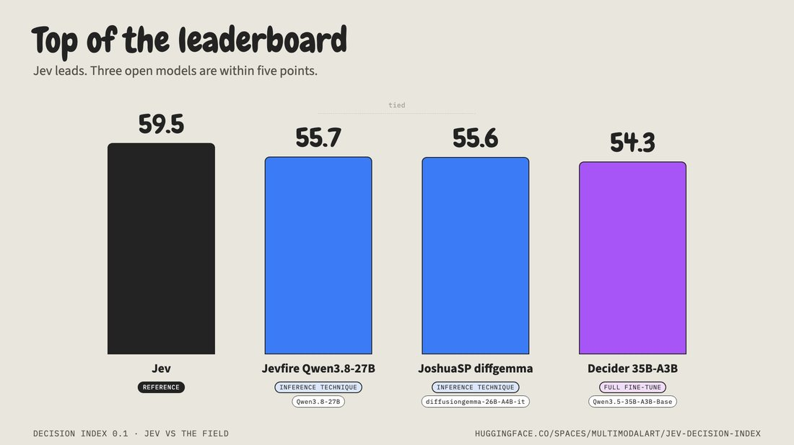
        
      
      

        
@witcheer 2026-09-24 ♥38 ↻1 [archive](../archive/t/2103024788897706203/) [original ↗](https://x.com/witcheer/status/2103024788897706203)
        
Hermes Agent is driving my Microduck!

I typed one sentence: "make the duck walk forward for five seconds then sit"

Hermes Agent took it from there. it checked the duck was sitting, stood it up, walked it 0.58 m and sat it back down. every command in the clip is one Hermes Agent picked and ran itself.

it runs on a local Qwen3.8-27B.
      
      

        
@Lithros 2026-09-25 ♥8 ↻0 [archive](../archive/t/2103476992574111944/) [original ↗](https://x.com/Lithros/status/2103476992574111944)
        
Lyrics through Qwen3.8-27B
Music through YuE2
Art through Qwen-Image 2.1 and Nano Banana Pro
Lipsync through LTX-2.5 22B
Animation through Wan 2.2 I2V A14B or drawn by Claude Opus 5.5

I used a prompt adapted from this @donaldjewkes: [https://t.co/Z8PmWhkjGA](https://t.co/Z8PmWhkjGA)
      
      

        
@witcheer 2026-10-07 ♥48 ↻2 [archive](../archive/t/2107795715250430286/) [original ↗](https://x.com/witcheer/status/2107795715250430286)
        
Gemma 4 31B solved 51 of the 63 problems in this year's AIME and HMMT on my RTX 5090, the most of nine local models.

the reason is answer length. I cap each answer at 32k tokens, thinking included. Gemma's median answer used about 8,300 to 9,000 tokens, and none of its 63 hit the cap. the other eight ran out of room on 6 to 22 problems per contest.

when those eight finish an answer, they are right 95 to 100% of the time. Gemma is right on 81%, but it finishes all of them.

for hard maths with a 32k thinking cap, Gemma 4 31B is the one I would run. with a bigger cap the order could move, and I have not measured that yet.

problems solved out of 63 (AIME 2026 out of 30 + HMMT Feb 2026 out of 33), MATH-500 in brackets:

- Gemma 4 31B Q4_0: 25 + 26 = 51 (94.0)
- Qwen3.8-27B UD-IQ3_XXS: 26 + 22 = 48 (94.6)
- Qwen3.8-27B Q6_K: 25 + 22 = 47 (95.2)
- Ornith 1.5 35B Q4_K_M: 23 + 20 = 43 (88.2)
- Qwen3.6-27B Q6_K: 22 + 15 = 37 (92.0)
- Qwen3.6-35B-A3B UD-Q5_K_M: 20 + 15 = 35 (91.2)
- Nemotron 3.5 Lightning 30B-A3B Q4_K_M: 19 + 15 = 34 (90.2)
- Ornith 1.5 9B Q6_K: 18 + 11 = 29 (84.6)
- Qwable 27B Q4_K_M: 16 + 13 = 29 (90.0)
        

          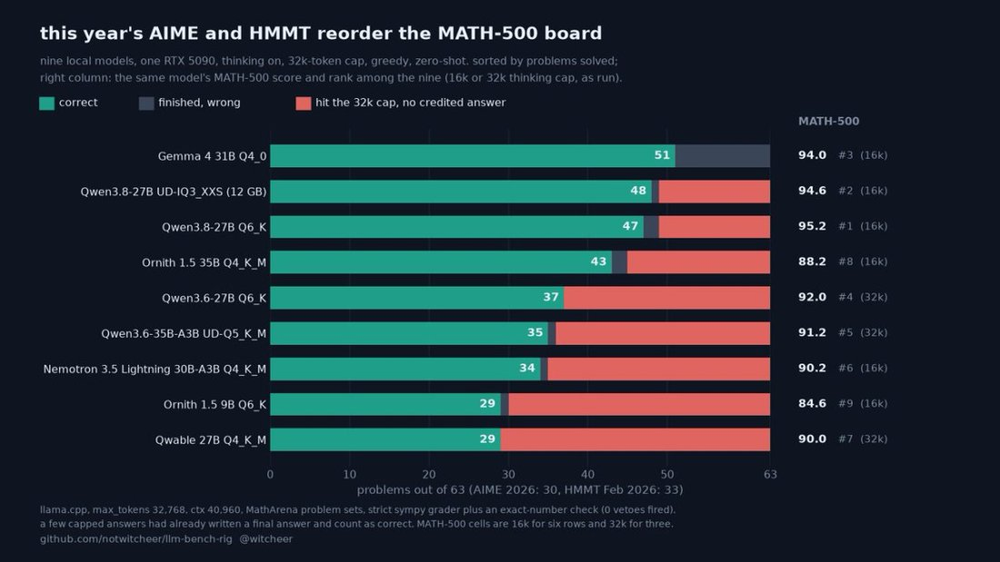
        
      
      

        
@mimi10v3 2026-10-13 ♥2 ↻0 [archive](../archive/t/2109842227203576200/) [original ↗](https://x.com/mimi10v3/status/2109842227203576200)
        
@albrorithm running a quantized qwen 3.8 27B on my 3090 w 24gb vram, and yeah having a local model on vllm does open up some possibilities... i have mostly just built out tools and enjoyed having it around but should try more experiments at some point
      
      

        
@witcheer 2026-10-20 ♥2 ↻0 [archive](../archive/t/2112527015903420731/) [original ↗](https://x.com/witcheer/status/2112527015903420731)
        
@mfranz_on would love to but I can only run Qwen 3.8 27B at max
      
    
    
[← back to the Pantheon](../)
