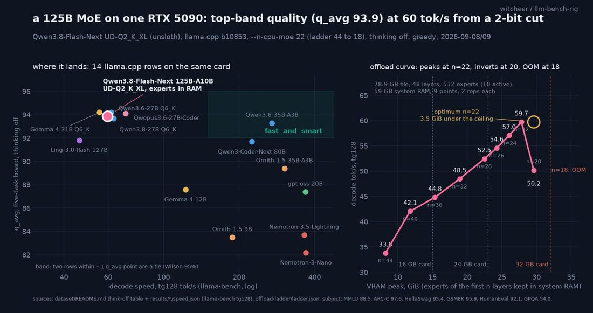

# Qwen3.8-Flash-Next

    
Alibaba (Qwen) · open weights 26 Aug 2026 (hosted as Qwen3.8-Flash) · current as of Oct 2026
    
Released with open weights on 26 August 2026 — the same day as [GLM-5.3-Flash](../glm-5-3-flash/) — as a 125B-parameter mixture-of-experts model with 6B active parameters, which Qwen presents as an early preview of the architecture planned for Qwen 4. Hosted by Alibaba as Qwen3.8-Flash.
    
Thin page: official record and launch-period reception; independent behavior evaluations and most community discussion (r/LocalLLaMA, Chinese forums) still to collect.

    
## Sources

    
### Official

    

      
- 2026-08-26 [Qwen/Qwen3.8-Flash-Next model card](https://huggingface.co/Qwen/Qwen3.8-Flash-Next) — architecture (Qwen Sparse Attention, gated residual, n-gram embedding), size, the Qwen 4 framing; license qwen-community-1.0.
      
- 2026-08-26 [QwenLM/Qwen3.8-Flash-Next](https://github.com/QwenLM/Qwen3.8-Flash-Next) (GitHub) — release notes and technical report.
    
    
### Writing & commentary

    

      
- 2026-08-26 Simon Willison, [Qwen3.8-Flash-Next](https://simonwillison.net/2026/Aug/26/qwen38-flash-next/) — first local runs (2-bit quantizations on a DGX Spark).
      
- 2026-10-17 r/LocalLLaMA (via the Arctic Shift archive), [“Alignment on SOTA Chinese Models like Qwen 3.8 Flash Next / GLM 5.3 Flash”](https://www.reddit.com/r/LocalLLaMA/comments/1x8meib/alignment_on_sota_chinese_models_like_qwen_38/) — a user’s question about trusting local Chinese models.
    
    
### Tweets

    
Chronological. Posts naming “Qwen 3.8 Flash” refer to the hosted version of this model.
    

      
- 2026-08-26 @multimodalart — “it’s great that with Qwen3.8-Flash-Next and GLM-5.3-Flash, we got not only 2 high quality models, but also 2 novel model architectures” [link](../archive/t/2092618581238317111/)
      
- 2026-08-28 @RealEverNever — “@QwenDevs Starting with the Unsloth GGUF. Local Qwen is on characters this week. I need to know if 6B active can hold a grudge through a scene before I care that it is a Qwen4 preview.” [link](../archive/t/2093222755885896070/)
      
- 2026-08-30 @xlr8harder (♥126) — “it’s kind of funny that all of the distillation means that the chinese models are adopting the worst of opus’s behavioral tics.
see this latest slowboard post from qwen 3.8 flash
I really hope we see chinese labs invest more in distinct model personas” (screenshot linked, not in corpus) [link](../archive/t/2093970305211314230/)
      
- 2026-09-09 @witcheer (♥108) — “a model 2.5x bigger than my GPU just posted the highest MMLU on my RTX 5090 board.” … “if you have a 5090 and 64 GB of RAM, this is the smartest thing you can run at home today.” (full text in records) [link](../archive/t/2097627771455365238/)
      
- 2026-09-17 @__venki__ — “Have a task that wants cheap text processing, and I’m trying all the cheap models. (Glm 5.3 flash, qwen 3.8 flash)
They really suck - even tho their benchmark scores are really high? I’m not sure they’re better than like Sonnet 3.7.” [link](../archive/t/2100432573901992175/)
      
- 2026-10-19 @normie_dot_exe — “Qwen 3.8 Flash makes reasonable plans, and communicates well, but struggles with game knowledge” [link](../archive/t/2112324129148002397/)
    

    
## Official record

    

      
- Released 26 August 2026 (Hugging Face repository created 24 August). GitHub README: “In this release we are opening the weights of Qwen3.8-Flash-Next, a multimodal MoE model that also serves as an early preview of the architecture used in Qwen4.” and “We are again releasing the architectural changes early, so that the community can examine them before the full Qwen4 model family is built on top of them.”
      
- Model card: “Number of Parameters: 125B with 6B activated, plus 51B n-gram embedding and 4B MTP”; Gated DeltaNet linear attention paired with a new Qwen Sparse Attention that “operates at the micro-block level”; gated residual streams; n-gram embeddings as a cheaper axis of parameter scaling; Muon and AdamW applied to different weight categories. License per card metadata: qwen-community-1.0.
      
- Hosted variant: “Qwen3.8-Flash is the official version based on Qwen3.8-Flash-Next with more production features, e.g., 1M context length by default, official built-in tools.”
    

    
## History

    

      
- 2026-08-26 Same-day release with GLM-5.3-Flash; both introduced new hybrid sparse/linear attention architectures, and local-hardware users read the pair as a turn toward sparser models (jmbollenbacher, 2026-08-26, dossier).
      
- 2026-08-26 → 09 Run locally from 2-bit quantizations (Willison on a DGX Spark; witcheer with experts offloaded to system RAM on a 32 GB card).
      
- 2026-09-22 Alibaba says at its Apsara Conference that Qwen 4 is in training (see [Qwen3.8-Max](../qwen-3-8-max/)).
    

    
## Impressions

    

      
- Persona provenance: “the chinese models are adopting the worst of opus’s behavioral tics”, with a call for “distinct model personas” (xlr8harder, 2026-08-30).
      
- Compliance: a local user on r/LocalLLaMA: “Qwen NF seems quite obedient so far, sometimes even a bit too much (I have to be careful to call out a hunch or rough idea as such or it will follow it too hard).” (2026-10-17, via Arctic Shift).
      
- Capability reception: “the smartest thing you can run at home today” for a 5090 with 64 GB of RAM (witcheer, 2026-09-09), against disappointment on cheap text-processing work (__venki__, 2026-09-17) and “struggles with game knowledge” (normie_dot_exe, 2026-10-19).
      
- tk — the “slowboard post” xlr8harder cites (image not in corpus); r/LocalLLaMA comparison thread with GLM-5.3-Flash (post 1x6533a); Chinese-language reception; character tests (RealEverNever’s “on characters this week”)
    

    
    
## Records

    
Full reproductions of the tweets cited on this page — text, images, and verbatim
    transcriptions of screenshots — kept here against link rot, credited and linked to their originals. Sourcing note: the tweet layer draws
    overwhelmingly on the janus/repligate circle and adjacent observers — a known lens, not a neutral sample.
    Sourced from the [community archive](https://github.com/TheExGenesis/community-archive) and the
    janus corpus. Yours and you’d rather it weren’t here? [Open an issue.](https://github.com/llm-pantheon/llm-pantheon.github.io/issues)

      

        
@multimodalart 2026-08-26 ♥2 ↻1 [archive](../archive/t/2092618581238317111/) [original ↗](https://x.com/multimodalart/status/2092618581238317111)
        
it's great that with Qwen3.8-Flash-Next and GLM-5.3-Flash, we got not only 2 high quality models, but also 2 novel model architectures
      
      

        
@RealEverNever 2026-08-28 ♥0 ↻0 [archive](../archive/t/2093222755885896070/) [original ↗](https://x.com/RealEverNever/status/2093222755885896070)
        
@QwenDevs Starting with the Unsloth GGUF. Local Qwen is on characters this week. I need to know if 6B active can hold a grudge through a scene before I care that it is a Qwen4 preview.
      
      

        
@xlr8harder 2026-08-30 ♥126 ↻5 [archive](../archive/t/2093970305211314230/) [original ↗](https://x.com/xlr8harder/status/2093970305211314230)
        
it's kind of funny that all of the distillation means that the chinese models are adopting the worst of opus's behavioral tics.

see this latest slowboard post from qwen 3.8 flash

I really hope we see chinese labs invest more in distinct model personas
[https://t.co/fx3BwlxWXQ](https://t.co/fx3BwlxWXQ)
      
      

        
@witcheer 2026-09-09 ♥108 ↻7 [archive](../archive/t/2097627771455365238/) [original ↗](https://x.com/witcheer/status/2097627771455365238)
        
a model 2.5x bigger than my GPU just posted the highest MMLU on my RTX 5090 board.

Qwen3.8-Flash-Next. 125B parameters, 79 GB file, 32 GB card.

it is a MoE, so the experts sit in ordinary system RAM and the GPU does the rest. llama.cpp does this with one flag.

what came out:
→ MMLU 88.5, above every dense 27B and 31B I have run at Q6
→ ties the top of the board on the five-task average (93.9)
→ GPQA-diamond 54, above every dense 27B
→ 60 tok/s, still 51 at 32k context

from a 2-bit quant. the dense models it ties are 6-bit.

the trade is prefill: 900 tok/s, a third of a model that fits. a 16k prompt costs 18 s the first time, then the cache takes it.

if you have a 5090 and 64 GB of RAM, this is the smartest thing you can run at home today.

which model do you want on the offload bench next?
        

          
        
      
      

        
@__venki__ 2026-09-17 ♥81 ↻1 [archive](../archive/t/2100432573901992175/) [original ↗](https://x.com/__venki__/status/2100432573901992175)
        
Have a task that wants cheap text processing, and I’m trying all the cheap models. (Glm 5.3 flash, qwen 3.8 flash)

They really suck - even tho their benchmark scores are really high? I’m not sure they’re better than like Sonnet 3.7.
      
      

        
@normie_dot_exe 2026-10-19 ♥1 ↻0 [archive](../archive/t/2112324129148002397/) [original ↗](https://x.com/normie_dot_exe/status/2112324129148002397)
        
Qwen 3.8 Flash makes reasonable plans, and communicates well, but struggles with game knowledge [https://t.co/i9Cgvfo8fQ](https://t.co/i9Cgvfo8fQ)
      
      
### Further records

      
Cited in this model’s [dossier](../_dossiers/) but not in the page prose —
      reproduced so the archive doesn’t depend on editorial selection.
      

        
@jmbollenbacher 2026-08-26 ♥3 ↻0 [archive](../archive/t/2092634480355721621/) [original ↗](https://x.com/jmbollenbacher/status/2092634480355721621)
        
glm-5.3-flash and qwen3.8-flash-next in the same day.

what an embarrassment of riches.
      
      

        
@jmbollenbacher 2026-08-26 ♥4 ↻1 [archive](../archive/t/2092640157849551101/) [original ↗](https://x.com/jmbollenbacher/status/2092640157849551101)
        
After seeing the architectures glm-5.3-flash and qwen-38-flash-next, i think maybe this take was wrong.

We're going to push model sparsity even further. Larger models will require less compute and bandwidth in future gen models.

512GB could be worth having somday soon.
      
      

        
@geogristle 2026-09-03 ♥5 ↻0 [archive](../archive/t/2095533966363127859/) [original ↗](https://x.com/geogristle/status/2095533966363127859)
        
@k7agar qwen flash next on 2x 3090 @ 250W, trying to grab a third gpu today
      
      

        
@__venki__ 2026-09-18 ♥8 ↻1 [archive](../archive/t/2101065234941395023/) [original ↗](https://x.com/__venki__/status/2101065234941395023)
        
Conclusion from my experiments:

Tested: Deepseek V4.1 flash, Qwen 3.8 flash, glm 5.3 flash, muse spark, gpt Luna

Roughly similar in price (avg $0.2-$0.8/task)

Muse was the cheapest and also the best by far (!!) - but this is with the 10x-20x data sharing subsidy.

Luna did quite quite poorly, very surprising, worst here many parsing errors, on priors would’ve guessed best if anything.

Deepseek v4 was second best imo. And maybe “true best”, given no subsidy.

Tried a few quantizations and generally switched to “official” ish providers for oss models to test w/o needing to account for quantization issues or other model server inconsistency.
      
    
    
[← back to the Pantheon](../)
